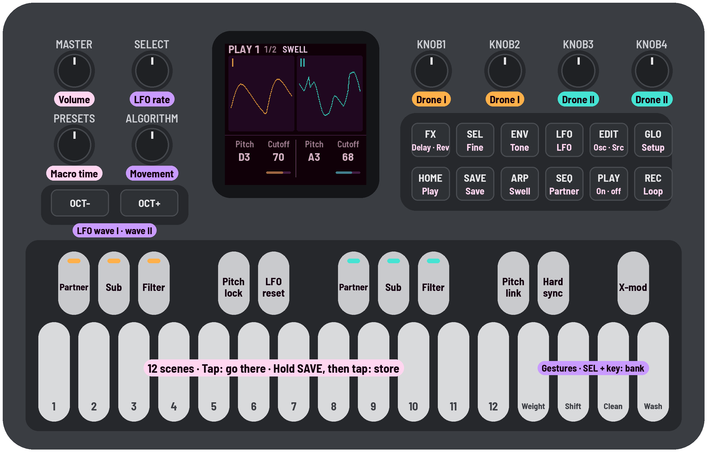
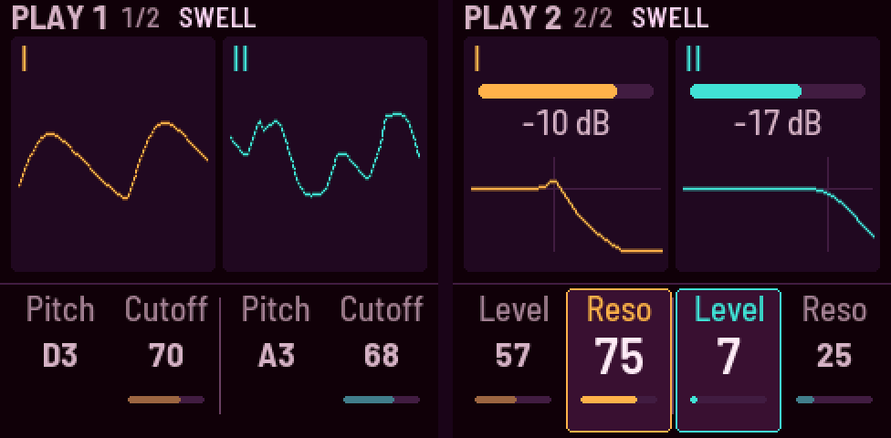
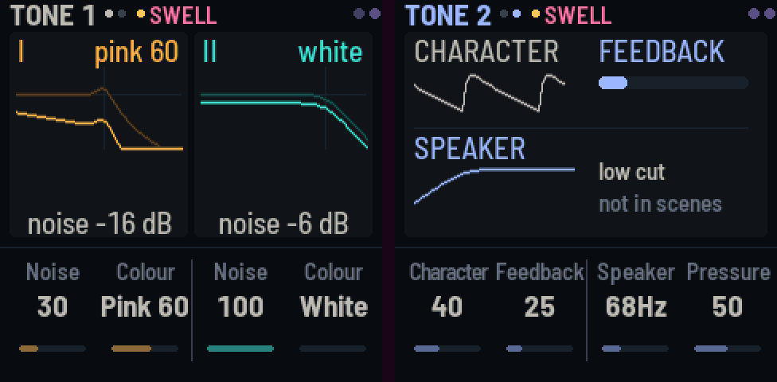
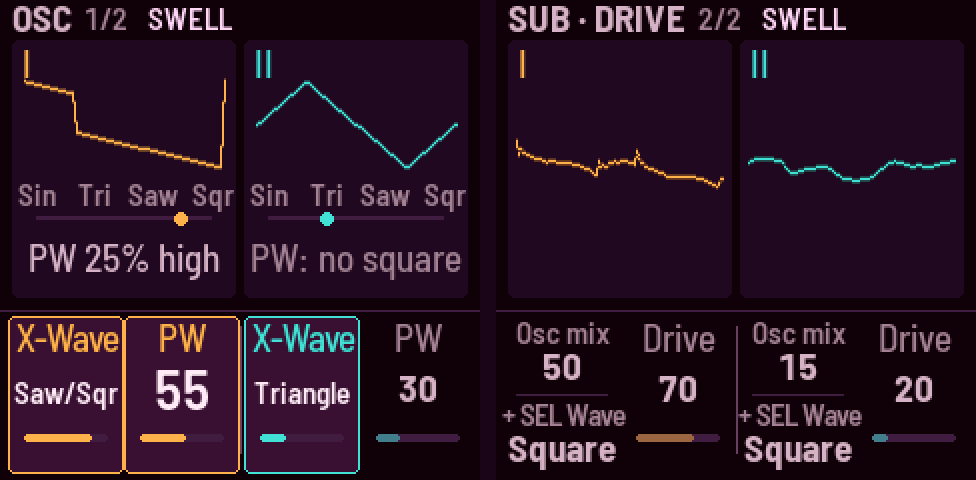
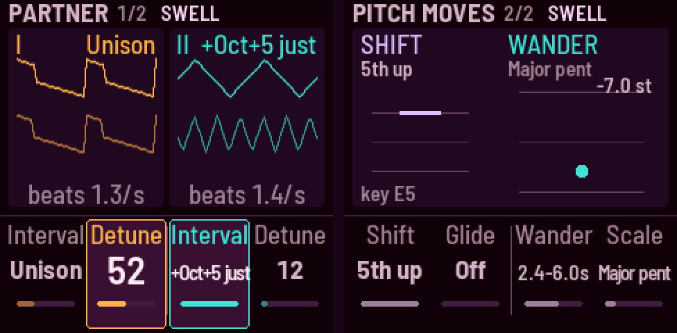
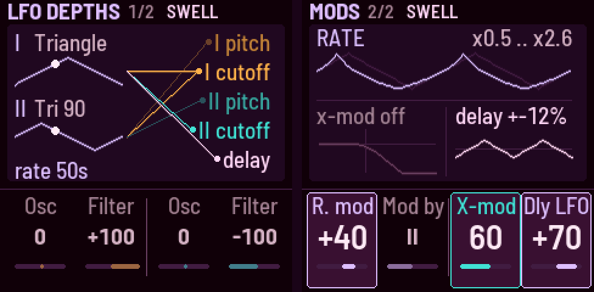
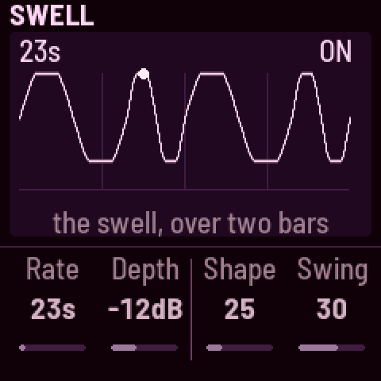
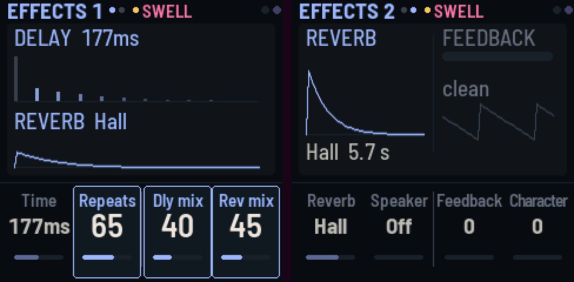
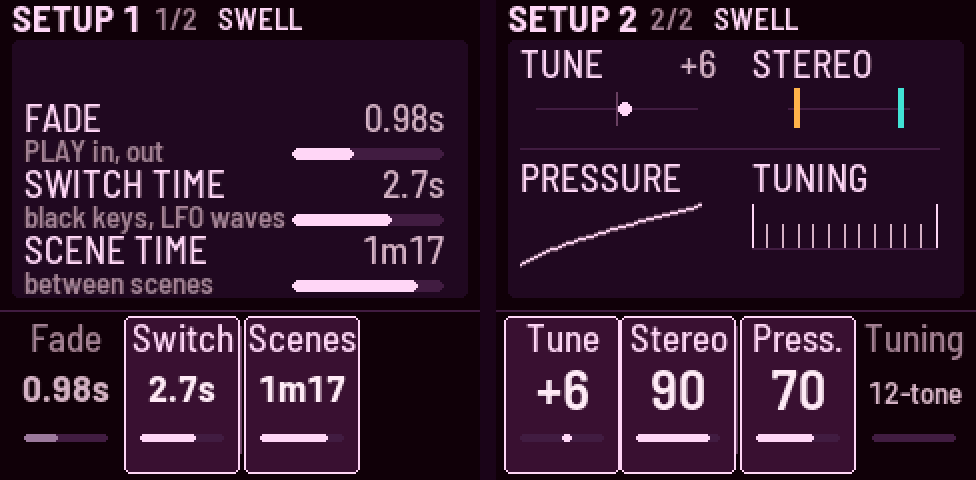
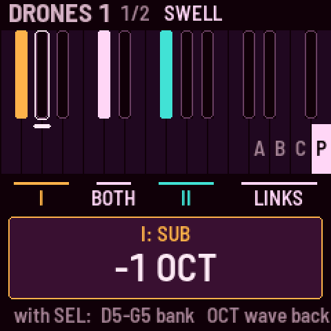

# Niagara Drift

**A drone synth for the M-VAVE FM-1.**

> **This is the manual for 0.3, in development** (what's on `main` now). For the released 0.2, see
> [the README of 0.2](https://github.com/evanyerburgh/niagara-drift/blob/v0.2/README.md); for 0.1 beta,
> [the README of 0.1](https://github.com/evanyerburgh/niagara-drift/blob/v0.1-beta/README.md).

Niagara Drift is open-source firmware that turns the M-VAVE
FM-1 into a drone synthesizer: two always-on drones you tune, shape and move rather than play note by
note. It's inspired by the Stylophone CPM DS-2, the Moog Subharmonicon and the Soma Lyra-8.



*Your FM-1 with Niagara Drift installed: what each knob, button and key now does. Amber is drone I,
teal drone II, lilac the LFO. The black keys are switches (lit = on; on the LFO pages they set the
LFO's routing, and X-mod lets drone I move drone II's filter, or the drones and their sound bend each other's pitch); white keys 1–8 hold scenes, in
banks you pick with SEL and the top four; keys 9–12 and the top four are gestures. The page buttons' pages, each tap the next: HOME
Drones 1, 2 · ENV Life, Tone · EDIT Osc, Sub · Drive · SEQ Partner, Pitch moves · LFO LFO depths, Mods · ARP Swell ·
FX Delay, Reverb · GLO Setup 1, 2.*

**Status: 0.2.** It runs on the FM-1 (tested on one unit so far) and in the browser:
[try it](https://evanyerburgh.github.io/niagara-drift/) without an FM-1, the same code with sound.

## What it does

- **Presets** to start from, each a different side of the instrument: Niagara, Abyss, Eerie, Glass, Heaven,
  Tanpura, Tape and Whistle on keys 1–8 of the Presets bank, and Howl, Cathedral, Metal and Clean in bank C.
- **Eight gestures**, each several settings moving together on top of your sound: **Weight**, **Shift**, **Clean** and
  **Wash** on the top keys, in while you hold and out as slowly as you held; **Tick**, **Chord**, **Snarl** and
  **Stutter** on keys 9–12, as deep as you press. Tap any of them in to stay.
- **Scenes**: 8 on the white keys in each of three banks (24 of yours), plus the Presets, recalled gliding over the
  Scene time, or **crossfaded into by pressing the key harder**; a **motion loop** that records your knob moves, gestures and scenes.
- **It moves on its own**: the LFO, the Swell, **Drift**, **Wander** (drone II's slow random melody on a scale) and
  **Age** (tape wear) keep it breathing without a hand on it.
- **Two drones**, each a main oscillator that blends sine → triangle → saw → square (X-WAVE), a
  partner oscillator at an interval (tempered or just) with detune, a sub one to four octaves down
  (the lowest two click under a low drone) or a subharmonic (⅓, ⅕ of the pitch), and a white or pink noise, into its own self-oscillating
  filter (low-, band- or high-pass) with drive. Pitch is free between notes, from 2 Hz to 1.6 kHz.
- **Links** between them: pitch link, hard sync, and cross-mod: drone I's sound moving drone II's cutoff, or each
  drone's sound bending the other's pitch (cross-FM, as on the Lyra-8).
- **The Ultra LFO**, after the DS-2's: one rate, two waves of ten shapes each (one of them truly
  random, two the Lyra-8's stepped AND and OR), routed to each drone's pitch or X-WAVE and cutoff or resonance, alone or summed. It can
  move its own rate and lock to the Swell.
- **Movement** (ALGORITHM): all the LFO's depths down or up together, from still to double.
- **The Swell**: both drones breathing in time, from a slow soft swell to a hard rhythmic gate, with swing.
- **Effects**: a stereo delay of six types (Clean, Wide, Ping-pong, Tape, and the Lyra-8-like Grain and Self, whose
  own echoes move their time; the LFO can warble it too), a drive
  after it (the drones and their echoes distorted together, as on the Lyra-8), into a reverb of four (Room, Hall,
  Cathedral, Chorus hall) whose length goes to Inf, a freeze.
- **Feedback** (the finished sound fed back into the drones) and **Character** (clean to vintage).
- **Drift**: the drones are never quite still; pitch, cutoff, timbre, level and detune slowly wander.
- **Switch time**: buttons and keys never jump: the sound moves to a new setting over a time you set.

## Installing

1. Open the [web installer](https://evanyerburgh.github.io/niagara-drift/install/) in **Chrome or Edge**
   (they can talk to the FM-1 over USB; Safari and Firefox can't).
2. Connect the FM-1 straight to the computer with a USB **data** cable (no hub) and switch it on.
3. Press **Install** and allow MIDI when the browser asks. It takes about two minutes; don't touch the cable
   or the FM-1 until it says Done. Then press PLAY.

Or from a terminal, with the file from the [releases](https://github.com/evanyerburgh/niagara-drift/releases):
`pip3 install mido python-rtmidi`, then `python3 tools/fm1_install.py niagara-drift-0.2.fwsc`.

**What it replaces:** Niagara Drift takes the place of M-VAVE's firmware, so the FM-1's own sounds and
sequencer are gone until you go back (below).

**Updating:** when there's a new version, run the installer again the same way. Your sound and scenes are
kept, unless that version's notes in the [changelog](CHANGELOG.md) say otherwise.

**Backing up:** both installers save your sound, scenes and settings to a file before they install over
Niagara Drift: the web installer into your downloads (and it offers to put them back afterwards), the terminal
one into `~/niagara-drift-backups/`. The web installer's "Your sounds and scenes" card saves or restores one at any
time, as `python3 tools/fm1_install.py --backup` and `--restore FILE` do (the FM-1 restarts); each reads the
other's files. Back up before trying another firmware, and restore when you come back. A backup leaves out the
knobs' calibration, which belongs to each FM-1, so it can go onto another one; a damaged file is refused before
anything is written.

**Going back:** the installer's "Back to M-VAVE's firmware" writes M-VAVE's own FM-1 V15 back over the
same cable (or use M-VAVE's updater, M-UPGRADE, from [m-vave.com/download](https://www.m-vave.com/download)).
If it ever fails to start twice in a row it comes up in **safe mode** (no sound, USB on), where the installer
still works. If an FM-1 won't start at all, a Mac can still put the stock firmware back: see
[BUILDING.md](BUILDING.md#install). Installing firmware is at your own risk.

## Playing it

### Start here

1. **PLAY**: the drones fade in.
2. **Tap the white keys 1–8**: a new FM-1 starts on the Presets, a sound on each key ([The Presets](#the-presets)).
3. **Hold a gesture key** and let go: a top key (Weight, Shift, Clean, Wash), or keys 9–12 (Tick, Chord, Snarl,
   Stutter), pressed harder for more ([The gestures](#the-gestures)).
4. **Tune each drone**: black key 4 turns Pitch lock off, then KNOB 1 and KNOB 3 on the Drones page.
5. **Change the sound**: the page buttons (ENV, EDIT, LFO, …) and KNOB 1–4 ([Pages](#pages)).
6. **Save your sound**: SEL + D5 picks bank A, then hold SAVE and tap a white key.
7. **PLAY** again: the drones fade out.

The keys aren't notes: the drones play on their own. White keys 1–8 hold presets and scenes, keys 9–12 and the top
four are gestures, the black keys are switches. The first time you do some things (blend into a scene, flip a black key, play
a gesture, open the effects…) the screen shows a one-line tip about what's next to it, once.

### The Presets

Twelve sounds to start from, each showing a part of what Niagara Drift does: P1–P8 on keys 1–8 of the Presets bank
(SEL + G5), P9–P12 in bank C (keys 1–4 on a new FM-1; on one updated from 0.2, in the first empty keys of C, B or A),
where they're yours to change and store over. Most
have drone I on D, so moving between them keeps the root and changes the interval and the sound. With **Pitch lock**
on (as a new FM-1 starts) they keep the pitch you're on, so you hear the textures first; turn it off (black key 4)
and each plays at its own pitches, as described below. They're levelled to sound alike in loudness with the lock on,
and within about 3 dB at their own pitches. The screen names the one you pick ("SCENE P3 EERIE"). They're fixed: to keep a sound you
made from one, pick bank A, B or C (SEL + D5, E5 or F5) and store it there (SAVE + a key).

| Key | Preset | What it shows |
|---|---|---|
| P1 | **Niagara** | the starting sound: D and A a fifth apart, breathing slowly, like a calm Lyra-8 |
| P2 | **Abyss** | dark: D over B a minor third below, a saw and a narrow square, a subharmonic sub, closed resonant filters, character and feedback, a dark hall; the resonance swells and rings |
| P3 | **Eerie** | D and G♯, a tritone: near-sines, drone II through a ringing band-pass with a breath of white noise, wandering a whole-tone scale, its pitch wavering; long clean echoes, a chorus hall |
| P4 | **Glass** | high sines a fifth apart (D5, A5), drone I's partner an octave up, beating a little, a long bright reverb |
| P5 | **Heaven** | D and F♯ a tenth apart, sines with just thirds and fifths blooming toward triangles, a long light cathedral |
| P6 | **Tanpura** | Sa and Pa: D with its high octave over the A below, bright buzzing strings, plucked about once a second |
| P7 | **Tape** | worn: D and F, a wide square and a saw, Age and lots of Character, tape wow, a tape delay, hiss |
| P8 | **Whistle** | the filters at the edge of resonance sing as sines of their own (D5, A5) over soft low drones; long clean echoes |
| P9 | **Howl** | low, D and E♭ a semitone apart so they grind, the feedback high, drone II band-passed; flares at random |
| P10 | **Cathedral** | D and B a sixth apart, soft waves, a sub below, a long dark reverb, almost a freeze; nearly still |
| P11 | **Metal** | cross-mod and hard sync, squares an inharmonic gap apart, drone I high-passed, shimmering; a clean slapback |
| P12 | **Clean** (locked) | one oscillator, everything else off: a plain saw to build from. Drone II is out: SEL + PLAY brings it in |

### White keys: scenes

| | |
|---|---|
| **White key** 1–8 (F3–F4): **tap** | morph to the scene stored there in the current bank, over the Scene time, and stay (turn a knob to stop part way). A tap is anything you let go under half a second, however hard, as with the gesture keys. A scene keeps the sound, not the room: Pressure, Stereo, Tune, Pitch lock, Fade, Switch time and Scene time stay as they are |
| **Hold and press** a scene key | a **crossfade**: the harder you press, the further the sound moves from where it was into that scene (a light rest does nothing). It glides there no faster than the Scene time, so pressing hard at once glides in as a tap does, and pressing slowly follows your finger. The key gets brighter as you go in; the screen says how far ("A5 40%"). **Let go** and it glides back to where you were ("A5 BACK"). **Tap SEL** while holding and the blend stays right there ("A5 40% KEPT"), however you press after; let go when you like. It's a sound of its own between the two (SEL + SAVE takes you back to where you were before it) |
| **Press all the way** (and hold a moment) | the scene is **taken**: the key flashes, and letting go keeps it |
| **SEL + SAVE** | **undo**: back to the sound before your last scene tap or blend, gliding over the Scene time (a knob turned since goes back too; the room's settings, such as Stereo or the Scene time, stay). Again, and it goes forward to where you were. Keep SEL down until you've let go of SAVE |
| **SAVE, then a white key** | hold SAVE first, then tap the key: the sound is stored there (a key pressed first goes to its scene instead; lit keys hold a scene; the key of the scene you're on blinks slowly, until you turn a knob or flip a switch; while playing, the sound dips for a moment as it's written). Not into the Presets: they're fixed (store your own in A, B or C) |
| **SEL + a top white key** | picks the bank the 8 scene keys play: D5 bank **A**, E5 **B**, F5 **C** (yours), G5 the **Presets** (below; a new FM-1 starts there). The screen names scenes by bank: "B5" |
| **Top white key** (D5–G5) alone | a **gesture**: Weight, Shift, Clean, Wash (see [The gestures](#the-gestures)) |
| **Keys 9–12** (G4–C5) | **gestures** too, by pressure: Tick, Chord, Snarl, Stutter (see [The gestures](#the-gestures)) |

Updating from 0.2: keys 9–12 used to hold scenes. On the first start of 0.3, each scene you had there moves to the
first empty key 1–8 of its own bank, then of another; one with no room left stays stored, unplayed (the installer
backs everything up first). The screen says how many moved.

### The gestures

Eight keys are gestures, each a few settings together, by set amounts, on top of your sound: the top four, which go
by how long you hold, and keys 9–12, which go by how hard you press. Each on keys 9–12 is the partner of the top key
four to its right: Tick the low end (as Weight), Chord pitch (as Shift), Snarl dirt (which Clean takes out), Stutter
time (as Wash).
Your own settings stay as they are underneath: when a gesture has gone, it's gone without a trace. A gesture's
parts come in one after another, and go in their own order when you let go. Scenes remember which are latched.

| Gesture | What it moves | Key to start |
|---|---|---|
| **Weight** | a full, warm bass: the drones and a little of the sub come up through the swell, the resonance and noise give way, the cutoffs ease down a little, then drive and the vintage character round it off. It sounds heavier on the speaker too. Let go: the brightness comes back first, the sub lingers | D5 |
| **Shift** | a new chord, a voice at a time: drone I glides to the move you set (anywhere from a fifth down to a fifth up, in cents), drone II follows. Let go: drone I comes back first | E5 |
| **Clean** | back to a clean sound, your notes kept: the grit leaves first (drive, character, feedback, noise, cross-mod, hard sync), then the movement (Movement, Drift, the Swell), then the effects (the repeats, both mixes, the reverb's length). Let go: the effects come back first, the grit last. It holds the loudness: with the dips of the Swell gone the sound would jump up, so the level eases down to where it was | F5 |
| **Tick** | the sub sinks from its hum through 20 Hz until it breaks into slow beats, a click or two a second; pressing harder speeds the beats up, louder, into a flutter with a little drive. Ease off and they slow; let go and they climb back up into the hum | G4 |
| **Chord** | the beating goes, then the partners move one at a time to a chord from Wander's scale, tuned just and beatless (on the Tuning's notes, when it isn't 12-tone or Quarter), spread open: a different voicing each time you press (minor pentatonic: Dm7; major: D6; Dorian: Dm6; just: La Monte Young's harmonic seventh…) | A4 |
| **Snarl** | drone II detunes a little, then Snarl comes in and grows, the drive bites, and Feedback sings at the top. Let go: Feedback and the drive leave first, the snarl after, the detune last | B4 |
| **Stutter** | the Swell switches on and chops the drone: quick from the first touch, then deeper, then harder, into a gate. Let go: it softens, slows, and lets go | C5 |
| **Wash** | the delay first, then the reverb opens and grows longer and darker (toward Inf), each only up to where Wash aims (if your own effects are already further up, it leaves them be; the repeats stop short of the delay's howl), the dry sound dips last and, at the top, breathes slowly in and out of the cloud. Let go: the dry comes back first, the tails ring on and go last | G5 |

- **The top four** are always the same: D5 Weight, E5 Shift, F5 Clean, G5 Wash (they don't sense pressure).
  **Hold** one and it comes in while you hold; **let go** and it goes, over as long as you held it (hold 2 s, it leaves
  in 2 s; hold 10 s, it drifts out over 10 s).
- **Keys 9–12** sense pressure: press and the gesture moves toward how hard you press, over its time (press half way,
  it goes half way in); ease off and it comes back; let go and it goes.
- On any gesture key, a **tap** (a press under half a second) takes it all the way and keeps it; tap again and it
  goes. **Tap SEL while holding one** and it stays where it has got to. Its key glows dimly, and lights as it comes in.
- **PRESETS is Gesture time**: how long every gesture takes, coming in and going out. The screen shows Weight's time
  ("GESTURE TIME 2.8 s"); the others scale with it. The middle is each gesture's own time: Weight 2.8 s, Shift 3.9 s,
  Clean and Wash 3.3 s, Tick, Chord, Snarl and Stutter 6.5 s. Left is slower, each detent a little more time, up to
  12 times as long (Weight 34 s); right is faster, up to 4 times (Weight 0.7 s). For a long one, tap the key: it
  latches and comes in on its own, and a tap lets it go over the same time. Turn it while a gesture moves to change
  it on the way.
- **The LFOs step aside**: while a gesture is in, the LFO that moves the same thing eases off (the filter LFO for
  Weight's cutoff, the oscillator LFO for Shift's pitch), so
  a high **Movement** doesn't wobble what the gesture is doing. **Wash** also eases the filter LFOs to a third, so
  their sweeps don't pile up in the reverb as surges. They come back as the gesture goes.
- Turning a knob while a scene switch is on its way lets go of that setting; the rest still lands.

### The controls

**On the drone pages, KNOB 1–2 are drone I and KNOB 3–4 drone II** (Play, Tone, Osc, Sub · Drive, Partner, LFO
depths: their names underlined amber and teal). The other pages hold settings for the whole sound, a knob each.
The page buttons change what they do; the screen shows each page's settings as a picture, and the value of the
knob you're turning.

| | |
|---|---|
| **PLAY** | fade the drones in or out; **SEL + PLAY** fades drone II alone out or back in |
| **OCT− / OCT+** | the LFO's **Wave I** / **Wave II**: tap for the next shape, round and round; **SEL + OCT** for the one before. Each light pulses with its wave |
| **SAVE** | save the sound, at once. While the drone plays, the sound dips out and back over about 50 ms around the write; SAVE glows dimly while something isn't written yet |
| **SEL** (hold) | fine: a pitch knob moves in single cents, cutoff and resonance in tenths |
| **ARP** (tap) | the Swell page, as the other page buttons open theirs (landing on it switches nothing). On the page, a tap switches the Swell on or off: both drones chopped in time, and the ARP light breathes with it. Hold ARP to peek at the page from anywhere, to set the Swell before you start it |
| **REC** | tap to record your knob moves, gestures and scenes (tapped or blended by pressure), tap to loop them (your own keys still play on top), tap to stop (up to 5 minutes, the time shown by REC in the top bar; all four knobs turning fast for minutes fills it sooner, and it starts looping there, "FULL"; each pass glides back to the start) |

### Pages

Tap a page button and the knobs stay on that page. Hold it to peek: turn a knob, let go, and you're
back. Tap it again for its next page (FX has three); "1/2" by the page's name shows which of its pages you're on. A page
button opens the page you last used there (HOME always opens Drones 1), so after visiting Reverb, holding FX
peeks at Reverb.
Each page's screen shows a picture of what its knobs do, and the four values below it. Every knob
glides: a slow turn is a smooth sweep, never steps; turn faster to go further. The levels follow your ear: halfway is about a quarter as loud.

#### Drones · HOME



| Page | KNOB 1 | KNOB 2 | KNOB 3 | KNOB 4 |
|---|---|---|---|---|
| Drones 1 | I pitch | I cutoff | II pitch | II cutoff |
| Drones 2 | I level | I resonance | II level | II resonance |

- **Pitch** goes from 1.6 kHz down to 2 Hz. Under 27 Hz (where the screen shows Hz, not a note) a drone stops being a
  tone and becomes a pulse of clicks, a click a cycle: rhythm, and through a drive they ping against the other drone.
  The speaker can't play the low part: listen on headphones.
- **Turning a pitch knob** moves it a note of the **Tuning** a click (Setup 2, KNOB 4; semitones to start), however
  far apart the Tuning's notes are, and the screen shows the note it's going to. It glides from note to note, so a
  steady turn is one slide. **SEL** held, the knob moves a cent at a time: that's how to tune a drone a little sharp
  or flat, and the knob keeps it there, so +3 cents over one note moves to +3 over the next. With Pitch link on,
  drone II's knob turns the gap between the drones, a step of the Tuning's intervals a click.
- **MASTER**: past about four-fifths of its turn it drives into overdrive, at about the same loudness: thicker,
  but the breathing flattens (the swells and dips get much smaller).

#### Life and Tone · ENV



| Page | KNOB 1 | KNOB 2 | KNOB 3 | KNOB 4 |
|---|---|---|---|---|
| Life | character | feedback | age | drift |
| Tone | I noise | I colour | II noise | II colour |

- **Character** takes the oscillators from clean to vintage: softer edges, a bent saw, a little pitch
  jitter, the two drones slightly apart, a whisper of noise.
- **Feedback** sends the finished sound (after the delay and reverb) back into the drones: a resonant,
  thickening colour that grows with the knob, as strong on a quiet, dry sound as on a loud one. Over the top of
  its turn (past about 70) it starts to sing on its own and takes the sound over, held close to the same loudness.
  It rings in key, on drone I's harmonics, and fades with the drones when you stop. The meter shows its share.
- **Age** wears the sound like an old tape: darker, a little hiss, a slow wow and a little flutter in the pitch.
  It wears in slowly (about 20 s from none to full) and wears out as slowly when you turn it back. Character is
  the oscillators' own wear; Age is the tape's.
- **Drift** keeps the drones from ever being quite still: besides a little pitch wander, each drone's
  cutoff, timbre (X-Wave), level and partner detune slowly wander on their own, around where you've set
  them, never repeating. Gentle by default; 0 holds everything exactly where you put it.
- **Noise** is the noise's level beside the oscillators, as in a synth's mixer: they stay as they are.
  It's heard all along the knob, and at the top it's about as loud as them (100 is level with a saw, 50 about −7 dB, 25 −12; a sine is quieter). It
  goes through the drone's filter with them, so the cutoff, resonance, LFO and Drift shape it.
- **Colour** blends from white (left) to pink (right).

#### Osc · EDIT



| Page | KNOB 1 | KNOB 2 | KNOB 3 | KNOB 4 |
|---|---|---|---|---|
| Osc | I X-Wave | I PW (pulse width) | II X-Wave | II PW |
| Sub · Drive | I osc mix (+ SEL: sub wave) | I drive | II osc mix (+ SEL: sub wave) | II drive |

- **X-Wave** blends sine → triangle → saw → square; **PW** is the square's pulse width. The sine and the triangle are a
  little louder than the saw, so they still carry on a small speaker, and the square a little quieter, level with the
  saw there.
- **Osc mix** goes from the oscillators to the sub; **drive** pushes each drone into its filter.
- **The sub's wave**: hold SEL and turn a drone's Osc mix knob: **Square** (as it starts), **Sine** (pure weight, the
  deepest on headphones, the least for a small speaker), **Triangle**, **Saw** (the brightest). Each is as loud as the
  square, and a change glides through, as the sub's octave does. The card shows both: the mix above, "+ SEL Wave"
  below.

#### Partner · SEQ



| Page | KNOB 1 | KNOB 2 | KNOB 3 | KNOB 4 |
|---|---|---|---|---|
| Partner | I interval | I detune | II interval | II detune |
| Pitch moves | Shift's move | pitch glide | II wander | Wander's scale |

- **Shift's move** is where the Shift gesture takes the drones: from a fifth down through none in the middle to a
  fifth up, 10 cents a detent, 1 with SEL held; it lights while Shift (E5) is in. See [The gestures](#the-gestures).
- **Wander** gives drone II a slow random melody: it jumps from note to note in no order, the notes of a scale on
  drone I (in any octave, up to an octave from its own pitch), and only now and then comes home. The knob is **how
  often**, at random times within a range: 25–30 s apart at the bottom, 0.5–2 s at the top; the screen shows the
  range. It doesn't glide by itself: **Pitch glide** slides it. At 0 it's off.
- **Pitch glide** is how long a drone takes to reach a new pitch (up to 10 s; off by default): a pitch knob, a scene,
  Wander's notes.
- **Wander's scale**: minor pentatonic, major pentatonic, fifths and octaves, whole tone, Dorian, or just (the
  harmonics 1–8 of drone I, pure: the root, the pure major third, fifth and the seventh harmonic). Its notes take the
  Tuning's (Setup 2): see Tuning.

- The partner oscillator sits an interval above or below each drone; **detune** makes them beat.
- Each **interval** comes twice: tempered, then **just** ("+5th just"), a pure ratio (a fifth is exactly 3/2) that
  doesn't beat; detune still adds beating on purpose. Octaves and unison are both at once.

#### LFO · LFO



| Page | KNOB 1 | KNOB 2 | KNOB 3 | KNOB 4 |
|---|---|---|---|---|
| LFO depths | I osc depth | I filter depth | II osc depth | II filter depth |
| Mods | rate mod | mod by (wave) | I → II cutoff amount | delay LFO depth |

- **Depths** and **rate mod** are centred: the middle is none.
- **Mods**, the LFO moving other things, and cross-mod's amount:
  - **Rate mod**: the LFO speeds up and slows down on one of its own waves (up to 3 octaves either way).
  - **Mod by**: which wave does that (I, II or both).
  - **X-mod amt**: how deep cross-mod goes (black key 11): how much drone I's sound moves drone II's filter; how
    far each drone's sound bends the other's pitch (**cross-FM**: a little roughens and thickens the two, a lot
    tangles them into one restless, metallic sound); or, with **Snarl**, how far the finished sound, echoes and all,
    bends both drones' pitch (growly with two different pitches; on a single plain drone it only reshapes the tone).
    Their pitches stay where you set them: the bending is around them.
  - **Dly LFO**: how far the LFO wobbles the delay's time (up to ±25%; negative the other way), on the wave black
    key 10 picks on the LFO pages. You hear it only with some delay mix (FX, the Delay page).
  - Movement (ALGORITHM) scales the delay's wobble too, as it does the LFO depths; not Rate mod or X-mod (see
    [The LFO](#the-lfo)).
- The LFO's rate and waves are on the top-left knobs; see [The LFO](#the-lfo) below.

#### Swell · ARP



| Page | KNOB 1 | KNOB 2 | KNOB 3 | KNOB 4 |
|---|---|---|---|---|
| Swell | rate (on a MIDI clock: division) | depth | shape | swing |

- Tap ARP for this page; tap it again here to start or stop the Swell. The picture shows a bar of it, and a dot where it is.
- **The Swell** runs from a 33-second breath to a buzz (the starting sound has it on: a slow breath, 40 deep).
- **Depth** is how far it dips, in dB (down to −30; all the way, silence). **Shape** runs both ways from the
  middle, **even** (a smooth breath): to the right it becomes a **ramp**, swelling slowly and falling away quickly,
  more like a sawtooth the further you go ("ramp 100": the rise takes 97 % of each breath; at fast rates the fall
  stays at least 20 ms, so it doesn't click); to the left it firms up into a pulse, and only at the end into a hard
  gate.
- **On a MIDI clock** (see MIDI below) the Swell breathes in time: KNOB 1 becomes **Division**, how long a breath
  lasts, from 32 bars down to a quarter note, and the picture shows it with the tempo ("8 bars · 120"). A locked LFO
  (black key 5, held) restarts on the Swell's bars, so it follows the clock too.

#### Delay and Reverb · FX



| Page | KNOB 1 | KNOB 2 | KNOB 3 | KNOB 4 | SEL + KNOB 4 |
|---|---|---|---|---|---|
| Delay | drive | time | repeats | delay mix | delay type |
| Reverb | length | damp | reverb type | reverb mix | into reverb |

- **KNOB 4 has two jobs** on these pages, and its card shows both: the mix above, and below it the choice you make
  before playing, marked **+ SEL**. Hold SEL and turn KNOB 4 to change that choice; its half of the card lights and
  the mix dims. Let go of SEL and KNOB 4 is the mix again.

- **Drive** distorts the drones and their echoes together, after the delay and before the reverb, as the Lyra-8's
  distortion does: ghost notes, beating and crackle on the repeats. The first fifth of its turn blends a little in;
  past that it drives harder, up to a hard clip. It holds the loudness: turning it changes the grit, not the level.

- **Delay types**, from plain to most alive: **Clean** (bright, with no wow, so a just-tuned drone stays still),
  **Wide** (stereo: the right side's echoes come at three-quarters of the left's time), **Ping-pong** (the echoes
  bounce left and right), **Tape** (the same on both sides, warm, a gentle wow; the one a new sound starts with),
  **Grain** (Tape whose time its own echoes shake: grainy, metallic, wilder as they ring), **Self** (Tape whose
  time stretches as its echoes get louder: loud echoes sag and wobble, and a runaway lurches). Changing type
  crossfades the echoes, without bending their pitch. The type knobs go round both ways: past Self comes Clean.
- **Time** is 70 ms to 1.46 s, and turning it bends the echoes' pitch, as tape does. The echoes keep what's under
  about 9 kHz. **Repeats** past about 85 runs
  away into self-oscillation ("runaway" on the screen), held by a soft clip.
- **Reverb types**: **Room**, **Hall**, **Cathedral** (the largest), **Chorus hall** (a hall that shimmers).
  They differ in size, distance and movement; changing type crossfades, and the knob goes round both ways.
- **Into reverb** (Reverb, SEL + KNOB 4) is what the reverb hears: **Both** (the drones and their echoes, as the effects
  are chained), **Echoes** (only the echoes wash out; the drones stay dry and up front), or **Drones** (the reverb
  beside the delay: the drones wash, the echoes stay dry and distinct on top). Like every knob of choices, it goes
  round.
- **Length** is how long the tail takes to die away, 0.3 to 40 seconds. At the top, **Inf**, it never does: a
  freeze. Press PLAY to stop and the freeze lets go, over about twice the Fade time.
- **Damp** darkens the tail (out at Inf, so a freeze holds what's in it).
- The delay and reverb are ChoralRoot's design (see [Credits](#credits)).

#### Setup · GLO



| Page | KNOB 1 | KNOB 2 | KNOB 3 | KNOB 4 |
|---|---|---|---|---|
| Setup 1 | fade | switch time | scene time | |
| Setup 2 | tune | stereo | pressure | tuning |

Everything on GLO belongs to the FM-1 and the room, not to a sound: scenes don't change it.

- **Fade** is how long PLAY takes (up to 60 s); **Switch time** is how long a black key or a new LFO wave (OCT) takes
  to move the sound to its new setting (0.02–30 s); **Scene time** is how long every scene move takes: a tap, a
  crossfade pressed all the way in at once, and the way back (0.1 s to 5 minutes; about 15 s to start).
- **Tune** moves everything up or down by up to 50 cents. **Stereo** spreads the drones from mono to drone I
  left, drone II right.
- **The speaker** gets a low cut (about 120 Hz) for the deep bass it can't play, so it doesn't waste its loudness
  there. It's automatic: plug in headphones and the cut goes out, unplug and it comes back.
- **Pressure** is how hard you have to press the scene keys: up for a light touch, down for a firm one (50 as
  tuned).
- **Tuning** is the notes the pitch knobs move through: **12-tone** (semitones), **Quarter** tones, **19-**, **31-** or
  **53-tone** equal temperament, **Just** intonation (Ptolemy's 5-limit), **Harmonics** (the odd harmonics 1–15 of A,
  in each octave: the drones as notes of one harmonic series), **LMY**: La Monte Young's tuning for The Well-Tuned
  Piano (built on 3s and 7s, with its septimal intervals), **Harrison**: Lou Harrison's tuning for his National Steel
  guitar (11-limit), the 22 **Shrutis** of Indian music, or **Partch**: Harry Partch's 43 notes to the octave
  (11-limit): the equal ones by size, then the rest simplest to richest. The knob goes round both ways. The picture shows an octave of it, a tick a note.
  - **Just and Shruti move with drone I**, as just intonation does (a movable do; drone I is do, or Sa): drone I's
    knob picks the tonic in semitones, and drone II's knob, Pitch link, Wander and Chord are pure over it, wherever it
    is.
  - **The others are built on A**, so Tune moves them (at −32 cents A is 432 Hz). LMY, Harrison and Partch are placed
    as in Ableton's tuning files, with A at 440 one of their notes (Partch's own, G at 392 Hz, is Tune +4).
  - **Wander and Chord follow it too.** On 12-tone and Quarter they're as they've always been (Chord pure). On the
    other 12-note Tunings (Just, LMY, Harrison) Wander's scale plays the same keys, so a minor pentatonic on LMY takes
    LMY's own intervals; on the rest, each note is the Tuning's nearest to the pure interval (a 31-tone minor third is
    310 cents). On Harmonics, Wander moves between all the harmonics, whatever the scale.
  - It only decides where a turn goes: a sound or scene plays its pitches as they were saved, until you turn the knob
    (the first click goes to the Tuning's next note).

### The LFO

| Knob | Sets |
|---|---|
| SELECT | the rate, from one cycle in 50 seconds to 70 Hz (below 0.1 Hz the screen shows a cycle's length, "21s"). While SELECT, ALGORITHM or PRESETS turns, its value fills the bottom of the screen, large |
| ALGORITHM | the **Movement**: every LFO depth together, from still (0%) to double (200%) |
| OCT− · OCT+ | Wave I's · Wave II's shape: tap for the next (or off), round and round; SEL + OCT for the one before |

One clock, two waves; the OCT− and OCT+ lights pulse with them. After the DS-2's shapes comes a random one,
then the Lyra-8's two: **AND** and **OR**, two square waves together, one at the LFO's rate and one inside it
(3 times as fast on Wave I, 5 times on Wave II). AND is up only while both are, so it steps between 2 levels; OR
adds them, 4 levels. On a drone's pitch that's the Lyra-8's "acid": the drone jumps between 2 or 4 notes in a
pattern, as far apart as the osc depth says.

**Movement** (ALGORITHM) is how much of all that you hear: it scales every LFO depth together, as you've set
them. At 0% the LFO moves nothing, whatever the depths say; at 100% (the middle) the depths are as set; at 200%
they're twice as deep. It can only scale depths you've set: the starting sound breathes its filters deeply
and slowly, so Movement is heard at once; set an osc depth to hear it move the pitch too.

| Movement scales | Movement leaves alone |
|---|---|
| **LFO depths**: all four knobs (each drone's osc depth and filter depth) | **Mods: Rate mod** (how much the LFO speeds itself up) |
| **Mods: Dly LFO** (the delay's wobble) | **Mods: X-mod amt** (the drones moving each other: that's sound, not the LFO) |
| | the LFO's rate, its shapes, and where the waves go (the black keys on the LFO pages) |
 Turning a
depth that can't be heard says why on the screen (Movement at 0%, or its wave off).
**PRESETS** is **Gesture time**: how fast every gesture moves (see [The gestures](#the-gestures)).

### Black keys: switches

Lit means on. They follow the page: on the LFO pages they set the LFO's routing. Normally they're grouped
by meaning: drone I (keys 1–3), the two global keys (4–5), drone II (6–8), the links (9–11).

**Hold SEL** for a moment and the screen draws the black keys as they sit on the keyboard, lit as on the panel,
with their groups named, and the top four white keys as the banks they pick (A, B, C, P), the one playing lit.
**Touch a black key while SEL is held** and the screen names it and its setting ("I: SUB
-1 OCT"), without switching it: let go of SEL to play it. The map steps aside while you turn a knob or hold a white
key.



| Key | Normally | On the LFO pages |
|---|---|---|
| 1 | I partner | I osc wave (I, II, both) |
| 2 | I sub: −1 oct, −2 oct, ⅓, ⅕, −3 oct, −4 oct | I osc LFO → X-Wave (instead of pitch) |
| 3 | I filter: LP, BP, HP | I filter LFO → resonance (instead of cutoff) |
| 4 | pitch lock (the pitch knobs do nothing, and scenes leave the pitches where they are; on when you first start: turn a pitch knob and the screen says "PITCH LOCKED · KEY 4") | I filter wave (I, II, both) |
| 5 | LFO reset | LFO reset |
| 6 | II partner | II osc wave (I, II, both) |
| 7 | II sub: −1 oct, −2 oct, ⅓, ⅕, −3 oct, −4 oct | II osc LFO → X-Wave |
| 8 | II filter: LP, BP, HP | II filter LFO → resonance |
| 9 | pitch link (II follows I) | II filter wave (I, II, both) |
| 10 | hard sync (II to I) | delay wave (I, II, both) |
| 11 | cross-mod: off, I → II cutoff (lit), pitch I ↔ II (winking), Snarl: the finished sound bends both (winking) | the same |

- A **wave key** goes round with each tap: Wave I (dark), Wave II (lit), both (winking).
- **LFO reset:** tap to restart the LFO. Hold it half a second to lock the LFO to the Swell (it then
  restarts every bar; the key stays lit). Hold again to free it.
- With **pitch link** on, KNOB 3 sets the gap between the drones, in semitones and cents ("+7 st", "+8 st +20").
- A **filter key** goes round with each tap: low-pass (dark), band-pass (winking), high-pass (lit).
- A **sub key** goes round with each tap: −1 octave (dark), −2 octaves (lit), then the subharmonics ⅓
  and ⅕ of the pitch (winking). With the drone's OSC MIX at 0 (Sub · Drive) the sub isn't heard: the screen says
  so ("OSC MIX 0 · EDIT x2").

### MIDI

Over USB or the TRS jack, a note on **channel 1** tunes drone I to it, a note on **channel 2** drone II
(with Pitch link on, a channel 2 note sets the interval instead). It tunes, even with Pitch lock on; it doesn't start
or stop the drones.

**MIDI clock** (from a DAW or a drum machine, over USB or the TRS jack) puts Niagara Drift in time. After about two
beats it locks ("120 BPM · SWELL ON CLOCK"), and then:

| What | On the clock |
|---|---|
| **The Swell** (KNOB 1 on its page) | a breath a **Division**: 32 bars .. 1/4 |
| **The LFO** (SELECT) | a cycle a division: 32 bars .. 1/16 ("LFO CYCLE") |
| **The delay** (Time, Delay page) | a **note value**: 1/16, 1/8T, 1/8, 1/4T, 1/8D, 1/4, 1/2T, 1/4D, 1/2, 1/2D, 1 bar (halved when longer than the delay holds) |
| **Wander** | its notes land on the beat (on the bar, when they're slow), still at random |
| **Scene time** (Setup 1) | in **bars**: 1 .. 16; a scene change ends on a bar line |

They follow the clock's beat however long it runs: a wobbly clock's tempo is smoothed, and nothing can drift from it.
**Start** (playing from the top) brings the Swell and the LFO back to their tops. While synced, scenes leave the
Swell's on / off and its division alone. When the clock stops, everything carries on at the last tempo ("CLOCK
STOPPED · KEEPS 120"). In Logic: File → Project Settings → Synchronization → MIDI, tick Clock for the FM-1.

### Trying it in the browser

[Play it on the website](https://evanyerburgh.github.io/niagara-drift/): the firmware itself, compiled for the
browser, with sound. SAVE there keeps your sound in that browser. Working on the code, `./emulator.command`
builds the same page from your checkout, serves it at http://localhost:8765 and opens it.

| Do | Mouse | Keyboard |
|---|---|---|
| Turn a knob | drag up or down, or scroll | ↑ ↓ LFO rate, ← → Movement |
| Hold a button | Shift-click or right-click (click again to let go) | |
| PLAY · SAVE (hold) · SEL (hold) | | Space · Enter · C |
| HOME · EDIT · Wave I · Wave II (OCT− · OCT+) | | Esc · V · Z · X |
| Black keys 1–11 | click | 1 … 0, − |
| Scenes 1–8 · gestures 9–12 · gestures 13–16 | click | Q … I · A … F · G … K |

## Problems and ideas

It's tested on one FM-1 so far. If something goes wrong, sounds wrong or could be better, please
[open an issue](https://github.com/evanyerburgh/niagara-drift/issues): say what you did, what happened, and
what the startup screen says the version is.

## Building and testing

See [BUILDING.md](BUILDING.md) for the toolchain, including the extra steps on a Mac.

```
tests/run_tests.sh      # the instrument, the platform pieces, the app in a simulator
./emulator.command      # the same code in the browser: builds it, serves it, opens it
./build.sh              # build/omni.fwsc, the installable firmware
```

`build/host/omni_host SCRIPT OUTDIR` runs the whole app on a computer from a script
(`tests/scenarios/*.omni`), writing audio and screenshots. `python3 tools/make_screens.py` remakes the pictures of the pages
above (`docs/img/page-*.png`) from `tests/scenarios/pages.omni`.

Installing firmware is at your own risk. Before installing a development build, make sure you can
put M-VAVE's firmware back (see BUILDING.md).

## Credits

Niagara Drift is the next link in a chain of FM-1 firmwares:

- [Felucca](https://github.com/hugelton/Felucca) by Leo Kuroshita (Hügelton Instruments): the
  platform (hardware layer, USB, update loader, storage, installer), and a reference for the
  sound engine.
- [X0X](https://github.com/charlesvestal/fm1-x0x) and [FoMni](https://github.com/charlesvestal/fm1-fomni)
  by Charles Vestal: the platform reshaped for a single instrument, the host simulator and the
  browser emulator. Niagara Drift started from FoMni's code.
- [MONK-1](https://github.com/charlesvestal/fm1-monk) by Charles Vestal: reading key pressure (from
  [Velo](https://github.com/charlesvestal/fm1-velocity)'s sensing), which plays the scene crossfade.
- [ChoralRoot](https://github.com/Quixotic7/ChoralRootFM1) by Quixotic7: the design of the delay and the
  reverb, written anew here; the idea of crossfading between scenes, and of a backup before installing.

GPL-3.0-only; see [LICENSING.md](LICENSING.md).

Niagara Drift isn't affiliated with or endorsed by M-VAVE, Hügelton Instruments or the makers of any
instrument that inspired it.
