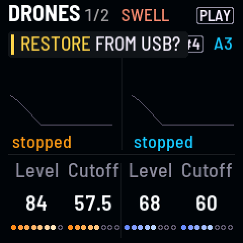

<!-- SPDX-License-Identifier: GPL-3.0-only -->

<!-- github -->
AIで翻訳したページです。英語版：[Help](../help.md)
<!-- /github -->

起きていることを選んでください。

<ul class="doors">
<li><a href="#installing-and-updating"><small>入手する</small> <b>インストールとアップデート</b> Webインストーラー、ケーブル、サウンドを残す</a></li>
<li><a href="#an-install-doesn-t-take"><small>困ったとき</small> <b>インストールが通らない</b> 何も変わらない、エラー、FM-1が起動しない</a></li>
<li><a href="#sound-and-playing"><small>演奏中に</small> <b>音がおかしい</b> ドローンが鳴らない、音が飛ぶ、値がグレー、低音が出ない</a></li>
<li><a href="#backups"><small>あなたのサウンド</small> <b>バックアップ</b> サウンドとシーンの保存と復元</a></li>
<li><a href="#going-back-or-to-another-firmware"><small>やめるとき</small> <b>元に戻す</b> M-VAVEのファームウェアへ、または別のファームウェアへ</a></li>
<li><a href="#send-feedback"><small>アイデア、ご意見、不具合</small> <b>フィードバック</b> ほしい機能、感想、うまくいかなかったこと</a></li>
</ul>

## インストールとアップデート {#installing-and-updating}

| したいこと | 方法 |
|---|---|
| **インストール** | ChromeまたはEdgeで[Webインストーラー](https://evanyerburgh.github.io/niagara-drift/ja/install/)を開き、USBデータ・ケーブルでFM-1をパソコンに直接つなぎます |
| **アップデート** | インストーラーをもう一度実行します。サウンドとシーンはそのまま残ります（そのバージョンの[変更履歴](changes.md)に別の記載がある場合を除く） |

ファームウェアのインストールは自己責任で行ってください。

## インストールが通らない {#an-install-doesn-t-take}

FM-1がパッケージ全体を確認するまでは何も書き込まれないので、やり直しても安全です。次の順に試してください。

1. USBデータ・ケーブルでパソコンに直接つなぎ、MIDIを使う他のアプリ（DAW、M-UPGRADE）を閉じ、ケーブルを差し直して、
   もう一度試します。
2. 0.2や別のファームウェアから戻すときに何も書き込まれなかった場合：M-VAVEのもう一方のファイル（V16またはV15）を選びます。
   FM-1が受け付けるのは、すでに入っているブートローダーに合うバージョンだけです。0.2.1以降のNiagara Driftはどちらも受け付けます。
3. それでも直らない場合：[[OCT−]]と[[OCT+]]を5秒間押し続けます。FM-1はチップ自身のアップデート・モードに入ります。
   このモードはどのファームウェアにも邪魔されません。[M-Flasher](https://github.com/jvitkauskas/m-flasher)
   （Windows、Mac、Linux）でM-VAVEのファームウェアに戻せます。FM-1がまったく起動しない場合は[下](#an-fm-1-that-won-t-start)を見てください。

> **0.2を入れた新しいFM-1.** 0.2までのNiagara Driftは、新しいFM-1の一部に使われているメモリー・チップを認識できず、
> 保存ができず、インストールも受け付けませんでした。そのFM-1で0.2を使っている場合は、手順3で抜け出してください。
> 0.2.1からは標準的なチップをすべて受け付けます：新しいUC25HQ80（ID B36014）と、最初のPuya P25Q80（856014）。

## FM-1が起動しない {#an-fm-1-that-won-t-start}

FM-1のチップには、どのファームウェアにも上書きされない専用のアップデート・モードがあります。そのため、起動しないFM-1でも、
USBデータ・ケーブルでパソコンに直接つなげば、M-VAVEのファームウェアに戻せます。

1. 電源を切って入れ直します。2回続けて起動に失敗すると、セーフ・モード（音は出ず、USBは使える）で立ち上がります。
   [インストール・ページ](https://evanyerburgh.github.io/niagara-drift/ja/install/)を開いてもう一度インストールするか、
   M-VAVEのファームウェアに戻します。
2. 画面に何も表示されない場合：さらに何度か電源を切って入れ直します。4回続けて起動に失敗すると、
   自動的にチップのアップデート・モードに入ります。
3. Mac、Windows、Linux用の無料アプリ[M-Flasher](https://github.com/jvitkauskas/m-flasher/releases/latest)をダウンロードします。
   アップデート・モードのFM-1を見つけるので、M-VAVEのFM-1用ファイルを選び、REVIEW & FLASHを押します。
   書き込む前にFM-1全体をファイルに保存します。インストール・ページの「インストールがうまくいかない？」に各手順があります。
4. FM-1の電源を切って入れ直します：M-VAVEのファームウェアで起動し、インストール・ページがまた使えるようになります。

> **補足.** MacやLinuxのターミナルでは、`tools/fm1_rescue.sh`で手順3を行えます。このスクリプトはチップを確認し、
> 先にバックアップを取ります（[BUILDING.md](../../../BUILDING.md#install)、英語）。

## 音のトラブル {#sound-and-playing}

| 起きていること | すること |
|---|---|
| **何も聞こえない** | [[PLAY]]を押します：ドローンがフェード・インします（止まっているときはPLAYがゆっくり明滅）。次にMASTERを上げ、Dronesページで各ドローンのレベル（KNOB 1とKNOB 3）を上げます |
| **ドローン IIが鳴らなくなった。**[ヘッダー](reference/controls.md#screen-header)にII OUTと表示 | [[SEL]] + [[PLAY]]で戻ります |
| **ドローン Iが鳴らなくなった。**ヘッダーにI OUTと表示 | [[HOME]] + [[PLAY]]で戻ります |
| **シーンを選ぶ前の音に戻したい** | [[SEL]] + [[SAVE]]で戻ります。もう一度押すと先に進みます |
| **ドローン IIが勝手に別の音に飛ぶ** | Wanderです：Pitch movesページ（そのページになるまで[[SEQ]]、KNOB 3）で0にします |
| **ノブの値がグレー** | 今の設定では聞こえない値です。理由は画面に出ます（"needs sqr"、"needs [[F#3]]"、Movementが0%） |
| **スピーカーで低音が出ない** | スピーカーは一番低い音を出せず、クリック音になります：ヘッドホンで聴いてください |
| **プリセットが本来のピッチで鳴らない** | Pitch lock（[[C#4]]）が今のピッチを保っています：オフにします |

## バックアップ {#backups}

| いつ | 何が起きるか |
|---|---|
| Niagara Driftの上に**インストールするたび** | どちらのインストーラーも、サウンド、シーン、設定をファイルに保存します：Webインストーラーはダウンロード・フォルダーに（元に戻すこともできます）、ターミナル版は`~/niagara-drift-backups/`に |
| **いつでも** | Webインストーラーの「サウンドとシーン」で保存や復元ができます。`python3 tools/fm1_install.py --backup`と`--restore FILE`も同じで、互いのファイルを読めます |
| **別のファームウェアを試すとき** | 先にバックアップし、戻ってきたら復元します |
| **別のFM-1へ** | バックアップにはノブのキャリブレーション（FM-1ごとのもの）が含まれないので、別のFM-1にも入れられます |

### 復元は安全です {#restoring-is-safe}

1. バックアップ全体がまずFM-1に送られて確認されます。この時点では何も変わりません。壊れたファイルは、
   書き込む前に拒否されます。
2. FM-1が**RESTORE FROM USB?**とたずねます：[[SEL]]で復元します。[[HOME]]を押すか、どちらも押さずに1分たつと、
   今のままになります。
3. サウンドとシーンは、すべて一度に変わるか、まったく変わらないかのどちらかです。途中で電源が切れても、
   次に電源を入れたときに完了します。

## 元に戻す、または別のファームウェアへ {#going-back-or-to-another-firmware}

| 行き先 | 方法 |
|---|---|
| **M-VAVEのファームウェア** | インストーラーの「M-VAVEのファームウェアに戻す」が、同じケーブルでV16またはV15を書き戻します。M-VAVEのアップデーターM-UPGRADE（[m-vave.com/download](https://www.m-vave.com/download)）も使えます |
| **別のファームウェア** | ほとんどはM-VAVEのファームウェアからのインストールが前提です：先に戻してから、インストールしてください |

> **セーフ・モード.** Niagara Driftが2回続けて起動に失敗すると、音は出ずUSBが使える状態で立ち上がり、
> インストーラーはそのまま使えます。

## フィードバック {#send-feedback}

アイデア、要望、気に入ったところや気に入らないところ、うまくいかなかったこと：ここから送ってください。アカウントは不要です。
日本語で大丈夫です。GitHubのアカウントがあれば、[Issue](https://github.com/evanyerburgh/niagara-drift/issues)を開くこともできます。

<form class="feedback" action="https://formspree.io/f/xppdwkel" method="POST">
<label>メッセージ<textarea name="Message" rows="5" required placeholder="アイデア、感想、うまくいかなかったこと（不具合の場合は、起動画面のバージョンがあると助かります）"></textarea></label>
<label>メール・アドレス <small>任意。返事がほしい場合のみ</small><input type="email" name="email" autocomplete="email"></label>
<input type="text" name="_gotcha" class="gotcha" tabindex="-1" autocomplete="off" aria-hidden="true">

一緒に送られるもの：このページのアドレスと、ブラウザーの名前。

<button type="submit">送信</button>

</form>
