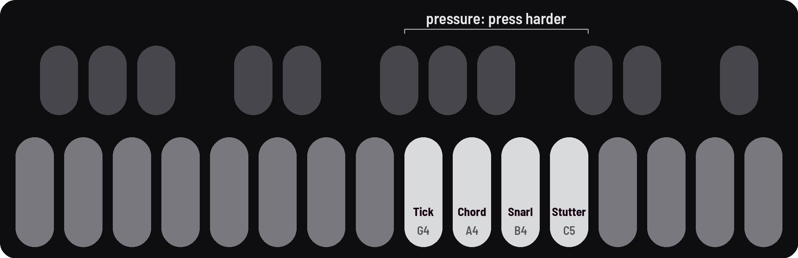
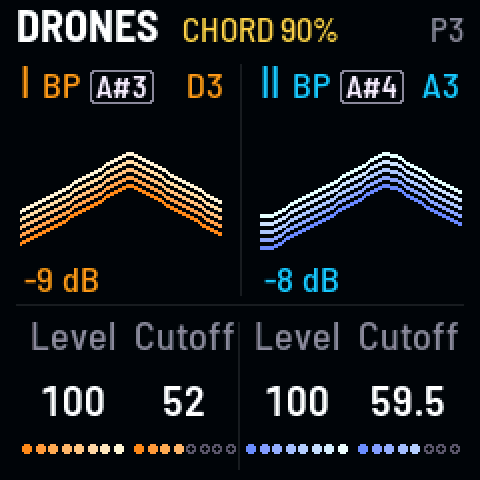
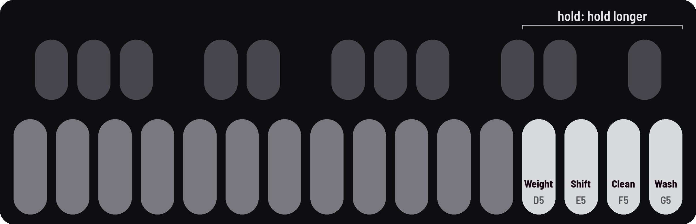
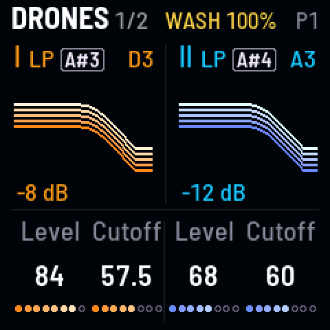
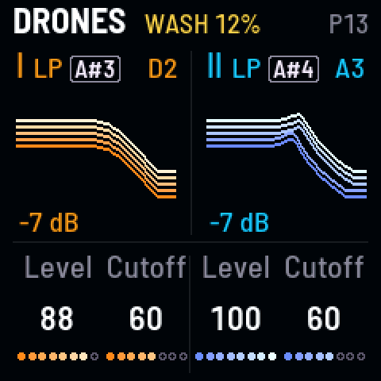
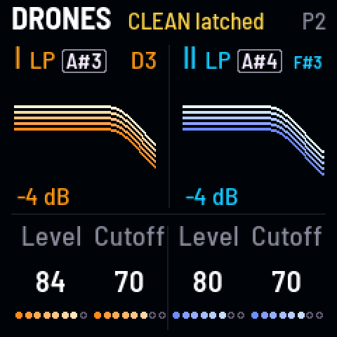
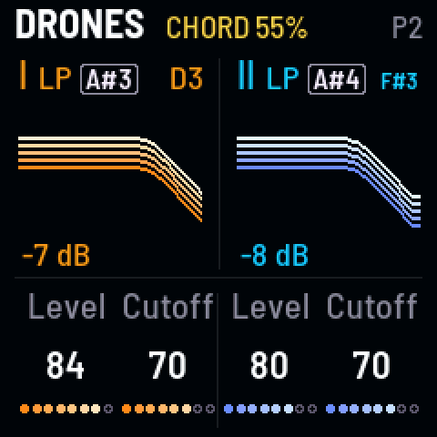
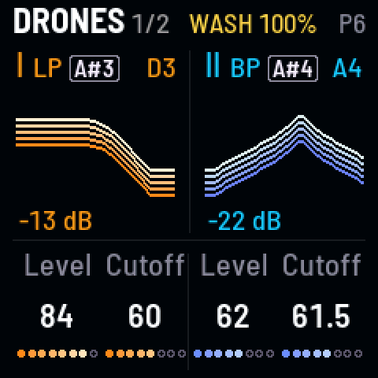
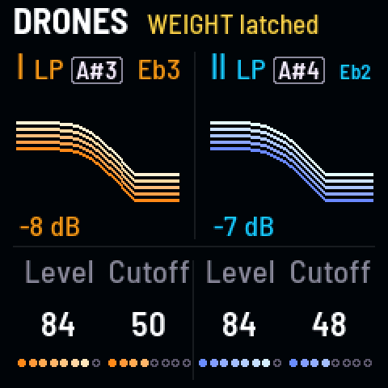

<!-- SPDX-License-Identifier: GPL-3.0-only -->

<!-- github -->
このページはAIによる翻訳です。ネイティブ・スピーカーによる確認はまだです。英語版：[Gestures](../../recipes/gestures.md)
<!-- /github -->

ジェスチャーはマクロです。1つのキーで、いくつもの設定を一度に動かします。**PRESETS**ノブ（Gesture time）でその速さを決めます。

## 押す強さのジェスチャー {#pressure-gestures}

キー9–12：強く押すほど、深くかかります。

### 和音へふくらみ、また戻る {#press}

*Chord：押した分だけ*

1. **Chord**、[[A4]]を、ゆっくり強く押していきます。ドローンが和音へ動いていきます。
2. 力を抜きます。元に戻ってきます。

> **補足** Chordは、**Pitch moves**ページ（そのページになるまで[[SEQ]]、KNOB 4）で設定する**Scale**の上に和音を組みます。Scaleを変えると
> 和音も変わります。プリセットは自分のScaleを持つことができます。VespersはJust 1-8（倍音）、Embersはメジャー・ペンタトニックです。

**聴いてみる** (`g-press`)

- 0:00 P3 Vespers
- 0:01 Chordを軽く押す：ドローンが動き始めます
- 0:04 さらに強く：和音がすべて鳴ります
- 0:08 力を抜く：始まりのほうへ戻ります
- 0:11 離す

## 長押しのジェスチャー {#held-gestures}

キー13–16：長く押すほど、深くかかります。

### リバーブへ花開き、ゆっくりフェード・アウト {#hold}

*長く押すほど、ゆっくり消えていく*

1. **Wash**、[[G5]]を、リバーブが花開くまで長押しします。
2. 離すと、押していたのと同じくらいゆっくりフェード・アウトします。

**聴いてみる** (`g-hold`)

- 0:00 P1 Niagara
- 0:01 Washを4秒長押し：リバーブが大きくなります
- 0:05 離す：4秒かけて消えていきます

### すばやく入れて、ゆっくり消す {#speed}

*離したあとでPRESETSを回す*

1. Gesture timeを速くしてジェスチャーを長押しし、離します。
2. **PRESETS**を左に回すと、ジェスチャーがゆっくり消えていきます。（ゆっくり入れて、速く抜くこともできます。）

**聴いてみる** (`g-speed`)

- 0:00 P13 Telegraph、Gesture timeは速め
- 0:01 Washを2秒長押し：すばやく入ります
- 0:03 離して、PRESETSを左に回す：ゆっくりフェード

## どのジェスチャーでも {#any-gesture}

タップ、ラッチ、重ねる、ゆっくりにする：どのジェスチャー・キーでも使えます。

### 弾きながらジェスチャーをかけたままにする {#keep}

*タップでラッチ、SELで好きな深さでラッチ*

1. ジェスチャー・キーをタップします。いっぱいまで入り、そのまま残ります。もう一度タップすると解除されます。
2. または、ジェスチャー・キーを長押し（または強く押し）して、画面に好きな深さが出たら、押したまま[[SEL]]をタップします：
   その深さでラッチされます。好きなときに離してかまいません。

**聴いてみる** (`g-keep`)

- 0:00 P2 Embers
- 0:01 Chordをタップ：いっぱいまで入り、ラッチ
- 0:05 もう一度タップ：解放されます
- 0:09 55%まで押してSELをタップ：その深さでラッチ

### クライマックスを作る {#stack}

*Washの下にSnarl*

1. **Snarl**、[[B4]]をしっかり押します。
2. その上で**Wash**、[[G5]]を長押しします。両方を離すと下りてきます。

**聴いてみる** (`g-stack`)

- 0:00 P6 Seance
- 0:01 Snarlを押す：グロウル
- 0:05 その上でWashを長押し：クライマックス
- 0:10 両方を離す：Snarlはすぐに抜け、Washは約5秒かけて抜けていきます
- 0:15 元のSeanceに戻ります

### 30秒かけてサウンドを変える {#minute}

*ゆっくりしたGesture timeと、1回のタップ*

1. **PRESETS**を左いっぱいに回します。**GESTURE TIME 33 s**。
2. ジェスチャー・キーをタップします。ひとりでに入ってきます。

**聴いてみる** (`g-minute`)

- 0:00 P12 Ashram、Gesture timeは33秒
- 0:01 Weightをタップ：ひとりでに入ってきます
