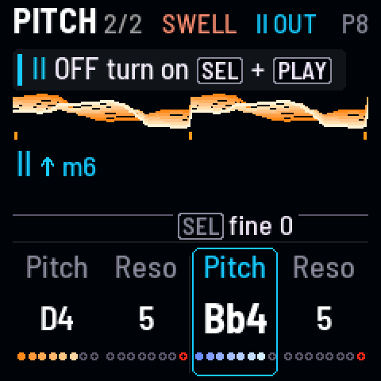
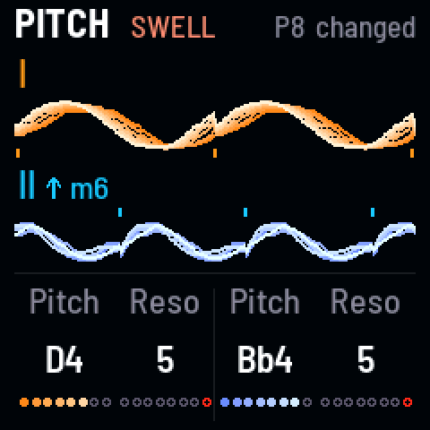
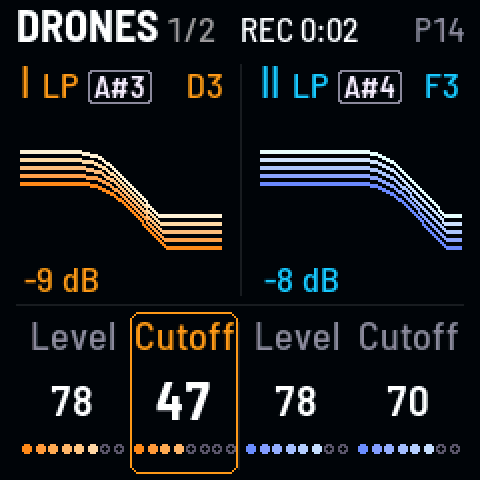
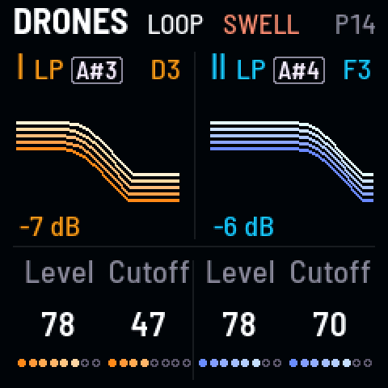
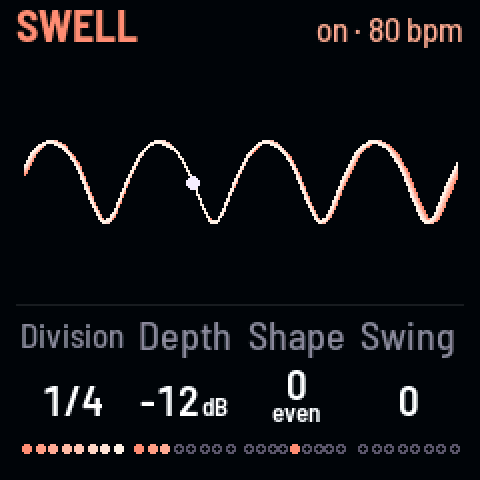
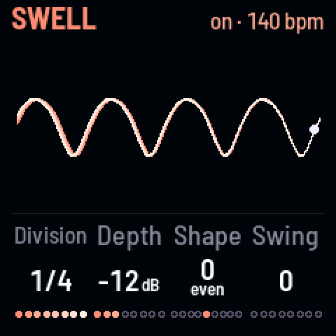

<!-- SPDX-License-Identifier: GPL-3.0-only -->

<!-- github -->
このページはAIによる翻訳です。ネイティブ・スピーカーによる確認はまだです。英語版：[Performing](../../recipes/performing.md)
<!-- /github -->

### スライドせずに和音を変える {#retune}

*ドローン IIを抜いて、新しい音にして、また入れる*

1. [[SEL]]を押しながら[[PLAY]]をタップします：ドローン IIがフェード・アウトします。
2. [[HOME]]を押して**Pitch**ページを開き、KNOB 3を新しい音に回します。
3. もう一度[[SEL]] + [[PLAY]]：新しい和音でフェード・インして戻ってきます。

> **補足** フェードの速さは**Fade**（Setup 1、KNOB 1）で決まります。

**聴いてみる** (`p-retune`)

- 0:00 P8 Sibyl、Fade 3 s
- 0:01 SEL + PLAY：ドローン IIがフェード・アウトします
- 0:05 無音のうちにチューニングし直す
- 0:07 SEL + PLAY：短調の和音で戻ってきます

### 動きをループする {#loop}

*REC、動かす、REC*

1. [[REC]]をタップして弾きます：ノブ、ジェスチャー、シーン。
2. もう一度[[REC]]をタップします：やったことが繰り返し再生されます。その上で弾きます。
3. もう一度[[REC]]をタップすると止まります。

**聴いてみる** (`p-loop`)

- 0:00 P14 Tape
- 0:01 REC：ドローン Iのカットオフを下げて、また上げる
- 0:06 もう一度REC：その動きがループします

### 別のページに手を伸ばして、戻ってくる {#peek}

*そのボタンを押したまま回し、離す*

1. ページのボタンを押したままにします。ここでは**Space**の[[FX]]です：[ヘッダー](../reference/controls.md#screen-header)に
   PEEKと出ます。
2. そこでノブを回します。
3. 離します：変更はそのままで、元のページに戻ります。

### MIDIクロックに合わせて弾く {#clock}

*クロックを送る：Swell、LFO、ディレイ、Wanderがそれに従う*

1. DAWやドラム・マシンから、USBまたはTRSジャックでMIDIクロックを送ります。
2. [[ARP]]を押して**Swell**を開き、KNOB 1（**Division**）を音符の長さに回します：テンポに合わせて呼吸します。

> **補足** **Sync**（Setup 1、KNOB 4）がオンならクロックに従い、オフなら無視します。詳しくは[MIDI](../reference/midi.md)を
> 見てください。

**聴いてみる** (`p-clock`)

- 0:00 P10 Cistern、80 BPMのクロック：1拍に1呼吸
- 0:05 クロックを140 BPMに：速くなります
