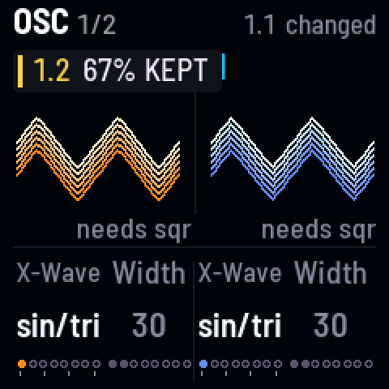
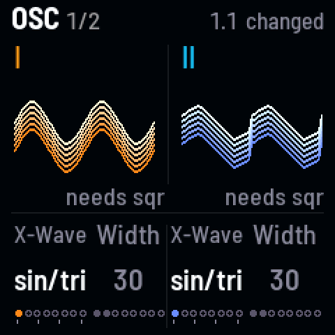

<!-- SPDX-License-Identifier: GPL-3.0-only -->

<!-- github -->
このページはAIによる翻訳です。ネイティブ・スピーカーによる確認はまだです。英語版：[Scenes and saving](../../recipes/scenes.md)
<!-- /github -->

白鍵1–8はシーンです。自分のサウンドを入れる8つずつ6つのバンク（1から6）と、プリセットがあります。

### プリセットを自分のものにする {#save}

*バンクを選び、変えて、SAVEと白鍵*

1. プリセットをタップし（Presetsバンク：[[SEL]]を押しながら[[F5]]をタップ）、次にバンク1を選びます。[[SEL]]を押しながら
   [[G4]]をタップします（2から6は[[A4]]から[[E5]]）。
2. 好きなように変えます。
3. [[SAVE]]を押しながら白鍵をタップします。そこに保存されます（[ヘッダー](../reference/controls.md#screen-header)に1.1と出ます）。
   あとでそのキーをタップすると、なめらかにそのサウンドへ戻ります。

> **補足** プリセットには上書きできません。自分のサウンドはバンク1から6に保存します。

### 2つのサウンドを混ぜて、そのブレンドを保つ {#blend}

*シーンのキーを強く押し、SELをタップ*

1. 別のシーンのキーを押し、ゆっくり強くしていきます。押した分だけ、サウンドがそちらへ動きます。
2. 押したまま[[SEL]]をタップします。ブレンドがそこで止まります（「1.2 67% KEPT」）。好きなときに離してかまいません。

> **補足** SELを押さずに離すと、なめらかに戻ります。いっぱいまで押して少し保つと、そのシーンに切り替わります（「TAKEN」）。

**聴いてみる** (`s-blend`)

- 0:00 1.1：P2 Embers（1.2には暗めのバージョン）
- 0:01 1.2をゆっくり強く押す
- 0:05 SELをタップしてから離す：ブレンドが残ります

### シーンの切り替えを取り消す {#back}

*SEL + SAVE*

1. [[SEL]]を押しながら[[SAVE]]をタップします。最後のシーンのタップ、またはブレンドの前のサウンドに戻ります。
2. もう一度押すと、取り消す前の状態に戻ります。
