<!-- SPDX-License-Identifier: GPL-3.0-only -->

<!-- github -->
このページはAIによる翻訳です。ネイティブ・スピーカーによる確認はまだです。英語版：[Sounds](../../recipes/sounds.md)
<!-- /github -->

## 音色と質感 {#tone-and-texture}

### クリックとチック {#ticks}

*低すぎてクリックに分かれるサブ、1秒に数回*

ドローン Iのサブを4オクターブ下にして全開にし、ドローン Iを約21 Hzまで下げます。サブは音程ではなくなり、1秒に約2.6回の
クリックになります。ドローン Iのレベルを下げると、クリックがドローン IIの下でパーカッションのように鳴ります。

1. [[SEL]]を押しながら[[F5]]をタップしてプリセットを呼び出し、白鍵2をタップします。**Embers**（P2）。
2. **Sub · Drive**ページになるまで[[EDIT]]を押し、KNOB 1（Osc/Sb）をサブ側いっぱいの**100**まで回します。
3. ドローン Iのサブ、[[G#3]]を、画面に**−4 oct**と出るまでタップします。−1、−2、⅓、⅕、−3、−4の順に巡ります。
4. **Pitch**ページになるまで[[HOME]]を押し、KNOB 1（ドローン Iのピッチ）を速く回して**A0**より下へ下げます。そこから画面の
   表示がHzに変わります。約**21 Hz**まで下げると、クリックになります。
5. **Drones**ページになるまで[[HOME]]を押し、KNOB 1（ドローン Iのレベル）を約**50**まで下げます。ドローン IIの下でクリックが鳴ります。

> **補足** 1秒あたりのクリック数は、ドローン Iのピッチ÷8です（サブは÷16で、1周期に2回クリックします）。D3では毎秒18回、
> A0（27.5 Hz）では約3回、21 Hzでは2.6回、5 Hzでは1.6秒に1回です。その下のハムは聞こえなくても、クリックはスピーカーから
> 聞こえます。**Tick**ジェスチャー（[[G4]]）はこれを自動で行い、強く押すほど速くなります。または、Osc/Sbを0にして、
> ドローン I自体を20 Hz以下にします。1周期ごとにクリックが鳴ります。**Sonar**（P7）がこの方法です。

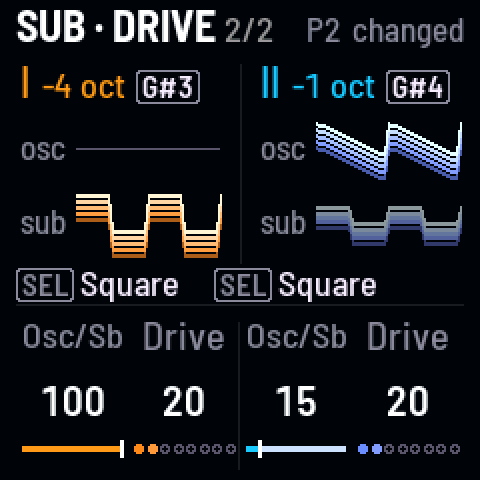
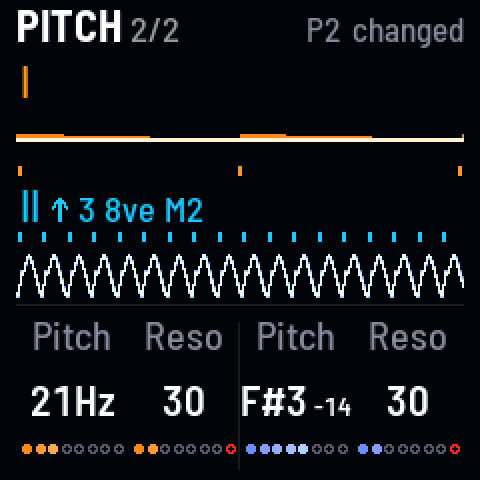

**聴いてみる** (`ticks`)

- 0:00 Embers（P2）の始まり：クリックはまだありません
- 0:01 Osc/Sbをサブへ、サブを−4 octへ、ドローン Iのピッチを速く約21 Hzまで下げ、レベルを50へ
- 0:06 毎秒約2.6回のクリックが、ドローン IIのふくらむ三角波の下でパーカッションのように鳴ります

### 歌うフィルター {#sing}

*レゾナンスを上げ、LFOでそれを動かす：ふくらんでは消えていく響き*

フィルターのレゾナンスを上げると、ドローンの音程で鳴り響きます。LFOでカットオフの代わりにレゾナンスを動かすと、
響きがひとりでにふくらみ、消えていきます。

1. **Pitch**ページになるまで[[HOME]]を押し、KNOB 2とKNOB 4（レゾナンス）を上げます。フィルターが鳴り響きます。最後の点は
   赤色です。そこではフィルターが自己発振します。
2. **Drones**ページになるまで[[HOME]]を押し、カットオフ（KNOB 2とKNOB 4）を上げます。響きが明るくなります。
3. **LFO sends**ページになるまで[[LFO]]を押し、[[C#4]]と[[C#5]]をタップします。LFOページでは、これらのキーで各ドローンの
   カットオフへのセンドを**resonance**に切り替えます。
4. KNOB 2とKNOB 4（レゾナンスへのセンド）を上げます。LFOが巡るにつれて、響きがふくらみ、消えていきます。

> **補足** **Abyss**（P5）はこの方法でレゾナンスをふくらませています。ドローンを5度やオクターブ離すと2つの響きが重なり、
> 半音離すとうなりが出ます。Weight（[[D5]]）を押している間は、レゾナンスが引いていきます。

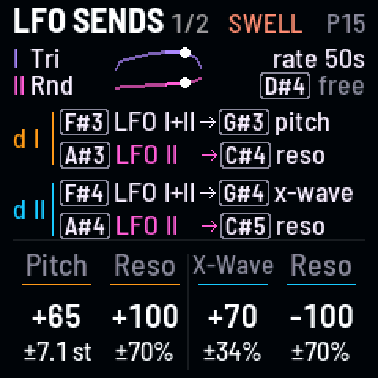
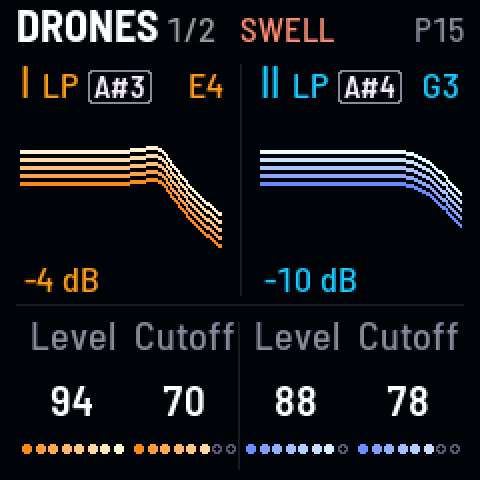

**聴いてみる** (`sing`)

- 0:00 P15 Falling、両方のレゾナンスを上げ、両方のカットオフを開いた状態：フィルターがドローンの音程で鳴り響きます
- 0:01 フィルターのLFOをレゾナンスへ：響きがゆっくりとふくらんでは消え、それを繰り返します

### ハード・シンクのスイープ {#sync}

*ドローン IIをドローン Iに同期させ、そのピッチを手で動かす：音程ではなく、音色のスイープ*

ハード・シンクでは、ドローン IIはドローン Iの1周期ごとに波形の先頭に戻ります。するとドローン IIのピッチを回したとき、
変わるのは音程ではなく音色になります。裂けるような、声のような、レーザーのようなスイープです。

1. **Drones**ページになるまで[[HOME]]を押し、KNOB 4（ドローン IIのカットオフ）を大きく上げ、ドローン IIを前に出します
   （KNOB 3を上げ、KNOB 1を下げる）。
2. 黒鍵10、[[D#5]]をタップします。**hard sync**、ドローン IIがドローン Iに同期します。
3. **Pitch**ページになるまで[[HOME]]を押し、KNOB 3（ドローン IIのピッチ）をゆっくり2オクターブ上げて、戻します。音色がスイープします。

> **補足** ドローン IIがドローン Iより高く、波形がノコギリ波か矩形波（Oscページ）のとき、いちばんはっきり出ます。手を使わずに
> 動かし続けるには、LFOをドローン IIのピッチに送ります（LFO sends、KNOB 3）。センド約30で上下2半音ずつ動く、ゆるやかな
> スイープになり、100では2オクターブ振れます。ここでは、ゆっくりした響きがスイープを隠さないように、先にAbyss自身の
> レゾナンスのLFOをオフにしています（LFO sends、KNOB 2と4を0に）。

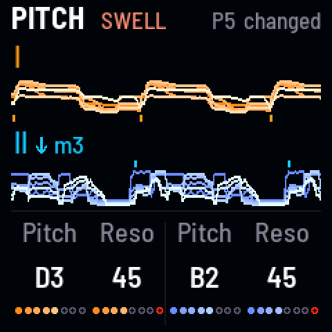
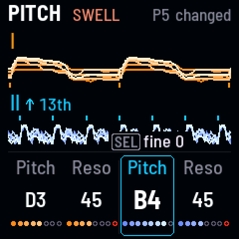

**聴いてみる** (`sync`)

- 0:00 P5 Abyss、ドローン IIを開いて前に出した状態
- 0:01 ハード・シンクをオン：より硬く、ジリジリしたエッジ
- 0:03 ドローン IIのピッチをゆっくり2オクターブ上げる：音色が裂けるように上がっていく、声のような、レーザーのようなスイープ
- 0:10 そして下げる：スイープが下がります
- 0:16 もう一度上げる、今度は速く

## クロス・モジュレーション {#cross-mod}

### ドローン Iがドローン IIを形づくる {#xfilter}

*ドローン Iの音がドローン IIのフィルターを動かす*

キー11の最初の設定では、ドローン Iの音がドローン IIのフィルターを、ドローン Iの周波数そのもの（オーディオ・レート）で動かします。ドローン IIは
グロウルし、ジリジリと鳴り、ドローン Iのピッチを粒立ちとして帯びます。

1. 黒鍵11、[[F#5]]を1回タップします。点灯し、**I moves II's cutoff**になります。
2. **Mods**ページになるまで[[LFO]]を押し、KNOB 4（X-mod）を上げます。グロウルが深くなります。
3. **Pitch**ページになるまで[[HOME]]を押し、ドローン Iのピッチ（KNOB 1）を動かします。グロウルの粒立ちが変わります。

> **補足** ドローン IIのフィルターにレゾナンスがあり、バンドパス（[[A#4]]）のとき、いちばんはっきり出ます。ここで使っている
> **Vespers**（P3）がその例です。**Seance**（P6）はこれを控えめに使っています。

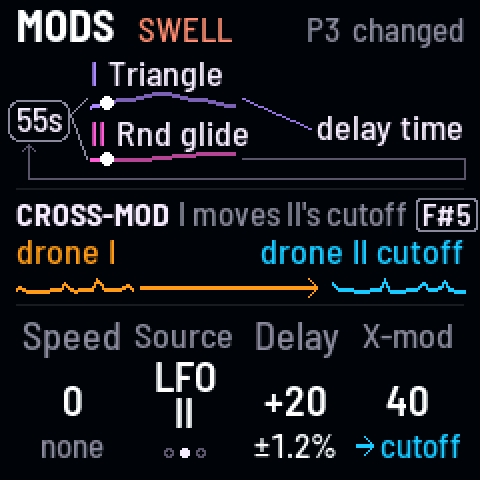
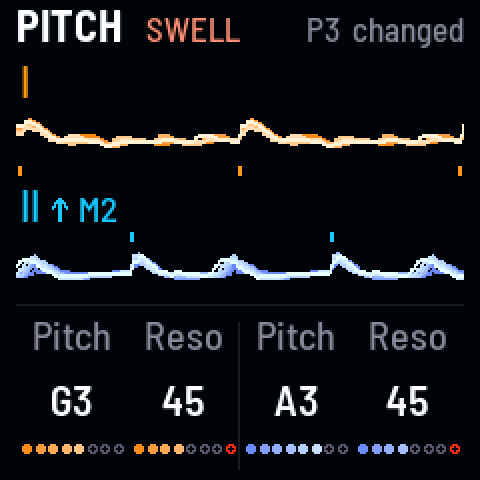

**聴いてみる** (`xfilter`)

- 0:00 P3 Vespersの始まり：バンドパス・フィルターを通したノコギリ波
- 0:01 キー11を1回：ドローン Iの音がドローン IIのフィルターを動かし、ドローン IIがグロウルし、きらめきます
- 0:04 X-modを上げる：グロウルが深くなり、ジリジリした声のようなエッジに
- 0:12 ドローン Iのピッチを動かす：グロウルの粒立ちが変わります

### 金属的なベル {#bells}

*クロスFMで高い2つのサイン波を金属の響きに。LFOがそれを何度も打ち鳴らす*

それぞれのドローンの音が、もう一方のピッチを曲げます。2つのドローンの間のFM合成です。三全音離れた、高く純粋な音では、
金属的な音色に鳴ります。ベルは打たれて減衰していくので、LFOでフィルターを一気に開き、ゆっくり閉じます。2.5秒ごとに
打たれ、鳴り終わっていくベルです。

1. **Osc**ページになるまで[[EDIT]]を押し、KNOB 1とKNOB 3（X-Wave）をいっぱいまで下げます。**sine**。
2. **Pitch**ページになるまで[[HOME]]を押し、両方のドローンを三全音離して高くします（ここではC#6とG6。音域の上限は約1.6 kHzです）。
3. 黒鍵11、[[F#5]]を、点滅して画面に**PITCH I <> II**と出るまでタップします（オフから2回）。ドローンが互いのピッチを曲げます。
4. **Mods**ページになるまで[[LFO]]を押し、KNOB 4（X-mod）を約**70**まで上げます。サイン波が金属のように鳴ります。
5. **Drones**ページになるまで[[HOME]]を押し、両方のカットオフ（KNOB 2とKNOB 4）を約**300 Hz**まで下げます。金属の響きがこもります。
6. **LFO sends**ページになるまで[[LFO]]を押します。LFO Iが**Round**（Roundtooth）になるまでOCT−をタップし、SELECT（LFOのレート）を
   約**0.4 Hz**にします。ドローン IIのカットオフにも**LFO I**と出るまで[[A#4]]をタップします。
7. KNOB 2とKNOB 4（カットオフへのセンド）を左いっぱい、**−100**まで回します。1周期ごとにフィルターが一気に開き、ゆっくり
   閉じます。ベルが打たれ、鳴り終わっていきます。
8. **Space**ページになるまで[[FX]]を押し、KNOB 4（リバーブのMix）を約**40**にします。響くための空間が広がります。

> **補足** Roundtoothは速く上がり、周期の終わりに下がります。上下を逆にすると（−100）、跳ね上がって減衰する、打撃になります。
> SELECTで打つ間隔を決めます。単純な音程（オクターブ、5度）はベルではなくハーモニーにまとまり、半端な音程（三全音、7度）は
> 金属的に鳴ります。X-modを85より上げると、ガンガンと鳴って暴れ出します。Swellがオンなら、LFOだけが打つようにオフにします
> （[[ARP]]、そのページでもう一度[[ARP]]）。

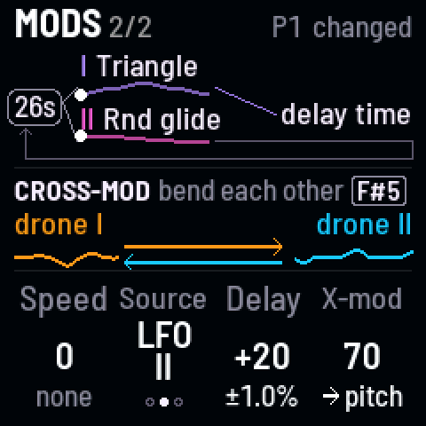
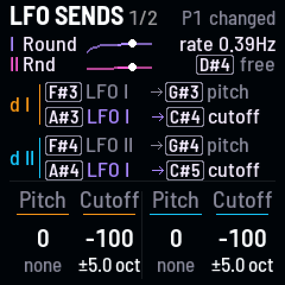

**聴いてみる** (`bells`)

- 0:00 2.5秒ごとに打たれるベル（0:03、0:05、0:08、0:10、0:13）：打った瞬間は明るく、ガンと鳴ります
- 0:03 高音から先に消え、次の打撃までに約25 dB下がって暗いハムになります

### Snarl {#snarl}

*エコーまで含めた最終的な音が、両方のドローンを曲げる*

キー11の最後の設定では、ディレイのエコーまで含めた最終的な音が、両方のドローンのピッチを曲げます。ピッチを引きずり、
引き裂くグロウルで、エコーも一緒に曲がります。エコーが多く、安定した音でいちばんはっきり出ます。

1. **Space**ページになるまで[[FX]]を押し、Repeat（KNOB 1）とMix（KNOB 2）を上げます。Snarlが引きずるエコーを増やします。
2. 黒鍵11、[[F#5]]をオフから3回タップします。**Snarl**（点滅します）。
3. **Mods**ページになるまで[[LFO]]を押し、KNOB 4（X-mod）を上げます。40でグロウル、85で吠えるような音に。

> **補足** **Snarl**ジェスチャー（[[B4]]）は、押す強さでこれを呼び込み、ドライブとFeedbackを上に重ね、跡を残さずに抜けていきます。
> **Clean**（[[F5]]）は、押している間これを取り除きます。

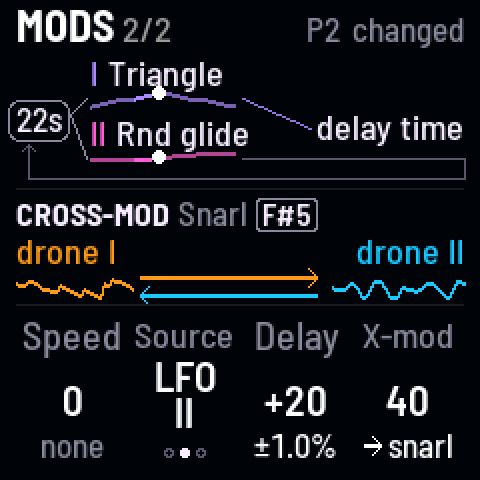
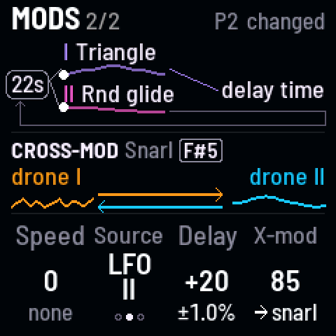

**聴いてみる** (`snarl`)

- 0:00 エコーを増やしたP2 Embers：ノコギリ波へとふくらんでいく、安定した三角波
- 0:01 Snarlをオン：最終的な音が両方のドローンを曲げ始めます
- 0:04 X-modを上げる：グロウルが大きくなり、ピッチが引きずられ、引き裂かれ、エコーも一緒に曲がります

## 動きとリズム {#movement-and-rhythm}

### 動いていくステップするフレーズ {#figure}

*ドローン IIのピッチにOR：4つの音をぐるぐる巡り、Wanderがフレーズを動かす*

LFO IIの**OR**波形は、2つの矩形波（一方はもう一方の5倍の速さ）を足したものです。ドローンのピッチに送ると、4つの音を巡る、
繰り返すフレーズになります。そしてWanderが、ときどきフレーズ全体を新しい音へ動かします。

1. フレーズが目立つように、ドローン IIを明るくします。**Osc**ページになるまで[[EDIT]]を押し、KNOB 3（その波形）を**saw**に
   します。次に**Drones**（[[HOME]]）でKNOB 4（そのカットオフ）を上いっぱいに、KNOB 3（そのレベル）を上げ、KNOB 1
   （ドローン Iのレベル）を下げます。
2. **LFO sends**ページになるまで[[LFO]]を押し、画面に**OR 5**と出るまで[[OCT+]]（LFO IIの波形）をタップします。
3. KNOB 3（ドローン IIのピッチ・センド）を上げます。40で約±4半音です。
4. SELECT（LFOのレート）を上げると、フレーズが速くなります。
5. **Pitch moves**ページになるまで[[SEQ]]を押し、KNOB 3（Wander）を上げます。ときどき、フレーズが別の音から始まります。

> **補足** LFO IのOR（[[OCT−]]）は3倍の速さで、また別のフレーズになります。**AND**（LFO IではAND 3、LFO IIではAND 5）は、
> 代わりに2つの音の間をステップします。**Piston**（P11）がその例です。**Telegraph**（P13）は、LFO IのOR 3でこの方法で作られています。

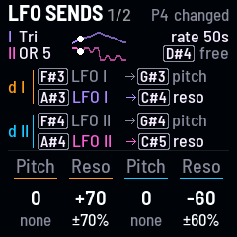
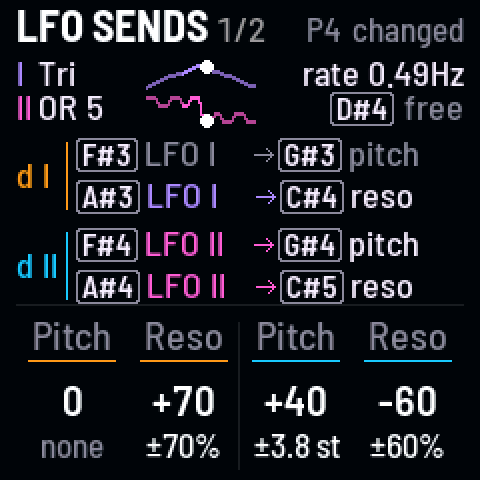

**聴いてみる** (`figure`)

- 0:00 ステップするフレーズ：明るいドローン IIが、LFO IIのOR 5で4つの音を巡ります
- 0:02 Wanderを上げる：数秒ごとに、フレーズ全体が新しい音へ移ります

### Swellに合わせたフィルターのリズム {#swell}

*両方のカットオフに矩形波のLFO、Swellの呼吸に同期*

Swellは両方のドローンを呼吸させます。LFOをそれに同期させると、フィルターにかけた矩形波が同じ拍で跳ね、2つのフィルターが
交互に動きます。

1. [[ARP]]を押して**Swell**ページを開き（Swellがオフならもう一度タップ）、KNOB 1を回して1秒に約1回の呼吸にします。
2. **LFO sends**ページになるまで[[LFO]]を押します。LFO Iが**Square**になるまで[[OCT−]]をタップし、LFO Iがドローン IIのカットオフも
   動かすまで、キー8、[[A#4]]をタップします。
3. KNOB 2とKNOB 4（カットオフへのセンド）を、一方は上へ、もう一方は下へ回します。フィルターが交互に跳ねます。SELECTを
   Swellの速さくらいにします。
4. 黒鍵5、[[D#4]]を0.5秒長押しします。LFOがSwellの2呼吸ごと、1小節ごとにリスタートします（「on Swell」）。

> **補足** エコーはリズムをぼかします。サウンドにエコーがあるなら、先にディレイのMixを下げます（[[FX]]、KNOB 2）。Swellの
> 速さがリズムを決めます。同期したLFOは1小節（2呼吸）ごとにリスタートします。もう一度[[D#4]]を長押しすると、LFOの同期が
> 外れます。（MIDIクロックがあれば、Swellと同期したLFOもその拍に従います。）

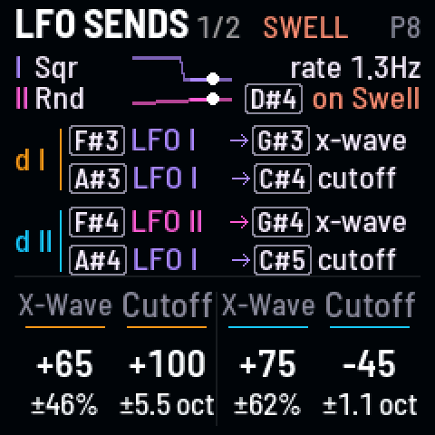
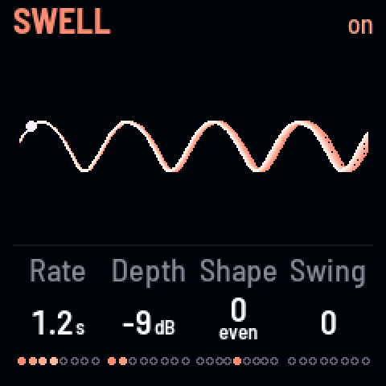

**聴いてみる** (`swell`)

- 0:00 P8 Sibyl、ディレイをオフにしてSwellを速くした状態：ドローンが1秒に約1回呼吸します
- 0:01 LFO IをSquareにして両方のカットオフへ：フィルターが交互に跳ねます
- 0:11 LFOをSwellに同期：跳ねるたびに呼吸と重なります

### 自分を追いかけるLFO {#chase}

*スピード・モジュレーション：LFOが自分の波で走ったり、もたったり*

スピード・モジュレーションでは、LFOが自分の波の1つに合わせて速くなったり遅くなったりします。揺れのひとつひとつが走っては、
もたります。ビブラートでいちばん聞き取りやすくなります。

1. **LFO sends**ページになるまで[[LFO]]を押します。LFO Iがドローン IIのピッチを動かすまでキー6、[[F#4]]をタップし、KNOB 3
   （そのピッチ・センド）を上げます。ゆっくりしたビブラート。
2. **Mods**ページになるまで[[LFO]]を押し、KNOB 1（Speed）を上いっぱいに回します。LFOが最大3オクターブ速くなったり遅くなったりします。
3. KNOB 2（Source）を**LFO I**にします。規則的に走ったりもたったりします（LFO IIのランダムな動きでは不規則になります）。

> **補足** スピード・モジュレーションは、LFOが動かしているものすべてのレートを一度に動かします。フィルター、ピッチ、
> ディレイ。Speedを0にすると、また安定します。

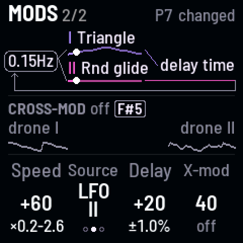
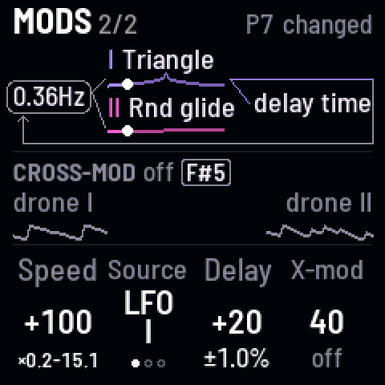

**聴いてみる** (`chase`)

- 0:00 ドローン IIにビブラートをかけたP7 Sonar：ゆっくりした、一定の揺れ
- 0:03 スピード・モジュレーションを最大に、LFO Iの三角波で：揺れが走り、もたり、それを繰り返します
- 0:14 Speedを0に戻す：揺れがまた一定になります

## エコーと空間 {#echoes-and-space}

### 揺れるエコー {#warble}

*LFOがディレイのタイムを動かす：ピッチが曲がるエコー*

ディレイのタイムが動くと、テープが速くなったり遅くなったりするときのように、エコーのピッチが曲がります。LFOで
動かすと、すべてのエコーが揺れます。Swellでドローンを沈ませると、曲がるエコーがすき間でひとりでに鳴ります。

1. **Space**ページになるまで[[FX]]を押し、Repeat（KNOB 1）とMix（KNOB 2）を上げます。曲げるための、はっきりしたエコー。
2. [[ARP]]を押して**Swell**を開き（オフならもう一度タップ）、KNOB 1を上げて1秒に約1回の呼吸にします。すき間でエコーが鳴ります。
3. **Mods**ページになるまで[[LFO]]を押し、KNOB 3（Delay）を上いっぱいに回します。LFOがディレイのタイムを4分の1揺らし、
   すべてのエコーが曲がります。
4. **Details**ページになるまで[[FX]]を押し、Time（KNOB 2）を上げます。より深く、ゆっくり曲がります。

> **補足** LFOページでは、黒鍵10、[[D#5]]で、どちらのLFOがディレイのタイムを動かすかを選びます。LFO Iの規則的な波では
> 均等に揺れ、LFO IIのランダムな動きでは、ここのようにさまよいます。Timeを手で回してもエコーは曲がります。
> Movement（ALGORITHM）は、ほかのLFOセンドと一緒にこの揺れの深さを変えます。

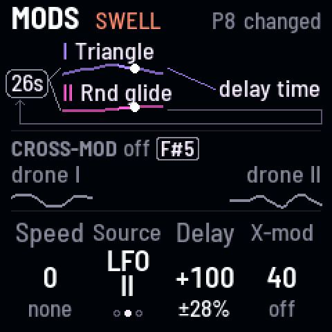
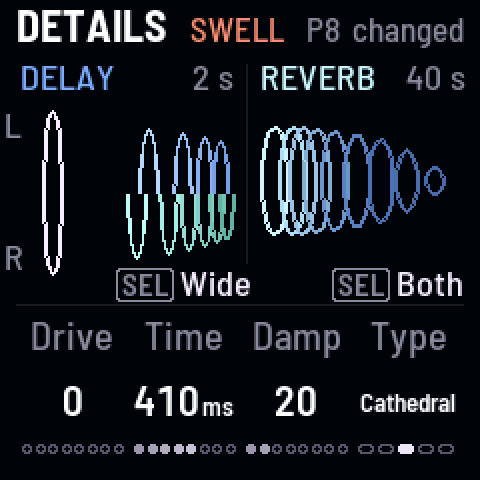

**聴いてみる** (`warble`)

- 0:00 エコーを上げ、Swellを速くしたP8 Sibyl：ドローンが1秒に約1回沈み、すき間でエコーが鳴ります
- 0:01 Delayを上いっぱいに：すべてのエコーのピッチが曲がり、すき間でいちばんはっきり聞こえます
- 0:10 長めのTime：より深く、ゆっくり曲がります

### パチパチ鳴るエコー {#crackle}

*SelfディレイとDrive：よれ、歪み、パチパチ鳴るエコー*

**Self**ディレイは、エコーが大きくなるほどタイムが伸びるので、大きなエコーはよれて揺れます。その後の**Drive**が
ドローンとそのエコーを一緒に歪ませます。ゴースト・ノートとパチパチという音。

1. **Space**ページになるまで[[FX]]を押し、Repeat（KNOB 1）を上げます。エコーが重なっていきます。
2. **Details**ページになるまで[[FX]]を押します。[[SEL]]を押しながらKNOB 2を**Self**にします（または**Grain**。こちらは自分の
   エコーがタイムを揺らします）。
3. KNOB 1（Drive）を上げます。

> **補足** Repeatが85を超えると、エコーが暴走して、自分で鳴り続ける響きになります（赤色の「runaway」）。Selfでは、その暴走が
> よろめきます。PLAYで鳴り終わらせることができます。

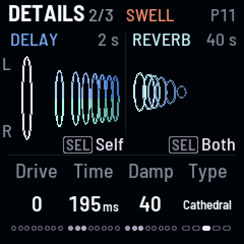
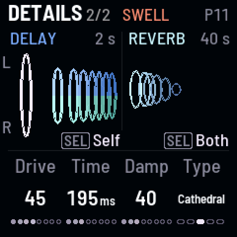

**聴いてみる** (`crackle`)

- 0:00 P11 Pistonの始まり
- 0:01 Repeatを上げる：エコーが重なっていきます
- 0:03 ディレイをSelfに：エコーが大きくなるほどタイムが伸びます
- 0:08 Driveを上げる：ドローンとエコーが一緒に歪み、ゴースト・ノートとパチパチという音

### 和音をフリーズして、その上で弾く {#freeze}

*Infのリバーブが和音を保ち、その上で新しい音を弾く*

いちばん上では、リバーブのLengthは**Inf**になります。消えることがなく、中にあるものをフリーズします。ドローンを動かすと、
フリーズした和音の上で鳴ります。

1. **Space**ページになるまで[[FX]]を押します。KNOB 4（リバーブのMix）を上げ、次にKNOB 3（Length）をいっぱいまで回します：
   **Inf**、青色の「freeze」。
2. **Pitch**ページになるまで[[HOME]]を押し、KNOB 1とKNOB 3を新しい音に回します。フリーズした和音の上でドローンが鳴ります。
3. Lengthを下げて解放するか、[[PLAY]]で止めます。

> **補足** Detailsページでは、[[SEL]] + KNOB 4でリバーブに入れるものを選びます。**Drones**ではドローンをフリーズし、
> エコーはその上にドライのまま残ります。InfではDampが効かないので、フリーズは中にあるものをそのまま保ちます。

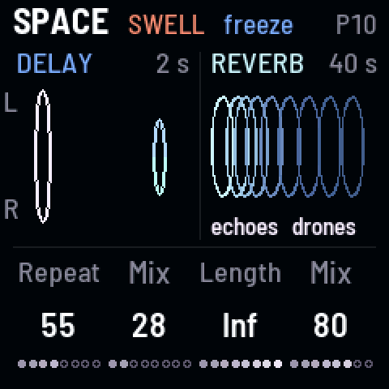
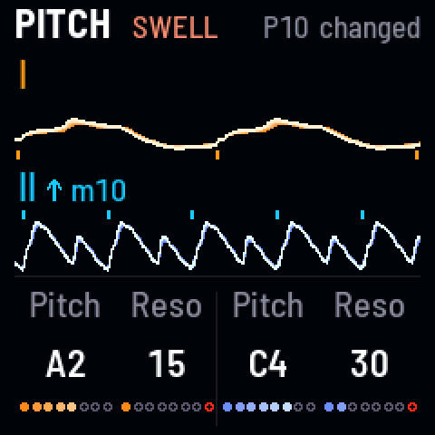

**聴いてみる** (`freeze`)

- 0:00 P10 Cisternの始まり
- 0:01 リバーブのMixを上げ、Lengthをいちばん上へ：和音がフリーズし、保たれます
- 0:08 両方のドローンに新しい音：フリーズした和音の上で鳴ります

### エコーにシマー {#shimmer}

*エコーだけがオクターブ上がり、光の輪になる*

**Shimmer**リバーブは、入ってきた音を、わずかにずれた2つの声でオクターブ上げます。エコーだけを送ると、ドローンはドライの
まま、エコーのひとつひとつが明るい光の輪へと上っていきます。中音域より上の声でよく輝きます。低いドローンでは、
オクターブ上も低いままです。

1. ドローンが低い場合は、**Pitch**ページになるまで[[HOME]]を押し、両方を1オクターブ上げます（KNOB 1とKNOB 3）：光の輪が
   その上できらめきます。
2. **Space**ページになるまで[[FX]]を押し、Repeat（KNOB 1）とMix（KNOB 2）を上げます。エコーを増やします。
3. **Details**ページになるまで[[FX]]を押し、KNOB 4（リバーブのType）を**Shimmer**にします。
4. [[SEL]]を押しながらKNOB 4を回します。Intoを**Echoes**に。
5. **Space**ページになるまで[[FX]]を押し、リバーブのMix（KNOB 4）を上げます。

> **補足** Shimmerは約8秒かけて入ってきて、6秒かけて引いていきます。**Cistern**（P10）は、すべての音にこれを使っています。

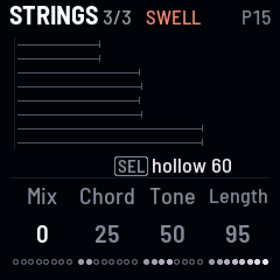
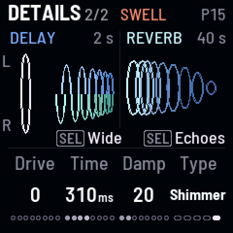

**聴いてみる** (`shimmer`)

- 0:00 両方のドローンを1オクターブ上げた（G4とE5）P15 Falling、エコーを上げた状態
- 0:01 リバーブをShimmerに、Into Echoes：8秒かけて、エコーがオクターブ上がって光の輪になります
