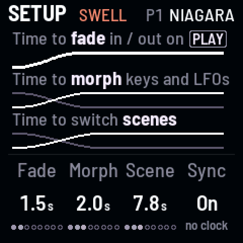
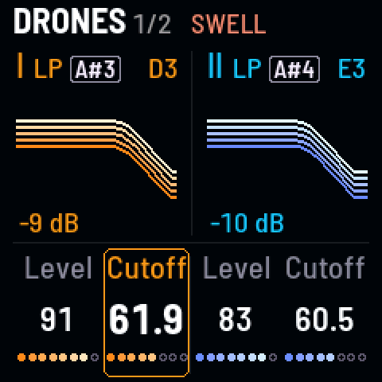
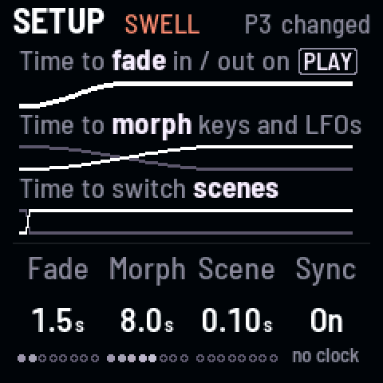
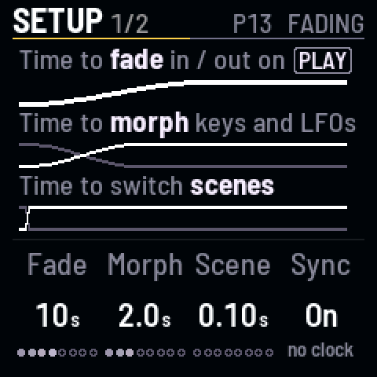
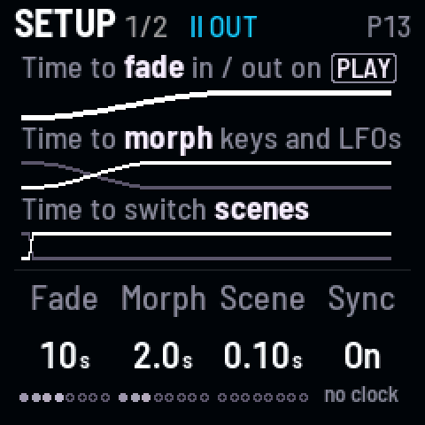

<!-- SPDX-License-Identifier: GPL-3.0-only -->

<!-- github -->
このページはAIによる翻訳です。ネイティブ・スピーカーによる確認はまだです。英語版：[Time and transitions](../../recipes/time.md)
<!-- /github -->

**Setup 1**（[[GLO]]）に3つの時間があります。Fade（KNOB 1）、Morph（KNOB 2）、Scene time（KNOB 3）。

### シーンをすぐ切り替える、またはなめらかに移る {#cuts}

*Scene time、0.1秒から5分まで*

1. **Setup 1**ページになるまで[[GLO]]を押します。
2. **Scene time**（KNOB 3）を左いっぱいに回します。
3. 別のシーンのキーをタップします。サウンドがすぐに切り替わります。
4. Scene timeを上げてから、別のシーンのキーをタップします。Scene timeの時間をかけて、サウンドがなめらかに移ります。

**聴いてみる** (`t-cuts`)

- 0:00 P1 Niagara、Scene time 0.1秒
- 0:01 P5 Abyssをタップ：すぐに切り替わります
- 0:04 P1をタップ：すぐに戻ります
- 0:06 Scene time 8秒、P5をタップ：ゆっくり移ります

### 移り変わりを途中で止める {#stop}

*シーンが移っている途中でノブを回す*

1. Scene timeをゆっくりにして、シーンをタップします。
2. 途中でどれかのノブを回します。移り変わりがそこで止まり、2つの間のサウンドになります。

**聴いてみる** (`t-stop`)

- 0:00 P1 Niagara、Scene time 8秒
- 0:01 P5 Abyssをタップ：ゆっくり移ります
- 0:04 ノブを回す：移り変わりがそこで止まります

### スイッチをゆっくり動かす {#morph}

*Morph：黒鍵の切り替えを数秒かけて*

1. **Morph**を上げます。
2. 黒鍵、またはLFOの波形（OCT−かOCT+）をタップします。その時間をかけて変化が入ってきます。

**聴いてみる** (`t-morph`)

- 0:00 P3 Vespers、Morph 0.02秒
- 0:01 [[A#3]]をタップ：すぐに細く、明るくなります
- 0:04 Morph 8秒、もう一度タップ：厚みがゆっくり戻ってきます
- 0:12 もう一度：同じくらいゆっくり細くなります

### ゆっくりフェード・インする、ドローンを1つフェード・アウトする {#fades}

*Fade：PLAYを最大1分かけて*

1. **Fade**を上げてから、[[PLAY]]をタップします。その時間をかけてドローンが入ってきます。
2. [[SEL]]を押しながら[[PLAY]]をタップします。ドローン IIだけがフェード・アウトします（もう一度で戻ってきます）。

**聴いてみる** (`t-fade`)

- 0:00 P13 Telegraph、Fade 10秒、PLAYをタップ：10秒かけて入ってきます
- 0:12 SEL + PLAY：ドローン IIがフェード・アウトします
