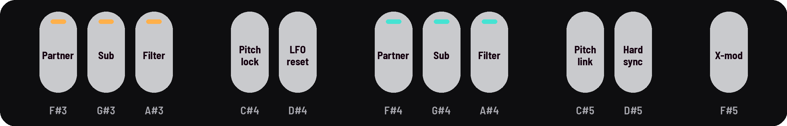
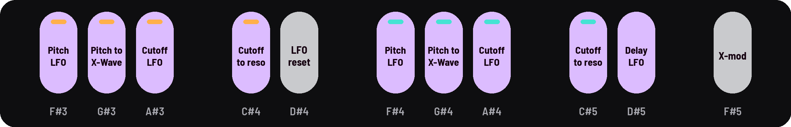
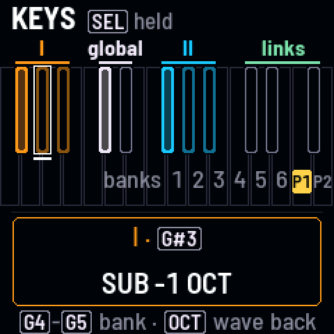

<!-- SPDX-License-Identifier: GPL-3.0-only -->

<!-- github -->
AIで翻訳したページです。英語版：[Black keys](../../reference/black-keys.md)
<!-- /github -->

## 黒鍵 {#black-keys}

11個の黒鍵はスイッチで、2組の働きがあります。LFOページ以外のすべてのページではドローンのため、LFOページを開いている間は
LFOのためです。LFO reset（[[D#4]]）とX-mod（[[F#5]]）は、どちらでも同じ働きです。

## ドローンのキー {#drone-keys}

LFOページ以外では、各ドローンに3つのキーがあり、さらに5つが両方のためのキーです。

各ドローン自身のキー：

| スイッチ | ドローン I | ドローン II | 選択肢 |
|---|---|---|---|
| **Partner** | [[F#3]] | [[F#4]] | オンかオフ |
| **Sub** | [[G#3]] | [[G#4]] | −1 oct、−2 oct、⅓、⅕、−3 oct、−4 oct |
| **Filter** | [[A#3]] | [[A#4]] | ローパス、バンドパス、ハイパス（画面ではLP、BP、HP） |

両方のためのキー：

| キー | スイッチ | 働き |
|---|---|---|
| [[C#4]] | **Pitch lock** | シーンやプリセットでも、ドローンのピッチを保ちます（初期設定はオン） |
| [[D#4]] | **LFO reset** | LFOをリスタートします。長押しでSwellに同期 |
| [[C#5]] | **Pitch link** | ドローン IIがドローン Iに従います |
| [[D#5]] | **Hard sync** | ドローン IIがドローン Iに同期します |
| [[F#5]] | **X-mod** | クロス・モジュレーションのモード：オフ、**cutoff**（ドローン Iがドローン IIのカットオフを動かす）、**pitch**（ドローンが互いのピッチを曲げる）、**snarl** |

## LFOのキー {#lfo-keys}

[LFOページ](lfo-pages.md)では、各ドローンの4つのキーで、その2つのセンドを設定します。

各ドローン自身のキー：

| スイッチ | ドローン I | ドローン II | 選択肢 |
|---|---|---|---|
| **Pitch LFO**（画面ではOsc LFO） | [[F#3]] | [[F#4]] | どのLFOがピッチを動かすか：I、II、または両方 |
| **Pitch to X-Wave**（Osc to） | [[G#3]] | [[G#4]] | ピッチ・センドが代わりにX-Waveを動かします |
| **Cutoff LFO**（Filt LFO） | [[A#3]] | [[A#4]] | どのLFOがカットオフを動かすか：I、II、または両方 |
| **Cutoff to reso**（Filt to） | [[C#4]] | [[C#5]] | カットオフ・センドが代わりにレゾナンスを動かします |

そのほか：

| キー | スイッチ | 選択肢 |
|---|---|---|
| [[D#5]] | **Delay LFO**（Dly LFO） | どのLFOがディレイのタイムを動かすか：I、II、または両方 |
| [[D#4]] · [[F#5]] | **LFO reset**、**X-mod** | ほかのページと同じ |

## 演奏中にキーを探す {#finding-a-key-while-you-play}

[[SEL]] + どれかの黒鍵で、そのキーの働きが表示されます。切り替わりはしません。

1. [[SEL]]を押したままにします。画面に黒鍵が、パネルと同じ点灯状態で描かれます。
2. SELを押したまま、黒鍵を押します。画面にそのキーの名前と設定が出ます。何も変わりません。
3. SELを離してから、キーをタップして切り替えます。

## 補足 {#good-to-know}

**ライト：**消えていればオフ、点灯していればオン。選択肢がいくつかあるキーは、ライトでどれかを示します：

| キー | 暗く点灯 | 点灯 | 点滅 |
|---|---|---|---|
| **Filter** | ローパス | ハイパス | バンドパス |
| **Sub** | −1 oct | −2、−3、−4 oct | ⅓、⅕ |
| **LFOのキー** | LFO I | LFO II | 両方 |
| **Pitch to X-Wave**、**Cutoff to reso** | Pitch、Cutoff | X-Wave、Reso | |
| **X-mod** | | Cutoff | Pitch、Snarl |
| **LFO reset** | | Swellに同期 | |

- **LFOのキーを切り替えると、**画面に、今何が何を動かしているかが出ます（「LFO II → I PITCH」）。
- **Pitch lock：**オンでも、ピッチのノブでチューニングできます。
- **Pitch link：**PitchのKNOB 3で間隔を決めます（「+7 st」）。
- **LFO reset：**0.5秒長押しでLFOをSwellに同期し、もう一度長押しで外れます。
- **画面が枠で示すキー**（「needs [F#3]」）は、そのメッセージが出ている間、点滅します。
