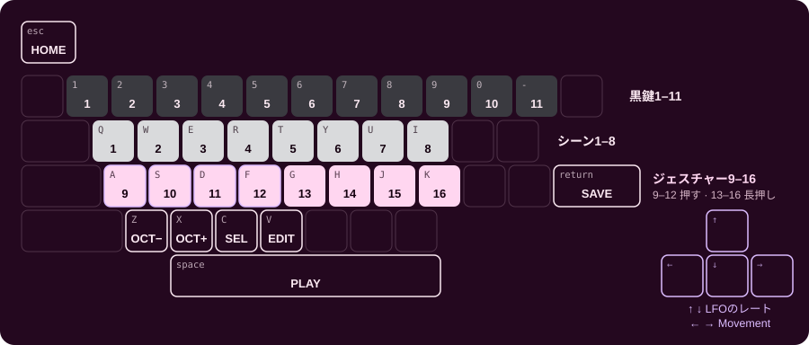

<!-- SPDX-License-Identifier: GPL-3.0-only -->

<!-- github -->
AIで翻訳したページです。英語版：[Playing in a browser](../../reference/browser.md)
<!-- /github -->

## ブラウザーで弾く {#playing-in-a-browser}

トップ・ページのエミュレーターでは、ファームウェアそのものが音付きで動きます。FM-1はいりません。

## マウス {#mouse}

[トップ・ページ](https://evanyerburgh.github.io/niagara-drift/ja/)で弾けます。

| 操作 | マウスで |
|---|---|
| **ノブを回す** | 上下にドラッグ、またはその上でスクロール |
| **ボタンやキーを押す** | クリックしたまま押さえる |
| **ボタンを押したまま**、ほかの操作をする | Shift+クリックまたは右クリック。もう一度クリックで離す |
| **白鍵の上をすべらせる** | 1つをクリックしたまま、横にドラッグ |

## パソコンのキー {#computer-keys}

キーを押したままにすると、指で押さえたときと同じように、そのコントロールを押したままになります。

| キー | FM-1では |
|---|---|
| **1 … 0, −** | 黒鍵1–11 |
| **Q … I** | シーンのキー1–8 |
| **A … F** · **G … K** | ジェスチャー・キー9–12 · 13–16 |
| **Space** · **Return** · **Esc** | PLAY · SAVE · HOME |
| **C** · **V** · **Z** · **X** | SEL · EDIT · OCT− · OCT+ |
| **↑ ↓** · **← →** | LFOのレート（SELECT） · Movement（ALGORITHM） |
| **Tab**、次に矢印 | どのノブでも、1つずつ |

## 補足 {#good-to-know}

- **ブラウザーでは押す強さがありません：**シーンのキーはタップだけになり（そのシーンへなめらかに移る）、押したままでも
  クロスフェードしません。ジェスチャー・キー9–12は、押したままにすると、そのジェスチャー自身の時間でいっぱいまで上がり、
  離すと下がります。FM-1では、これらのキーは押す強さに従います。
- **SAVE**は、サウンドをそのブラウザーに保存します。
- **コードを触る人へ：**`./emulator.command`で、手元のチェックアウトから同じページをビルドし、http://localhost:8765 で
  開けます。
