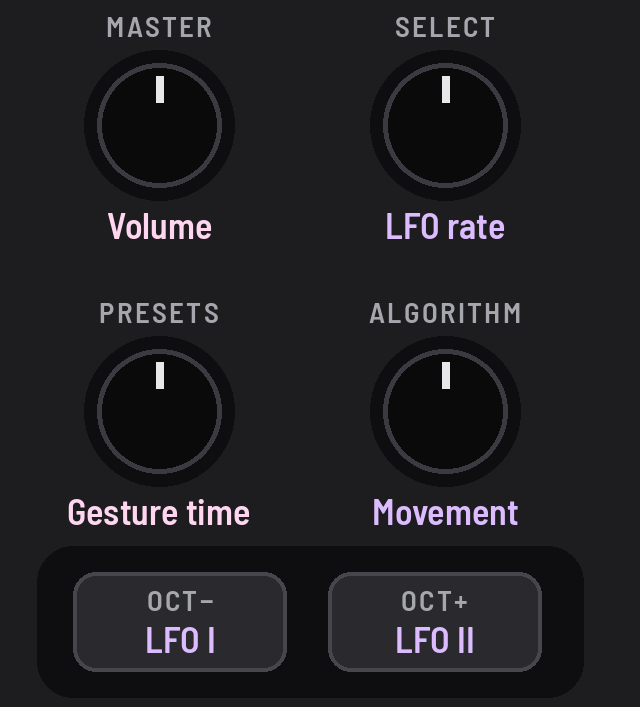
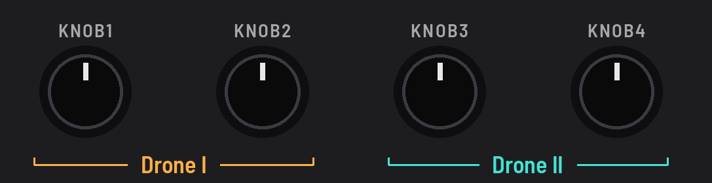
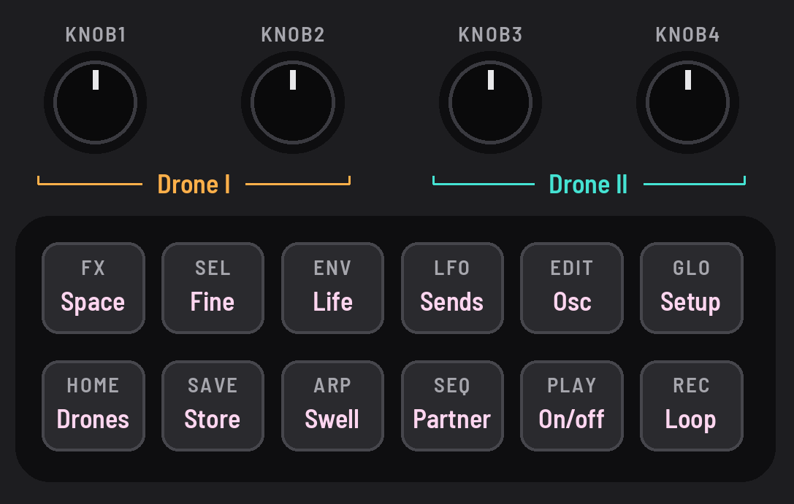
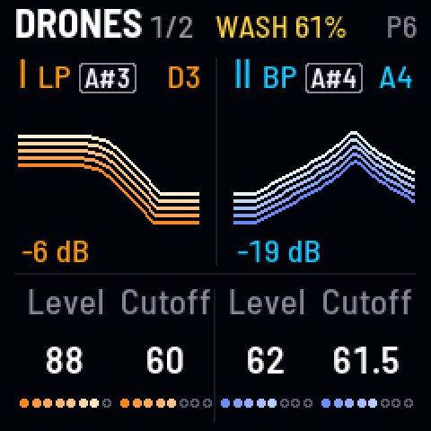

<!-- SPDX-License-Identifier: GPL-3.0-only -->

<!-- github -->
このページはAIによる翻訳です。ネイティブ・スピーカーによる確認はまだです。英語版：[Controls](../../reference/controls.md)
<!-- /github -->

## コントロール {#controls}

FM-1のノブとボタン、そして画面の上にあるヘッダーです。

## ノブ {#knobs}

| ノブ | 働き |
|---|---|
| **MASTER** | 音量。約5分の4を超えるとオーバードライブします。音量はほぼそのままで、厚みが増します |
| **SELECT** | LFOのレート |
| **ALGORITHM** | Movement：LFOがどれだけ音を動かすか |
| **PRESETS** | Gesture time：ジェスチャーが動く速さ |
| **KNOB 1–4** | ページに表示されているもの。ドローンのページでは、KNOB 1–2がドローン I、KNOB 3–4がドローン II |

## ボタン {#buttons}

| ボタン | 働き |
|---|---|
| [[HOME]] [[FX]] [[ENV]] [[LFO]] [[EDIT]] [[SEQ]] [[GLO]] [[ARP]] | それぞれのページを開きます。[[HOME]]は必ずDrones、[[FX]]は必ずSpaceを開きます。ほかのボタンは、そこで最後に使ったページを開きます。もう一度タップすると、もう一方のページへ |
| [[PLAY]] | ドローンをフェード・イン、フェード・アウトします |
| [[SAVE]] | サウンドを保存します |
| [[SEL]] | 押している間は細かいステップに。ほかのコントロールと組み合わせて、2つめの働きを呼び出します |
| [[REC]] | 動きを記録し、ループします |
| [[OCT−]] [[OCT+]] | LFO IとLFO IIの波形 |

## 画面のヘッダー {#screen-header}

| 位置 | 表示 |
|---|---|
| **左** | ページの名前、次に動いているもの：RECかLOOP、SWELL、ジェスチャー、I OUTかII OUT |
| **右** | サウンド：そのバンクとキー（「3.5」「P6 SEANCE」）。動かすと「changed」が付きます |

## 補足 {#good-to-know}

### ページと画面 {#pages-and-the-screen}

- **ページのボタンを押したままにすると、のぞけます。**ノブを回して離すと、元のページに戻ります（「let go: DRONES」）。
- **HOMEとFX**は必ずDronesとSpaceを開きます。ほかのボタンは、そこで最後に使ったページを開きます。
- **ドローンのページ：**Drones、Pitch、Tone、Osc、Sub · Drive、Partner、LFO sends。どれもドローン Iとドローン IIを
  それぞれの色で表示します。
- **シーンへ移っている途中は、**ヘッダーに行き先が金色で表示され（「→ P3 VESPERS」）、その下で金色の線が満ちていきます。

### ボタン {#buttons}

- **SEL + PLAY**でドローン IIだけ、**HOME + PLAY**でドローン Iだけがフェードします。もう一度で戻ります。停止中は
  PLAYがゆっくり明滅し、パネルのほかの部分は何も動きません。
- **SAVE**はすぐに保存します（演奏中は約50 ms音量が下がります）。保存していない変更があるときは、ほのかに光ります。
- **SEL**を押していると、ピッチのノブは1セントずつ、カットオフとレゾナンスは0.1ずつになります。押さえているジェスチャーやブレンドを、その深さでキープできるときに光ります。
- **REC：**タップで記録、タップでループ、タップで停止。最大5分で、時間はヘッダーに出ます。[レシピ](../recipes/performing.md#loop)を
  見てください。
- **OCT− / OCT+：**タップで次の波形、[[SEL]] + OCTで前の波形。それぞれのライトが、その波に合わせて脈打ちます。

### ノブ {#knobs}

- **どのノブもなめらかに動きます。**ゆっくり回すとなめらかなスイープ、速く回すとより大きく動きます。
- **MASTERでオーバードライブさせると、**ドローンのふくらみと沈みが平らになります。
