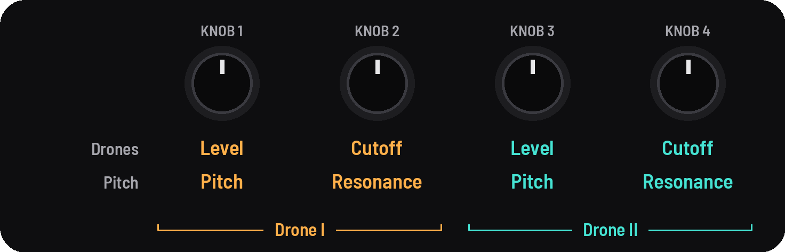
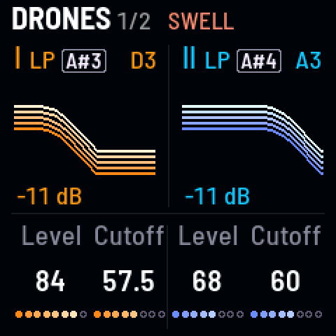
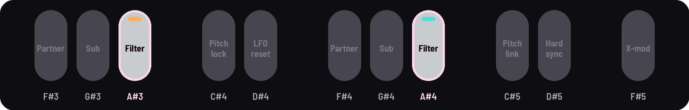
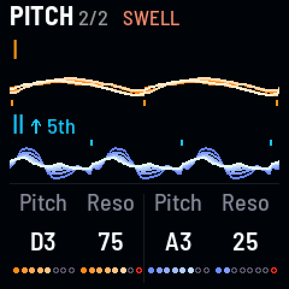
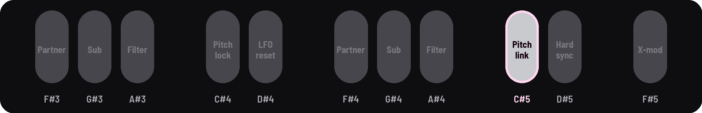

<!-- SPDX-License-Identifier: GPL-3.0-only -->

<!-- github -->
AIで翻訳したページです。英語版：[Drones and Pitch](../../reference/drones.md)
<!-- /github -->

## DronesとPitch {#drones-and-pitch}

演奏の中心になるページです。各ドローンのレベルとカットオフ、そしてピッチとレゾナンス。

## ノブ {#knobs}

[[HOME]]でDronesが開き、もう一度[[HOME]]でPitchが開きます。KNOB 1–2がドローン I、KNOB 3–4がドローン IIです。

## Drones {#drones}

| KNOB 1 | KNOB 2 | KNOB 3 | KNOB 4 |
|---|---|---|---|
| I level | I cutoff | II level | II cutoff |

| ノブ | 働き |
|---|---|
| **Level** | 各ドローンの音量。半分で約4分の1の大きさです |
| **Cutoff** | 各ドローンのフィルターを開いたり閉じたりします |

### フィルターのタイプ {#filter-type}

ローパス（LP）、バンドパス（BP）、ハイパス（HP）を黒鍵で選びます。ドローン Iは[[A#3]]、ドローン IIは[[A#4]]。

## Pitch {#pitch}

| KNOB 1 | KNOB 2 | KNOB 3 | KNOB 4 |
|---|---|---|---|
| I pitch | I resonance | II pitch | II resonance |

| ノブ | 働き |
|---|---|
| **Pitch** | 1.6 kHzから2 Hzまで、1クリックでTuningの1音。[[SEL]]を押しながらだと、ゆっくり回して1クリック1セント、速く回すと1クリック最大40セント：音と音の間を自由にすべります |
| **Resonance** | カットオフ周波数付近を強調します。最後の点は赤色で、そこではフィルターがひとりでに鳴ります（自己発振） |

### ピッチ・リンク {#pitch-link}

[[C#5]]でドローン IIをドローン Iにリンクします。するとドローン IIのピッチ・ノブで2つの間の音程を決めるようになります。

## 補足 {#good-to-know}

- **27 Hzより下では、**ドローンはクリックのパルスになります。スピーカーではそこまで低い音は出ないので、ヘッドホンで聴いてください。
- **ピッチは音から音へなめらかにすべるので、**一定の速さで回すと1つのスライドになります。
- **SELを押しながら速く回すと、**Tuningの音から離れて自由にすべります。ゆっくり回すと1セントずつ。止めたところが、
  細かいずれ（オフセット）になります。
- **細かいずれは残ります**（SELで+3セントにすると、音から音へ移っても+3のまま）。Tuningを変えるまで続き、「fine +3」と
  表示されます。
- **画面の絵：**Dronesでは、各フィルターのカーブ、その下にdB単位のレベル、右に音名。鳴っていないドローンは細いグレーの
  カーブになります。Pitchでは、1本の時間軸の上にドローン Iの波形、その下にドローン IIの波形があり、2つのピッチを並べて
  見られます。5度ではドローン Iの2周期にドローン IIが3周期、オクターブでは4周期です。
- **目盛り**は、波形の上下で各周期の始まりを示します。ドローン Iの目盛りはその波形の下、ドローン IIの目盛りはその波形の上に
  あり、2つの列が向かい合います。数えると音程がわかります（ドローン Iの2つにドローン IIの3つなら5度）。ユニゾンでは
  そろいます。
- **音程：**ドローン IIの名前の横に、ドローン Iからの音程が矢印を先にして表示されます（「↑ 5th」）。純正な音程から数セント
  ずれると、ドローン IIの波形がドローン Iの波形に対してゆっくりすべり、ずれが大きいほど速くなります。合っていれば止まって
  見えます。
- **Pitchでのレゾナンスとフィルターのタイプ：**レゾナンスを回している間、またはフィルター・キーをタップした少しの間、
  そのドローンのフィルター・カーブが画面いっぱいに大きくなり、もう一方のドローンはその下で薄れていきます。波形はカーブに乗り、
  レゾナンスの山で持ち上がります。その下の白い目盛りがカットオフの位置です。手を離すと、波形のところへすべり戻ります。
  フィルター・キーは、ドローンの名前の横にタイプとキーも表示します（「BP [[A#3]]」）。
