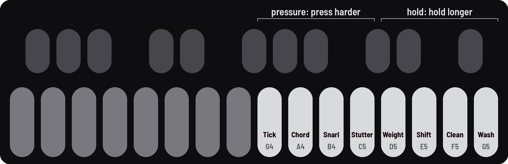

<!-- SPDX-License-Identifier: GPL-3.0-only -->

<!-- github -->
AIで翻訳したページです。英語版：[Gestures](../../reference/gestures.md)
<!-- /github -->

## ジェスチャー {#gestures}

マクロです。1つのキーで、いくつもの設定を、サウンドの上で、それぞれの順番で一緒に動かします。4つは押す強さに、
4つは押している長さに応えます。

> **元のサウンドはそのままです。**設定はジェスチャーの下でそのまま保たれ、ジェスチャーが抜ければ元どおりです。

### 押す強さのジェスチャー：キー9–12 {#pressure-gestures-keys-9-12}

強く押すほど、深くかかります。力を抜くと、また抜けていきます。

> **押す強さを感じるキー。**キー9–12は、押している間ずっと、どれだけ強く押しているかを感じ取ります（アフタータッチの
> ように）。打鍵の速さではありません。軽く押すと少し、しっかり押すといっぱいまで動きます。どれくらいで「いっぱい」になるかは、
> シーンのキーと同じく**Pressure**（[Setup 2](setup.md#setup-2)、KNOB 4）で決めます。

| キー | ジェスチャー | 働き |
|---|---|---|
| [[G4]] | **Tick** | サブが沈んでゆっくりしたクリックになります。強く押すと速くなり、細かく震える音に変わります |
| [[A4]] | **Chord** | パートナーが、Scale（Pitch moves）に沿ったうならない和音へ動きます。押すたびに違うボイシング |
| [[B4]] | **Snarl** | ドローン IIがデチューンし、Snarlが大きくなり、各ドローンのドライブが効いてきて、いちばん上でFeedbackが歌います |
| [[C5]] | **Stutter** | Swellがドローンを刻みます。深く、硬くなって、ゲートに |

### 長押しのジェスチャー：キー13–16 {#held-gestures-keys-13-16}

長く押すほど、深くかかります。離すと抜けていきます。

| キー | ジェスチャー | 働き |
|---|---|---|
| [[D5]] | **Weight** | 豊かで温かい低音：ドローンとサブが上がり、カットオフが少し下がり、各ドローンのドライブで丸みが出ます |
| [[E5]] | **Shift** | 新しい和音へ、1声ずつ：ドローン IがShift's move（Pitch moves）の分だけすべり、ドローン IIが続きます |
| [[F5]] | **Clean** | 音程はそのままで、クリーンなサウンドに：ざらつき、次に動き、次にエフェクトが抜けます |
| [[G5]] | **Wash** | ディレイ、そしてフリーズへと育っていくリバーブ。ドライの音がその中を出入りして呼吸します |

## 弾き方 {#playing-them}

### 長押し、または押す {#hold-or-press}

長押し、または押している間に入ってきます。押していたのと同じ時間をかけて、または力を抜くにつれて、抜けていきます。

### タップでラッチ {#tap-to-latch}

タップすると、いっぱいまで入ってそのまま残ります。もう一度タップすると解除されます。

### 好きな深さでラッチ {#latch-at-a-level}

押しながら[[SEL]]をタップします。その時点の深さでとどまります。

### Gesture time（PRESETS） {#gesture-time-presets}

すべてのジェスチャーが動く速さ：左で遅く、右で速く。

## 補足 {#good-to-know}

レシピ：[ジェスチャー](../recipes/gestures.md) · [クリックとチック](../recipes/sounds.md#ticks)

### 入り方と抜け方 {#in-and-out}

- **それぞれが自分の順番で抜けていきます。**Weightは明るさが先に戻り、サブが残ります。Shiftはドローン Iが先に戻ります。Cleanは
  エフェクトが先に戻ります。Washはドライの音が先に戻り、残響が鳴り続けます。
- **Gesture time：**最大12倍遅く、または4倍速く。真ん中がそれぞれ自身の時間です（Weight 2.8秒、Shift 3.9秒、CleanとWash
  3.3秒、押す強さのジェスチャー6.5秒）。画面にはWeightの時間が出ます。
- **すでに動いているジェスチャーにも効きます。**速く入れて、離して、遅くすると、ゆっくり抜けていきます。
- **長いジェスチャーには、**キーをタップします。ひとりでに入ってきます。

### パネルと画面 {#on-the-panel-and-the-screen}

- **キーのライト：**ジェスチャーのキーは、弾くまでは消えています。弾くと、ジェスチャーが入っている深さに応じて点灯し、
  抜けるにつれて薄れていきます。ラッチしたものは、その深さで点灯したままです。
- **[ヘッダー](controls.md#screen-header)**には、最後に弾いたものと、その深さ（「WASH 40%」）、または「latched」が出ます。
  シーンはどれがラッチされていたかを覚えています。シーンをタップすると、それらが戻ってきます。
- **パネル上のペア：**キー9–12はそれぞれ、4つ右のキーとペアになっています。TickとWeightは低音、ChordとShiftはピッチ、Snarlは
  Cleanが取り除くざらつきを加え、StutterとWashは時間。

### サウンドのほかの部分と {#with-the-rest-of-the-sound}

- **LFOは、**ジェスチャーが動かしているパラメーターにはかからなくなります。そのためMovementで揺れることはありません。
- **Chord**はTuningの音に従います。**Clean**は音の大きさを保ちます。
