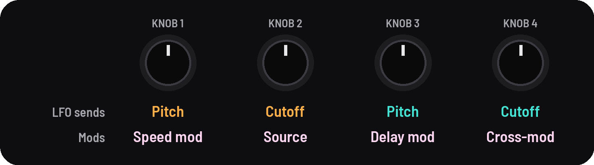
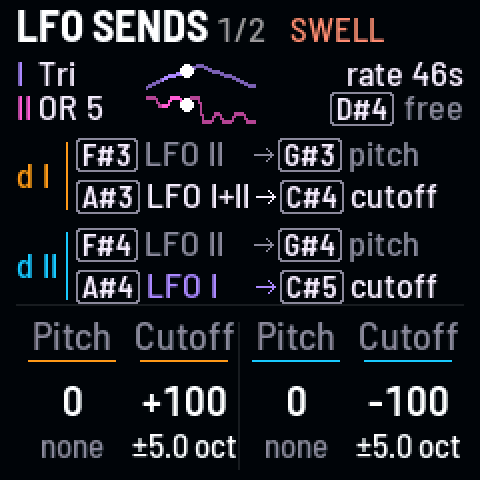
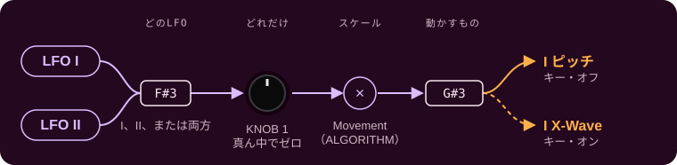
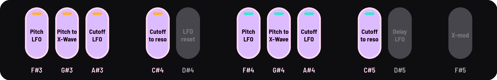
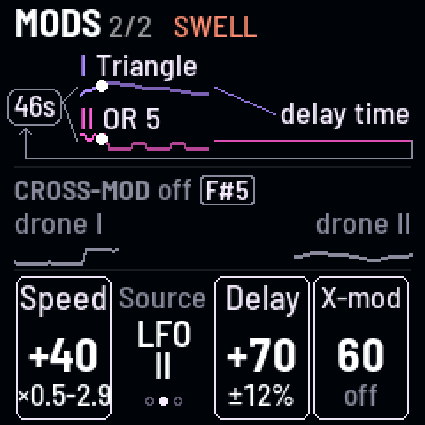
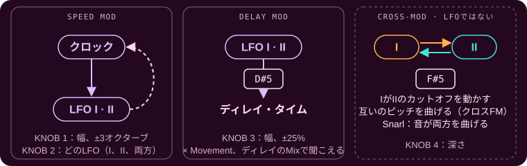
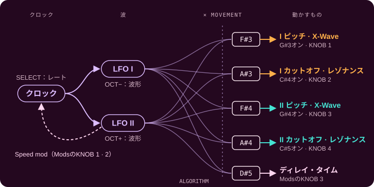

<!-- SPDX-License-Identifier: GPL-3.0-only -->

<!-- github -->
AIで翻訳したページです。英語版：[LFO sends and Mods](../../reference/lfo-pages.md)
<!-- /github -->

## LFO sendsとMods {#lfo-sends-and-mods}

LFOの行き先と、ほかに動かすものです。

## ノブ {#knobs}

[[LFO]]でLFO sendsが開き、もう一度[[LFO]]でModsが開きます。LFOのレートと波形は左のノブにあります。[LFO](lfo.md)を見てください。

## LFO sends {#lfo-sends}

| KNOB 1 | KNOB 2 | KNOB 3 | KNOB 4 |
|---|---|---|---|
| I pitch（またはX-Wave） | I cutoff（またはresonance） | II pitch（またはX-Wave） | II cutoff（またはresonance） |

| ノブ | 働き |
|---|---|
| **ピッチ・センド** | LFOがドローンのピッチを動かす幅。代わりにX-Waveを動かすこともできます（LFOページで[[G#3]]、[[G#4]]） |
| **カットオフ・センド** | LFOがドローンのカットオフを動かす幅。代わりにレゾナンスを動かすこともできます（LFOページで[[C#4]]、[[C#5]]） |

### センドのしくみ {#how-a-send-works}

それぞれのセンドは、次の順につながっています：どのLFOを、どれだけ、Movementでスケールして、何を動かすか。

ドローン Iのピッチ・センドです。カットオフ・センドも同じで、[[A#3]]、KNOB 2、[[C#4]]（カットオフかレゾナンス）を使います。
ドローン IIの2つは、自分のキーとKNOB 3、4を使います。

### どのLFOで、何を動かすか {#which-lfo-and-what-it-moves}

LFOページでは、各ドローンの4つの黒鍵で、センドごとのLFOと、動かすものを選びます。

## Mods {#mods}

| KNOB 1 | KNOB 2 | KNOB 3 | KNOB 4 |
|---|---|---|---|
| Speed mod | Source (LFO) | Delay mod | X-mod |

| ノブ | 働き |
|---|---|
| **Speed mod**（画面ではSpeed） | LFO自身の波の1つで、LFOの速さが上下それぞれ最大3オクターブ変わります |
| **Source** | どのLFOがスピードを動かすか：I、II、または両方 |
| **Delay mod**（画面ではDelay） | LFOがディレイのタイムを揺らす幅、最大±25% |
| **X-mod** | クロス・モジュレーションの深さ。モードは[[F#5]]で選びます。cutoff（ドローン Iがドローン IIのカットオフを動かす）、pitch（ドローンが互いのピッチを曲げる、クロスFM）、snarl |

### Modsのしくみ {#how-the-mods-work}

スピード・モジュレーションとディレイ・モジュレーションはLFOと一緒に動きます。クロス・モジュレーションは違います：
ドローンが互いを動かすものです。

## LFOの行き先 {#where-the-lfo-goes}

両方のページで、LFOが届くすべての場所です。それぞれのキーで、その場所に送るLFO I、II、または両方を選びます。
スピード・モジュレーションでは、波がクロック自体を速くしたり遅くしたりします。

## 補足 {#good-to-know}

### センド {#sends}

- **LFOページの黒鍵すべて：**[黒鍵](black-keys.md#lfo-keys)を見てください。
- **各センドの値の下に、**実際に聞こえる振れ幅が、Movementを含めて表示されます（「±12c」「±3.6 oct」）。
- **X-Waveとレゾナンスでは、**100で全範囲をスイープし、端で折り返すので動き続けます。
- **Movement**（ALGORITHM）は、センドとディレイ・モジュレーションをスケールします。スピード・モジュレーションと
  クロス・モジュレーションはスケールしません。
- **レートの位置に「mvmt 0%」：**Movementが0なので、何も動きません。

### Mods {#mods}

- **ディレイ・モジュレーション**は、ディレイのミックスがあるときだけ聞こえます。その波はLFOページの[[D#5]]で選びます。
- **クロス・モジュレーションのモード**（画面の名前で）：*cutoff*（ドローン Iの音がドローン IIのフィルターを動かす）、
  *pitch*（それぞれのドローンが互いのピッチを曲げる。荒い音から金属的な音まで）、*snarl*（最終的な音が両方を曲げる：グロウル）。
- **クロス・モジュレーション**は、設定したピッチのまわりで曲げます。ピッチそのものは動きません。

### 画面の絵 {#pictures}

- LFO sendsでは、各ドローンのセンドがキー付きの文で表示され（「[F#3] LFO II → [G#3] x-wave」）、その上に2つのLFO。
  Modsでは、LFOのクロックがLFO IとIIに送られる様子と、クロス・モジュレーションのモードとそのキー。
