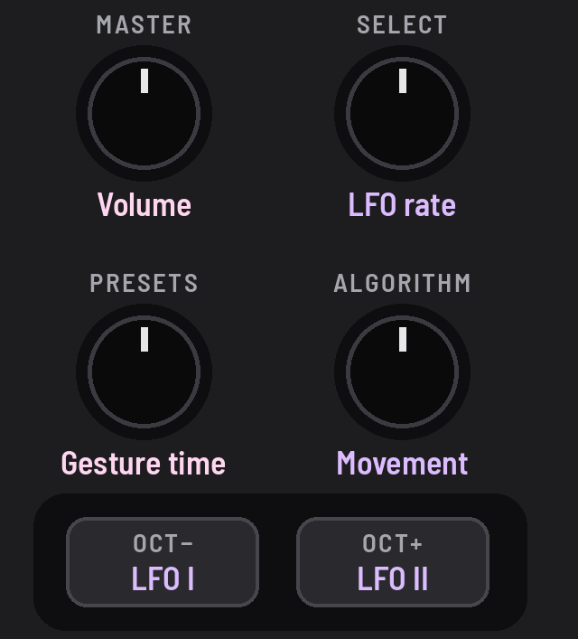

<!-- SPDX-License-Identifier: GPL-3.0-only -->

<!-- github -->
このページはAIによる翻訳です。ネイティブ・スピーカーによる確認はまだです。英語版：[LFO](../../reference/lfo.md)
<!-- /github -->

## LFO {#lfo}

2つの波（LFO IとLFO II）を持つ1つのクロックと、それがどれだけ聞こえるかを決めるMovementです。

## コントロール {#controls}

波の行き先は[LFOページ](lfo-pages.md)にあります。

### レート（SELECT） {#rate-select}

100秒に1周期から70 Hzまで。

### Movement（ALGORITHM） {#movement-algorithm}

すべてのLFOの深さをまとめて、止まった状態（0%）から2倍（200%）まで。

> **Movementは設定した量をスケールします。**設定した深さをスケールするだけです：0%では何も動かず、100%（真ん中）では
> 設定したとおりの深さになります。

| Movementがスケールするもの | Movementが変えないもの |
|---|---|
| **LFO sends：**4つすべて | **Mods：Speed mod** |
| **Mods：Delay mod**（ディレイの揺れ） | **Mods：X-mod**（クロス・モジュレーション：LFOではなく音そのもの） |
| | レート、波形、波の行き先 |

### 波形（OCT−とOCT+） {#shapes-oct-and-oct}

LFO IとLFO IIの波：タップで次の波形へ。

| LFO I | LFO II |
|---|---|
| Off | Off |
| Triangle | Tri 90 |
| Square | Square 90 |
| Saw | Exp saw |
| Roundtooth | Log tri |
| 2x Tri | 2x Saw |
| 2x Exp | 2x Pattern |
| 4x Pattern | 4x Exp |
| Random | Rnd glide |
| AND 3 | AND 5 |
| OR 3 | OR 5 |

## 補足 {#good-to-know}

### レートと波形 {#rate-and-shapes}

- **レート：**回せる範囲の大部分は100秒から10秒で、1クリック1秒です。遅いレートでは1周期の長さが表示されます
  （「21s」「1m40」）。
- **波形：**[[SEL]] + OCTで前に戻ります。それぞれのライトが、その波に合わせて脈打ちます。
- **ANDとOR**は、2つの矩形波を組み合わせたものです。一方はもう一方の3倍（LFO I）または5倍（LFO II）の速さです。ANDは2つの
  レベル、ORは4つのレベルの間をステップします：ドローンのピッチに送ると、2音または4音のパターンになります。

### Movementともう1つのノブ {#movement-and-the-other-knob}

- **聞こえない深さ**には、その理由が画面に出ます（Movementが0%、またはその波がオフ）。
- **PRESETS**（もう1つの左のノブ）はGesture timeです：[ジェスチャー](gestures.md)を見てください。
