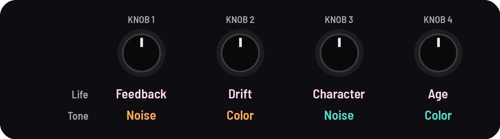
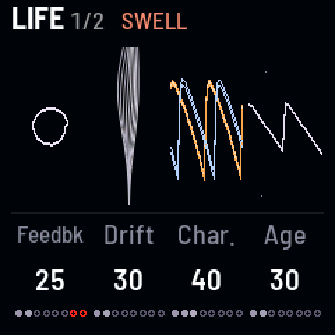
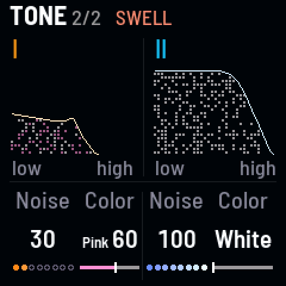

<!-- SPDX-License-Identifier: GPL-3.0-only -->

<!-- github -->
このページはAIによる翻訳です。ネイティブ・スピーカーによる確認はまだです。英語版：[Life and Tone](../../reference/life.md)
<!-- /github -->

## LifeとTone {#life-and-tone}

ドローンを生き生きと、そして使い込んだ音に保つもの。そして各ドローンのノイズです。

## ノブ {#knobs}

[[ENV]]でLifeが開き、もう一度[[ENV]]でToneが開きます。

## Life {#life}

| KNOB 1 | KNOB 2 | KNOB 3 | KNOB 4 |
|---|---|---|---|
| Feedback | Drift | Character | Age |

| ノブ | 働き |
|---|---|
| **Feedback**（画面ではFeedbk） | ディレイとリバーブを通った最終的な音を、ドローンに戻します：共鳴し、厚みを増す色合い。約70を超えると、ひとりでに歌い出します |
| **Drift** | ゆっくりしたランダムなモジュレーション：各ドローンのピッチ、カットオフ、波形、レベル、パートナーのデチューンが、設定した値のまわりをさまよいます。0ではすべて止まります |
| **Character**（画面ではChar.） | オシレーターを、クリーンからビンテージへ：やわらかいエッジ、曲がったノコギリ波、わずかなピッチの揺らぎ |
| **Age** | 古いテープのような劣化：暗くなり、少しヒスが乗り、ゆっくりしたワウとフラッター |

## Tone {#tone}

| KNOB 1 | KNOB 2 | KNOB 3 | KNOB 4 |
|---|---|---|---|
| I noise | I color | II noise | II color |

| ノブ | 働き |
|---|---|
| **Noise** | オシレーターと並べて鳴らすノイズの量：100でノコギリ波と同じレベル。ドローンのフィルターを通ります |
| **Color** | ホワイト（左）からピンク（右）へ |

## 補足 {#good-to-know}

- **Feedback**はキーに合って、ドローン Iの倍音で鳴ります。歌い出しても、音の大きさはほぼ変わりません。
- **Age**は約20秒かけてかかり、同じくらいゆっくり抜けていきます。Characterはオシレーター自身の劣化、Ageはテープの劣化です。
- **Noise**はフィルターの中にあるので、カットオフ、レゾナンス、LFO、Driftに従います。
- **画面の絵：**Lifeでは、Feedbackは輪（歌い出すと外側が赤に）、Driftは炎、Characterは手描きになっていく波形、Ageは
  すり減ったノコギリ波。Toneでは、各ドローンのノイズが、聞こえる大きさの高さの雪として表示されます。
