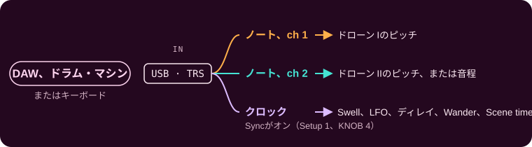
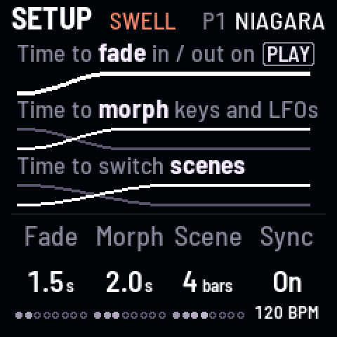
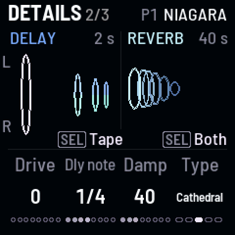

<!-- SPDX-License-Identifier: GPL-3.0-only -->

<!-- github -->
このページはAIによる翻訳です。ネイティブ・スピーカーによる確認はまだです。英語版：[MIDI](../../reference/midi.md)
<!-- /github -->

## MIDI {#midi}

USBまたはTRSジャックから、ノートでドローンをチューニングし、クロックでテンポに合わせます。

## メッセージ {#messages}

| メッセージ | 働き |
|---|---|
| **ノート、チャンネル1** | ドローン Iをそのノートにチューニングします |
| **ノート、チャンネル2** | ドローン IIをチューニングします。Pitch linkがオンなら音程を設定します |
| **クロック** | ドローンをテンポに合わせます：約2拍で同期します（「120 BPM」） |
| **スタート** | Swellをすぐにいちばん上に戻します。LFOは自分の位置へなめらかに戻ります |
| **ストップ**、**コンティニュー** | 無視します：クロックが来なくなっても、すべて最後のテンポで続きます（「keeps 120」） |

## Sync {#sync}

Setup 1、KNOB 4：**On**でクロックに従い、**Off**で無視します。その下に、クロックの状態が出ます：

| Syncの下 | 意味 |
|---|---|
| **120 BPM** | そのテンポのクロックに従っています |
| **keeps 120** | クロックが止まりました。最後のテンポで続いています |
| **no clock** | Syncはオンですが、何も来ていません |
| **free time** | Syncはオフ：ドローンは自分の時間で動きます |

## クロックに合わせて {#on-a-clock}

Syncがオンのとき、クロックに従うもの：

| 対象 | クロックに合わせて |
|---|---|
| **Swell**（そのページのKNOB 1） | **Division**ごとに1呼吸：32小節から1/4まで |
| **LFO**（SELECT） | 1つの分割ごとに1周期：32小節から1/16まで（「LFO CYCLE」） |
| **ディレイ**（DetailsのTime） | **音符の長さ**：1/16、1/8T、1/8、1/4T、1/8D、1/4、1/2T、1/4D、1/2、1/2D、1小節 |
| **Wander** | 音が拍の上に来ます（遅いときは小節の頭に）。選ばれる音はランダムのまま |
| **Scene time**（Setup 1） | **小節**単位：1、2、4、8、16。シーンの切り替えが小節線で終わります |

## 補足 {#good-to-know}

レシピ：[MIDIクロックに合わせて弾く](../recipes/performing.md#clock)

### ノート {#notes}

- **ノートはピッチ・ロックがオンでもチューニングします。**ドローンをスタート・ストップはしません。ノート・オフ、
  ベロシティ、ほかのチャンネル、コントローラー（CC）は無視します。

### クロック {#clock}

- **Syncがオフ**のときは、クロックとスタートを無視します。ノートでのチューニングは効きます。
- **クロック**は20 BPM以上が必要です。
- **揺れのあるクロック**はならされ、どれだけ長く続いても、そこからずれていくことはありません。
- **同期している間は、**シーンでSwellのオン・オフとDivisionは変わりません。
- **ディレイの音符の長さ**がディレイに入る長さより長いときは、半分になります。
- **Logicでは：**ファイル → プロジェクト設定 → 同期 → MIDIで、FM-1のクロックにチェックを入れます。

### 送り出すもの {#what-goes-out}

- **送り出すのは1つだけです：**USBで、FM-1は押す強さを感じるキー（シーンのキー1–8とキー9–12）を押す強さを、
  チャンネル1のポリフォニック・アフタータッチとして、そのキー自身のノートで送ります。DAWで記録したり、ほかのシンセを
  動かしたりできます。ノートとクロックは送りません。
