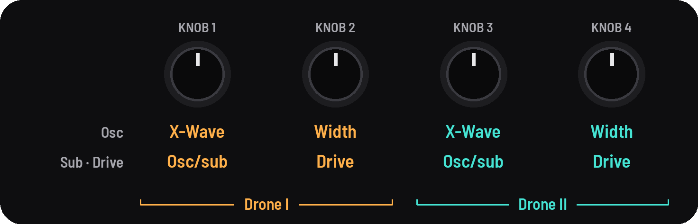
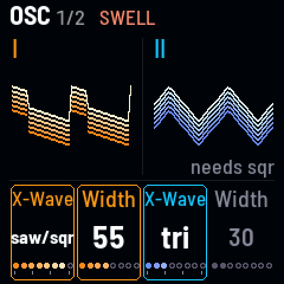
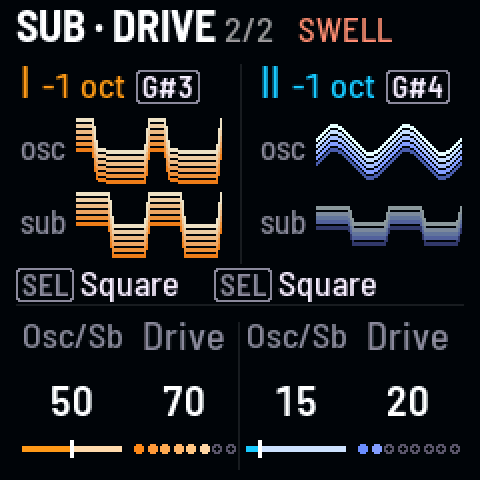
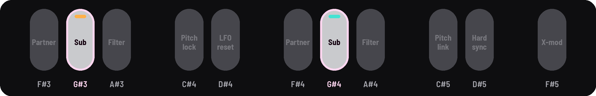

<!-- SPDX-License-Identifier: GPL-3.0-only -->

<!-- github -->
このページはAIによる翻訳です。ネイティブ・スピーカーによる確認はまだです。英語版：[Osc and Sub · Drive](../../reference/osc.md)
<!-- /github -->

## OscとSub · Drive {#osc-and-sub-drive}

各ドローンの波形、サブ・オシレーター、ドライブです。

## ノブ {#knobs}

[[EDIT]]でOscが開き、もう一度[[EDIT]]でSub · Driveが開きます。KNOB 1–2がドローン I、KNOB 3–4がドローン IIです。

## Osc {#osc}

| KNOB 1 | KNOB 2 | KNOB 3 | KNOB 4 |
|---|---|---|---|
| I X-Wave | I Width（パルス幅） | II X-Wave | II Width |

| ノブ | 働き |
|---|---|
| **X-Wave** | サイン波 → 三角波 → ノコギリ波 → 矩形波となめらかに変えます |
| **Width** | 矩形波のパルス幅 |

## Sub · Drive {#sub-drive}

| KNOB 1 | KNOB 2 | KNOB 3 | KNOB 4 |
|---|---|---|---|
| I osc/sub（+ SEL：サブの波形） | I drive | II osc/sub（+ SEL：サブの波形） | II drive |

| ノブ | 働き |
|---|---|
| **Osc/Sub** | オシレーターとサブをクロスフェードします（ノブの表示は「Osc/Sb」） |
| **サブの波形** | [[SEL]]を押しながらOsc/Subを回します：Square、Sine、Triangle、Saw |
| **Drive** | ドローンをフィルターへ押し込みます |

### サブのオクターブ {#sub-octave}

黒鍵で、各ドローンのサブがオクターブとサブハーモニックを順に切り替わります：ドローン Iは[[G#3]]、ドローン IIは[[G#4]]。

## 補足 {#good-to-know}

- **サイン波と三角波は**少し大きめにしてあるので、小さなスピーカーでもよく聞こえます。
- **Widthには、波形に矩形波が必要です。**ないときはグレー表示になり、「needs sqr」と出ます。
- **サブのオクターブ**は、各ドローンの名前の横に表示されます（「-1 oct」）：−1、−2、⅓、⅕、−3、−4。
- **サブの波形：**Sineはヘッドホンでいちばん深く、小さなスピーカーではいちばん聞こえにくくなります。Sawはいちばん明るい音です。
  切り替えはなめらかに移ります。
- **画面の絵：**Oscでは各ドローンの波形。Sub · Driveでは、各ドローンのオシレーターとサブの帯が、その割合の大きさで、
  ドライブで形を変えて表示されます。
