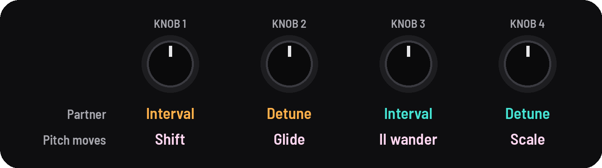
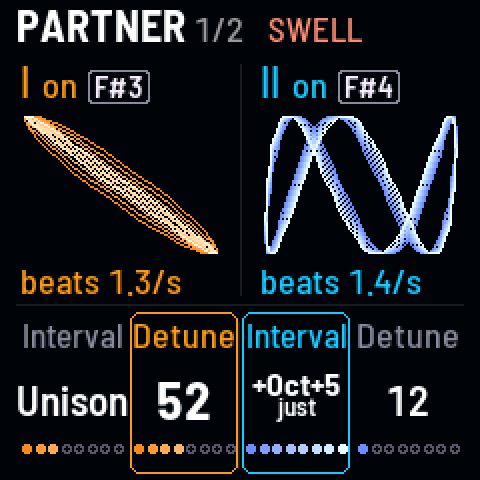
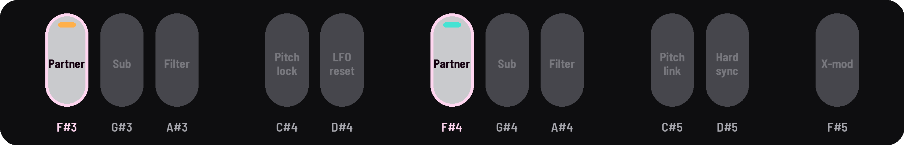
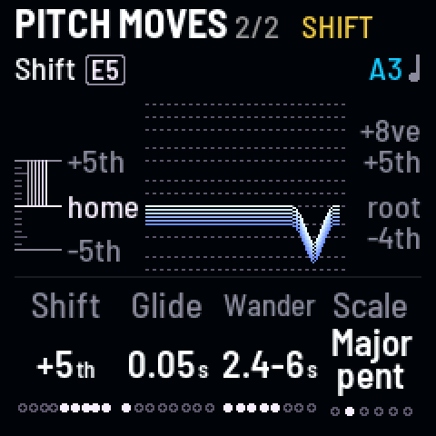

<!-- SPDX-License-Identifier: GPL-3.0-only -->

<!-- github -->
このページはAIによる翻訳です。ネイティブ・スピーカーによる確認はまだです。英語版：[Partner and Pitch moves](../../reference/partner.md)
<!-- /github -->

## PartnerとPitch moves {#partner-and-pitch-moves}

各ドローンの2つめのオシレーターと、ドローンのピッチの動き方：Shift、グライド、Wander。

## ノブ {#knobs}

[[SEQ]]でPartnerが開き、もう一度[[SEQ]]でPitch movesが開きます。

## Partner {#partner}

| KNOB 1 | KNOB 2 | KNOB 3 | KNOB 4 |
|---|---|---|---|
| I interval | I detune | II interval | II detune |

| ノブ | 働き |
|---|---|
| **Interval** | 1オクターブ下から、1オクターブと5度上まで。それぞれ平均律か**just**（うならない純正な比） |
| **Detune** | 最大30セント。2つがうなるようにします |

### オンとオフ {#on-and-off}

黒鍵で各パートナーをオン・オフします：ドローン Iは[[F#3]]、ドローン IIは[[F#4]]。

## Pitch moves {#pitch-moves}

| KNOB 1 | KNOB 2 | KNOB 3 | KNOB 4 |
|---|---|---|---|
| Shift's move | Pitch glide | II wander | Scale |

| ノブ | 働き |
|---|---|
| **Shift's move** | Shiftジェスチャー（[[E5]]）がドローンを動かす先：5度下から5度上まで |
| **Pitch glide**（画面ではGlide） | ドローンが新しいピッチに着くまでの時間：最大10秒 |
| **Wander** | Scaleに沿った、ドローン IIのゆっくりしたランダムなメロディー。ノブで頻度を決めます。0でオフ |
| **Scale** | WanderとChordジェスチャーのためのスケール：マイナー・ペンタトニック、メジャー・ペンタトニック、5度とオクターブ、全音音階、ドリアン、純正（just） |

## 補足 {#good-to-know}

### Partner {#partner}

- **純正な音程**はうなりません。Detuneでわざとうなりを加えます。ほかのTuningでは、音程はそのTuning自身のものになり、
  その書き方で名前が付きます（「+11\19」「+3/2」）。[Tuningでの音程](setup.md#intervals-on-a-tuning)を見てください。
- **パートナーがオフのとき：**Detuneはグレー表示になり（「needs [F#3]」）、回している間はキーが点滅します。

### Pitch moves {#pitch-moves}

- **Shift's move**は1クリックでTuningの1音（「+5th」「+m3」）、[[SEL]]を押しながらだと1クリック1セント動きます。
- **Wander**はドローン IIのピッチから1オクターブ以内にとどまり、ときどき元の音に戻ってきます：ノブがいちばん下で25–30秒ごと、
  いちばん上で0.5–2秒ごと。Pitch glideでその音がすべります。
- **Just**（Scaleの）は、ドローン Iの第1–8倍音です。Scaleの音はTuningに従います。

### 画面の絵 {#pictures}

- Partnerでは、各ドローンとそのパートナーが結び目として表示され、うなりに合わせて転がります（「beats 2.0/s」）。Pitch moves
  では、左にShiftの動き、右にドローン IIの直近4つのWanderの音。
