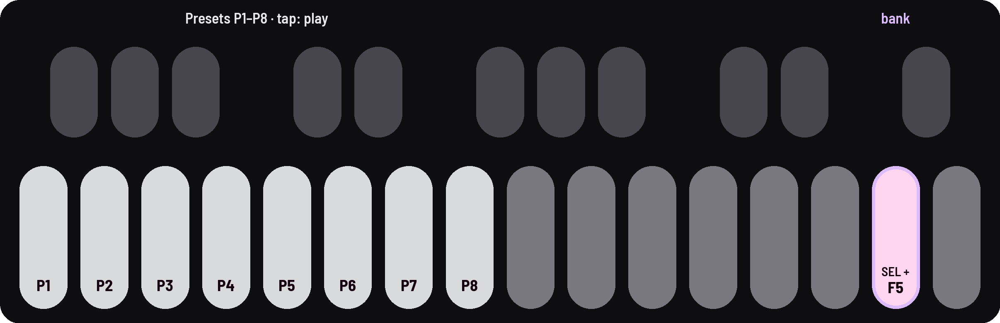
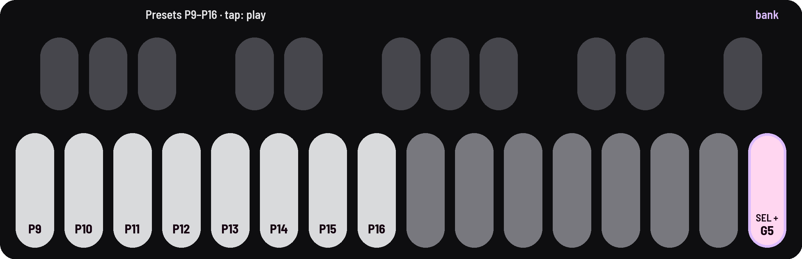

<!-- SPDX-License-Identifier: GPL-3.0-only -->

<!-- github -->
AIで翻訳したページです。英語版：[Presets](../../reference/presets.md)
<!-- /github -->

## プリセット {#presets}

Niagara Driftに入っている16種類のサウンドです。それぞれが違う一面を見せ、1分かけて変わっていきます。白鍵1–8に、8つずつ
2つのバンクで入っています。

### P1–P8 {#p1-p8}

[[SEL]]を押しながら[[F5]]をタップしてこのバンクにし、白鍵1–8をタップします。

| キー | プリセット | 聴きどころ |
|---|---|---|
| P1 | **Niagara** | 起動時のサウンド：5度離れたDとA、ゆっくり呼吸する |
| P2 | **Embers** | Dとその上の純正の3度。三角波がノコギリ波へとふくらんでは戻り、2つのドローンが交互に。Chorus hallのリバーブ |
| P3 | **Vespers** | 歌う「アー」に近いバンドパスを通したノコギリ波。波形がゆっくり変わり、穏やかなSwell（トレモロ）、明るいCathedralリバーブ |
| P4 | **Dreamhouse** | Harmonics Tuningで：A1とその第7倍音、純正の5度を含むサイン波。レゾナンスがふくらみ、少しのフィードバック |
| P5 | **Abyss** | 暗い：短3度下のBの上にD、ノコギリ波と細い矩形波、サブハーモニックのサブ、閉じたレゾナントなフィルター、CharacterとFeedback、暗いHallリバーブ。レゾナンスがふくらんで鳴り、Swellが潮のようにすべてをゆっくり沈める |
| P6 | **Seance** | Lou HarrisonのTuningで：うつろな低音（Dとその下の5度）の上に、かすかなノイズを含むバンドパスの高い声。ドローン Iがドローン IIのフィルターを動かし、長く揺れるエコー、Chorus hallのリバーブ。高い声がまれにさまよう |
| P7 | **Sonar** | 2.7 Hzまで下げたドローン I。1周期ごとのクリックがディレイを通って響き、ドローン IIのレゾナントなフィルターがスイープしながら歌う |
| P8 | **Sibyl** | 声：D4とF♯5、純正の3度と5度を含むサイン波。それぞれの波形が「アー」に変わり、穏やかなSwell、明るいCathedralリバーブ |

### P9–P16 {#p9-p16}

[[SEL]]を押しながら[[G5]]をタップしてこのバンクにし、白鍵1–8をタップします。

| キー | プリセット | 聴きどころ |
|---|---|---|
| P9 | **Howl** | 低い、半音離れたDとE♭がきしみ合う。フィードバックは高く、ドローン IIはバンドパス。ランダムなLFOが数秒ごとにフィルターをぱっと開かせる |
| P10 | **Cistern** | 貯水槽の中のリード：5度離れ、サイン波のサブで丸みを持たせたドローン I。ふいごのようなSwell、1秒のテープ・ディレイ、Shimmerリバーブ |
| P11 | **Piston** | 低いDが1秒に約1回、全音上がっては戻り、ドローン IIのフィルターを動かす。ゆっくりしたSwell |
| P12 | **Ashram** | Shruti TuningのE♭で鳴る温かいオルガン：サイン波のサブの上にフィルターを通したパルス、約24セント高い2つめの声、ドリアンでさまよう低音、Chorus hallのリバーブ |
| P13 | **Telegraph** | 低いDの上で、ドローン IIのピッチとフィルターにステップするフレーズ。20秒ほどごとに、フレーズ全体が新しい音へ移る |
| P14 | **Tape** | 使い古された音：DとF、幅の広い矩形波とノコギリ波、AgeとたっぷりのCharacter、テープのワウ、テープ・ディレイ、ヒス、ゆっくりとした、くたびれたSwell |
| P15 | **Falling** | La Monte YoungのTuning（LMY）で：E4とG3のサイン波。フィルターがゆっくり開き、高音が落ちながらすべっていく。フィードバック、ゆっくりさまよう低音 |
| P16 | **Bare** | オシレーター1つ、ほかはすべてオフ：組み立てるためのシンプルなノコギリ波。ドローン IIは鳴っていません（II OUT）：SEL + PLAYで入ってきます |

## 補足 {#good-to-know}

- **ピッチ・ロック**（[[C#4]]）は、新しいFM-1ではオンで始まります。プリセットを変えても、今のピッチのままです。オフにすると、
  それぞれ自分の音で聴けます。プリセットのTuningは、どちらでも一緒に読み込まれます。
- **プリセットは固定です。**変更を残すには、自分のバンク1から6に保存します（[レシピ](../recipes/scenes.md#save)）。
- **ほとんどがDを根音にしています。**そのため、プリセットの間を移っても根音は変わりません。
- **いちばん大きいところはP1にそろえてあります。**Bareはわざと小さめです。
