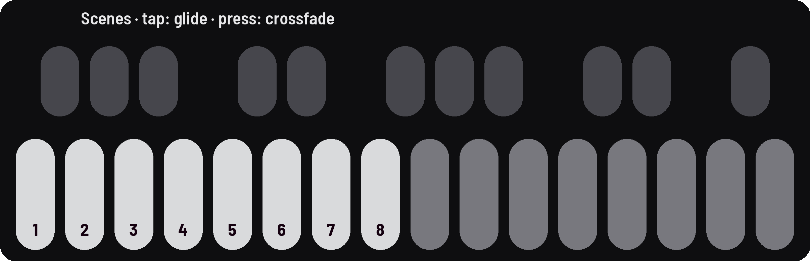
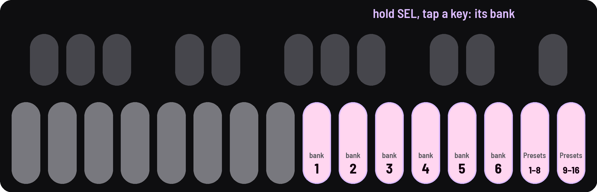

<!-- SPDX-License-Identifier: GPL-3.0-only -->

<!-- github -->
このページはAIによる翻訳です。ネイティブ・スピーカーによる確認はまだです。英語版：[Scenes and banks](../../reference/scenes.md)
<!-- /github -->

## シーンとバンク {#scenes-and-banks}

白鍵は保存したサウンドを呼び出します。なめらかに移ったり、押す強さでクロスフェードしたりします。

## シーン {#scenes}

白鍵1–8にはシーン（保存したサウンド）が入っていて、その間を移っていきます。

> **シーンが残すもの。**サウンドとそのTuning。演奏環境の設定は残しません：Pressure、Stereo、Tune、Sync、ピッチ・ロック、
> Setupの時間はそのままです。

### 新しいシーンのキーをタップする {#tap-a-new-scene-key}

そのシーンへなめらかに移り、そこにとどまります。

### 新しいシーンのキーを押す {#press-a-new-scene-key}

押した分だけ、そのシーンへクロスフェードします。離すと、なめらかに戻ります。

### ブレンドを保つ {#keep-a-blend}

押しながら[[SEL]]をタップします。ブレンドがそのまま保たれます。

### 切り替える {#take-it}

いっぱいまで押して少し保ちます。離してもそのシーンにとどまります。

### 取り消す {#undo}

[[SEL]] + [[SAVE]]：前のサウンドに戻ります。もう一度押すと、取り消す前に戻ります。

## シーンのバンク {#scene-banks}

8つのシーンが入るバンクが8つあります。バンク1から6はユーザー用で、2つにプリセットが入っています。画面では、
自分のシーンはバンクとキーで（バンク3のキー5なら3.5）、プリセットは番号で（P5）表示されます。

### シーンを保存する {#save-a-scene}

[[SAVE]]を押しながら、キーをタップします。

> **SAVEを先に。**キーに触れる前にSAVEを押してください：先にキーを押すと、そのシーンが鳴ります。プリセットには
> 上書きできません。

### バンクを選ぶ {#pick-a-bank}

[[SEL]]を押しながらジェスチャー・キーをタップします。そのバンクのシーンを白鍵1–8で弾けるようになります。

| キー | バンク |
|---|---|
| [[G4]] | 1 |
| [[A4]] | 2 |
| [[B4]] | 3 |
| [[C5]] | 4 |
| [[D5]] | 5 |
| [[E5]] | 6 |
| [[F5]] | プリセットP1–P8 |
| [[G5]] | プリセットP9–P16 |

## 補足 {#good-to-know}

### シーンを弾く {#playing-scenes}

- **なめらかに移る時間**はScene time（Setup 1）です。ノブを回すと途中で止まります。
- **タップ**は、強さにかかわらず0.5秒以内に離したものです。
- **画面**には、押した深さ（「3.5 40%」）、保ったブレンドでは「KEPT」、なめらかに戻るときは「→ 3.5」と出ます。
- **キーのライト：**点灯しているキーにはシーンが入っています。今のシーンのキーは、何かを変えるまでゆっくり点滅します。
- **キー9–16**は[ジェスチャー](gestures.md)です。

### 0.2からアップデートした場合 {#from-0-2}

- **0.2から：**キー9–12のシーンは、空いているキー1–8に移りました。まず自分のバンクに、必要ならバンク4と5に（画面にその数が
  出ます）。上書きされるものはありません。0.3に残っていない0.2のプリセット（Eerie、Glass、Tanpura、Whistle、Cathedral、
  Metal）は、バンク6のキー1–6（6.1から6.6）に入っています。HeavenはSibylに、CleanはBareになりました。FeedbackはLifeの
  KNOB 1に、Cross-modはModsのKNOB 4に、TuneはSetup 2のKNOB 2に移りました。HOMEでDrones、FXでSpaceが開きます。
