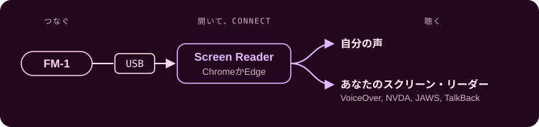
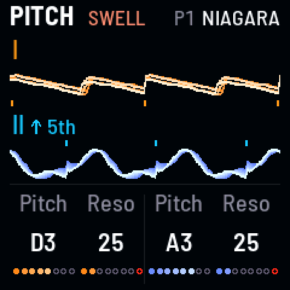

<!-- SPDX-License-Identifier: GPL-3.0-only -->

<!-- github -->
このページはAIによる翻訳です。ネイティブ・スピーカーによる確認はまだです。英語版：[Hearing your screen](../../reference/screen-reader.md)
<!-- /github -->

## 画面を聴く {#hearing-your-screen}

Niagara Driftは、画面が見えないプレイヤーのために、画面に表示されているものを読み上げられます。

## Screen Reader {#screen-reader}

Charles Vestalの[FM-1 Screen Reader](https://charlesvestal.github.io/fm1-reader/)は、それを読み上げるWebページです。
詳しいことや、読み上げられるほかのファームウェアについては、[そのガイド](https://github.com/charlesvestal/fm1-reader#readme)
（英語）を見てください。

1. FM-1をUSBでパソコンにつなぎます。
2. ChromeかEdgeでScreen Readerを開き、Connectをクリックします。
3. 聴きます：自分の声で読み上げるか、言葉をあなたのスクリーン・リーダー（VoiceOver、NVDA、JAWS、TalkBack）に渡します。

## 読み上げる内容 {#what-it-says}

ここに示したPitchページなら、開いたときにこう読み上げます：「Pitch page. Drone 1: Pitch D3, resonance 25. Drone 2: Pitch A3,
resonance 25.」

| いつ | 読み上げる内容 | 例 |
|---|---|---|
| **ページが開いたとき** | その名前とノブ | 「Pitch page. Drone 1: Pitch D3, resonance 25. Drone 2: Pitch A3, resonance 25.」 |
| **ノブを回したとき** | その名前と値 | 「Drone 1 resonance 28」 |
| **キーをタップしたとき** | 設定したもの | 「Drone 1 band-pass filter」 |
| **[[SEL]]を押しながら黒鍵に触れたとき** | その働きと、押すと何になるか。切り替えはしません | 「G sharp 3: drone 1 Sub, 1 octave down. Press for 2 octaves down」 |
| **PLAY、シーン、ジェスチャー** | 始まったもの、または移っている途中のもの | 「Play」「to Preset 2 embers」「wash」 |
| **尋ねたとき** | 画面のすべて：ページ、演奏中かどうか、サウンド | 開いたときのページの内容、続いて「Playing, on its way to Preset 3 vespers. Swell on.」 |

例は、Screen Readerが読み上げる言葉そのものです（英語）。あなたのスクリーン・リーダーでは、発音が異なることがあります。
