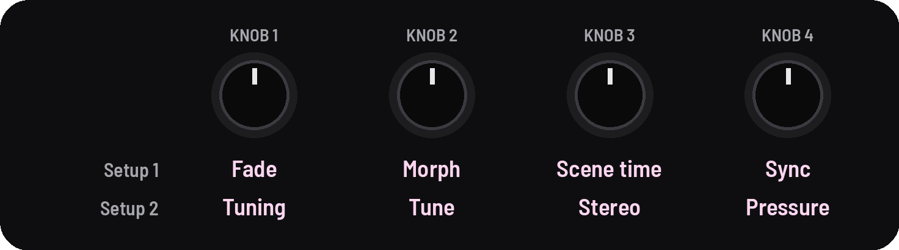
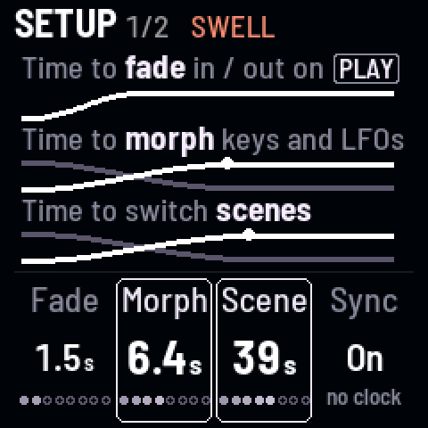
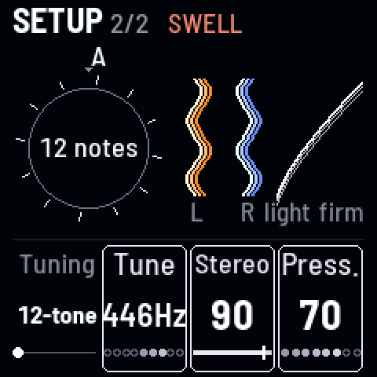

<!-- SPDX-License-Identifier: GPL-3.0-only -->

<!-- github -->
AIで翻訳したページです。英語版：[Setup](../../reference/setup.md)
<!-- /github -->

## Setup {#setup}

サウンドではなく、FM-1そのものの設定です。変化にかかる時間、クロック、Tuning、鍵盤のタッチ。

## ノブ {#knobs}

[[GLO]]でSetup 1が開き、もう一度[[GLO]]でSetup 2が開きます。これらはサウンドではなくFM-1に属する設定なので、
シーンでは変わりません（Tuningを除く）。

## Setup 1 {#setup-1}

| KNOB 1 | KNOB 2 | KNOB 3 | KNOB 4 |
|---|---|---|---|
| Fade | Morph | Scene time | Sync |

| ノブ | 働き |
|---|---|
| **Fade** | PLAYにかかる時間：最大60秒（初期設定は1.5秒） |
| **Morph** | 黒鍵や新しいLFOの波形が音を動かすのにかかる時間：0.02–30秒（初期設定は2秒） |
| **Scene time**（画面ではScene） | シーンの移動にかかる時間：0.1秒から5分（初期設定は約8秒） |
| **Sync** | **On**でMIDIクロックに従い、**Off**で無視します |

## Setup 2 {#setup-2}

| KNOB 1 | KNOB 2 | KNOB 3 | KNOB 4 |
|---|---|---|---|
| Tuning | Tune | Stereo | Pressure |

| ノブ | 働き |
|---|---|
| **Tuning** | ピッチのノブが通る音（[Tuning](#tunings)） |
| **Tune** | Aのピッチ：427から453 Hz（初期設定は440） |
| **Stereo** | モノラルから、ドローン Iが左・ドローン IIが右まで |
| **Pressure**（画面ではPress.） | シーンのキーを押す強さ：上げると軽いタッチ、下げるとしっかりしたタッチ |

## Tuning {#tunings}

11種類のTuning：12音と、ピアノの鍵盤の間の音を持つ10のマイクロトーナルなTuning。19、31、53音の平均律、純正律、倍音列、
インドのシュルティ、そしてLa Monte Young、Lou Harrison、Harry Partchのチューニングです。

> **サウンドにはTuningも含まれます。**LMYで保存したシーンは、ピッチ・ロックがオンでもLMYを呼び戻します。プリセットは、
> 自分のTuningを持っていなければ12音で鳴ります。Tuningは、シーンが移るちょうど半分のところで切り替わります。

| Tuning | 内容 |
|---|---|
| **12-tone** | 半音 |
| **Quarter** | 4分音 |
| **19-, 31-, 53-tone** | 平均律 |
| **Just** | 純正律（プトレマイオスの5リミット） |
| **Harmonics** | Aの奇数倍音1–15：ドローンを1つの倍音列の音として |
| **LMY** | La Monte Youngの『The Well-Tuned Piano』のためのチューニング |
| **Harrison** | Lou HarrisonのNational Steelギターのためのチューニング |
| **Shrutis**（画面ではShruti） | インド音楽の22のシュルティ |
| **Partch** | Harry Partchの、1オクターブ43音 |

### Tuningでの音程 {#intervals-on-a-tuning}

作曲家が書くとおりに名前を付けます。平均律ではステップ数（「11\19」）、それ以外では比（「3/2」「7/4」）。ただし、
聞こえる音程との差が10セント以内のときだけで、それ以外はなじみのある名前（「5th」）になります。

## 補足 {#good-to-know}

### ノブ {#knobs}

- **時間のノブ**は、回せる範囲の大部分を遅い時間に使っています。約4分の1のところで1秒です。
- **Sync**の下にクロックの状態が出ます。「no clock」「120 BPM」「keeps 120」（止まっていて、最後のテンポを保持）、
  「free time」。
- **Tune**は1クリック1 Hz、[[SEL]]を押しながらだと0.1 Hz動きます（「432Hz」）。
- **ドローンが1つだけ鳴っているとき**は、Stereoの設定にかかわらず中央に置かれます。
- **スピーカー**には、出せない低音のためのローカット（約120 Hz）がかかります。ヘッドホンをつないでいる間はオフです。
  ヘッドホンには聞こえる範囲よりずっと下（12 Hz）のローカットがかかり、いちばん低いサブやTickの拍で、音がリミッターにかからない
  ようにしています。

### Tuning {#tunings}

- **JustとShrutiはドローン Iと一緒に動きます**（移動ド）：そのピッチ・ノブで主音を選びます。ほかのTuningはAの上に作られて
  いるので、Tuneで動きます。La Monte Youngの1/1はC、Lou HarrisonとHarry PartchのものはGです。
- **Wander、Chord、パートナーの音程、Shift**は、Tuningの音を使います。

### 画面の絵 {#pictures}

- Setup 1では、時間ごとに1列で、ノブの位置で終わります。Setup 2では、Tuningが輪として、1音に1つの目盛りで表示され、
  Tuneで回ります。
