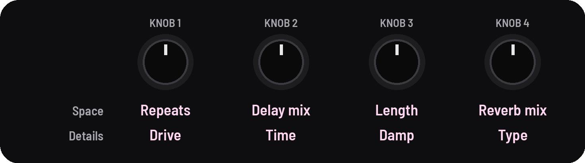
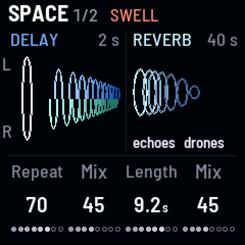
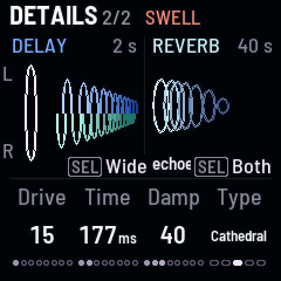

<!-- SPDX-License-Identifier: GPL-3.0-only -->

<!-- github -->
このページはAIによる翻訳です。ネイティブ・スピーカーによる確認はまだです。英語版：[Space and Details](../../reference/space.md)
<!-- /github -->

## SpaceとDetails {#space-and-details}

エフェクトです。6つのタイプがあるディレイ、ドライブ、5つのタイプがあるリバーブ。

## ノブ {#knobs}

[[FX]]でSpace（演奏中に動かす量）が開き、もう一度[[FX]]でDetails（演奏の前に決めておくもの）が開きます。

| ページ | KNOB 1 | KNOB 2 | KNOB 3 | KNOB 4 |
|---|---|---|---|---|
| Space | ディレイのリピート | ディレイのミックス | リバーブの長さ | リバーブのミックス |
| Details | ドライブ（ディレイの後） | ディレイのタイム · SEL：ディレイのタイプ | リバーブのダンプ | リバーブのタイプ · SEL：リバーブに入れるもの |

## ディレイ {#delay}

| ノブ | 働き |
|---|---|
| **Repeats**（画面ではRepeat） | エコーの数。約85を超えると暴走し、自己発振します |
| **Mix** | エコーの大きさ |
| **Time** | 70 msから1.45秒。回すと、テープのようにエコーのピッチが曲がります |
| **Type** | [[SEL]] + Time：6つから1つ（[ディレイのタイプ](#delay-types)） |
| **Drive** | ドローンとそのエコーを一緒に歪ませます。ゴースト・ノート、うなり、パチパチという音 |

### ディレイのタイプ {#delay-types}

シンプルなものから、いちばん生き生きしたものへ。

| タイプ | 聞こえるもの |
|---|---|
| **Clean** | 弾いたままのエコー、ワウなし：純正にチューニングしたドローンは止まったまま |
| **Wide** | 右側のエコーが、左側のタイムの4分の3で鳴る |
| **Ping-pong** | エコーが左右に跳ね返る |
| **Tape** | 温かく、穏やかなワウ。新しいサウンドの初期設定はこれです |
| **Grain** | 自分のエコーで揺さぶられるテープ |
| **Self** | エコーが大きくなるほどピッチがよれるテープ |

## リバーブ {#reverb}

| ノブ | 働き |
|---|---|
| **Length** | 0.3秒から40秒。いちばん上は**Inf**：フリーズ |
| **Mix** | リバーブの大きさ |
| **Damp** | 残響を暗くします |
| **Type** | 5つから1つ（[リバーブのタイプ](#reverb-types)） |
| **Into reverb** | [[SEL]] + Type：Both、Echoes、Drones |

### リバーブのタイプ {#reverb-types}

小さいものから大きいものへ、そして動く2つ。

| タイプ | 聞こえるもの |
|---|---|
| **Room** | 小さく、近い |
| **Hall** | ホール：より大きく、少し遠い |
| **Cathedral** | いちばん大きく、いちばん遠い。残響の始まりがいちばん遅い |
| **Chorus hall** | 残響が揺れてきらめくホール。いちばん広い |
| **Shimmer** | 鳴っている音の1オクターブ上を加えたHall。約8秒かけて入ってくる |

## 補足 {#good-to-know}

### ディレイ {#delay}

- **Drive**はディレイの後、リバーブの前にあり、音の大きさを保ちます。最初の5分の1は少し混ざる程度で、そこから硬い
  クリップまで。
- **暴走したリピート**はソフト・クリップで抑えられます。[ヘッダー](controls.md#screen-header)に「runaway」と出ます。

### リバーブ {#reverb}

- **Into reverb：**Both（ドローンとそのエコー）、Echoes（ドローンはドライのまま）、Drones（エコーはドライのまま上に重なる）。
- **フリーズ**は中にあるものを保ちます（InfではDampは効きません）。PLAYで止めると解放されます。

### ディレイとリバーブ共通 {#both}

- **タイプを変えると**クロスフェードします。タイプのノブは両方向に一周します。
- **画面の絵：**Spaceでは、左にエコーが半円の輪、右にリバーブの残響が輪として表示されます。Detailsでは同じものに、
  TimeとTypeの上のSELの選択肢が加わります。
- ディレイとリバーブはChoralRootの設計です（[概要](../about.md#where-it-came-from)を見てください）。
