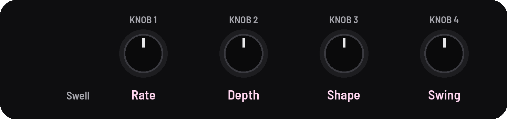
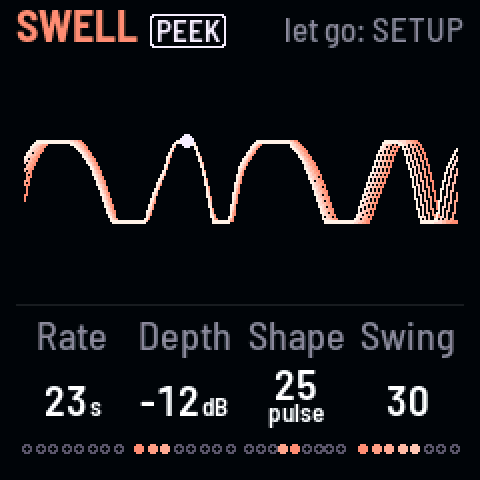

<!-- SPDX-License-Identifier: GPL-3.0-only -->

<!-- github -->
AIで翻訳したページです。英語版：[Swell](../../reference/swell.md)
<!-- /github -->

## Swell {#swell}

両方のドローンにかかるトレモロです。ゆっくりした呼吸から硬いゲートまで、単独でも、クロックに合わせても使えます。

## ノブ {#knobs}

[[ARP]]でSwellページが開きます。

| ページ | KNOB 1 | KNOB 2 | KNOB 3 | KNOB 4 |
|---|---|---|---|---|
| Swell | Rate（MIDIクロックではdivision） | Depth | Shape | Swing |

## コントロール {#controls}

このページで[[ARP]]をタップすると、スタート・ストップします。

| ノブ | 働き |
|---|---|
| **Rate** | 呼吸の速さ。MIDIクロックでは**Division**になります。32小節から4分音符まで |
| **Depth** | 沈む深さ、−30 dBまで。いっぱいまで回すと無音になります |
| **Shape** | 真ん中で**Even**（なめらかな呼吸）、右へ回すと**ramp**、左へ回すと**pulse**、さらに左で硬い**gate** |
| **Swing** | 1つおきの呼吸を長くします。最大3対1 |

## 補足 {#good-to-know}

- **起動時のサウンド**ではオンになっています。12 dBの深さの、ゆっくりした呼吸。[ヘッダー](controls.md#screen-header)には
  **on**、または**off · tap ARP**と出ます。
- **「ramp 100」：**上がる部分が、各呼吸の97%を占めます。
- **Swellに同期したLFO**（[[D#4]]を長押し）は、その小節ごとにリスタートするので、クロックにも従います。
- **画面の絵：**2小節、4呼吸が、今Swellがいる点で出会う糸として表示されます。
