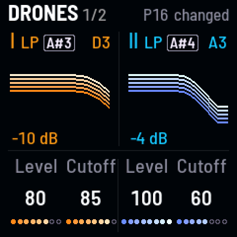
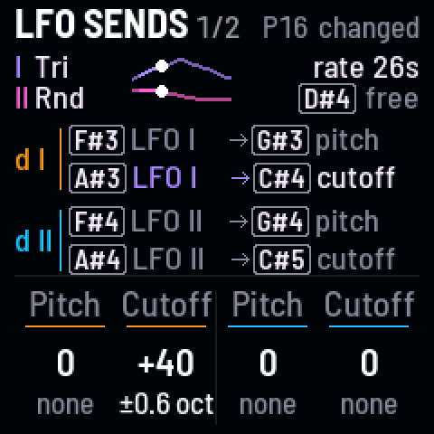

<!-- SPDX-License-Identifier: GPL-3.0-only -->

### Build up from Bare {#bare}

*One drone, everything off, then a control at a time*

Start from one plain oscillator with everything off, as on an analog synth, and build a sound up yourself: the second
drone, its interval, the sub, the LFO, the space.

1. Press [[SEL]] + [[G5]], tap white key 8 (**P16 Bare**), then [[PLAY]]: one saw, drone I, through an open filter.
   Wait for the gold line under the header to fill: Bare glides in over the Scene time.
2. Turn KNOB 2 on **Drones**, where you start: drone I's cutoff, down until the saw darkens.
3. Press [[SEL]] + [[PLAY]]: drone II comes in, a fifth above. Press [[HOME]] for **Pitch**, and turn KNOB 3 to tune
   it; the screen names the interval.
4. Press [[EDIT]] twice for **Sub · Drive**, and turn KNOB 1 to blend drone I toward its sub, an octave down.
5. Press [[LFO]] for **LFO sends**, and turn KNOB 2, drone I's cutoff send, up; then turn [[ALGORITHM]], Movement, up
   from 0%: the filter starts to breathe. Press [[FX]], and turn KNOB 2 for the echoes, KNOB 4 for the reverb.

> **Good to know.** On Bare, Movement starts at 0%, so no LFO send is heard until it comes up. Drift and Character
> ([[ENV]], KNOB 2 and 3) take the drones from still and clean toward alive and worn. Keep what you make: [[SEL]] +
> [[G4]] (bank A), hold [[SAVE]] and tap a white key.

**Listen** (`bare`)

- 0:00 P16 Bare: one plain saw, drone I
- 0:01 drone I's cutoff down: the saw darkens
- 0:04 drone II comes in, a fifth above
- 0:08 drone II tuned: a minor sixth, then back to the fifth
- 0:12 the sub blended in
- 0:17 a cutoff send, then Movement up from 0%: the filter starts to breathe
- 0:26 echoes and reverb
