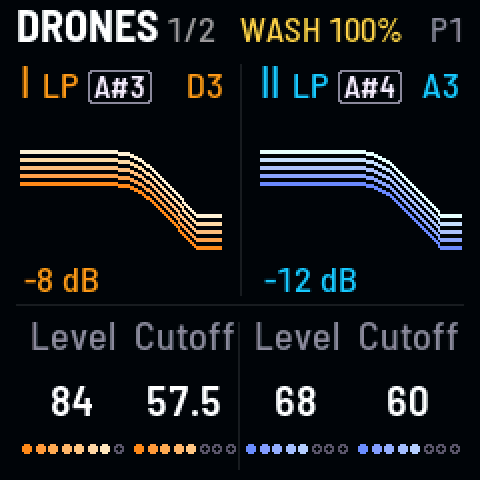
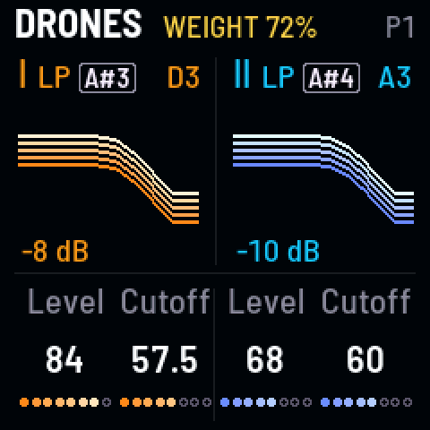
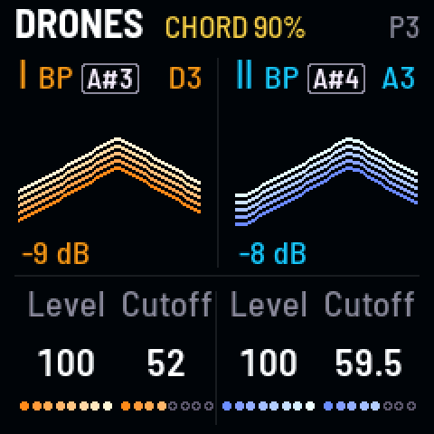
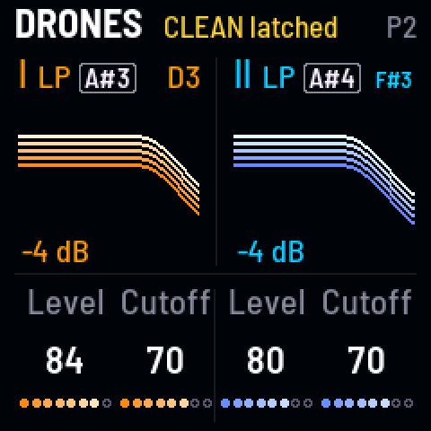
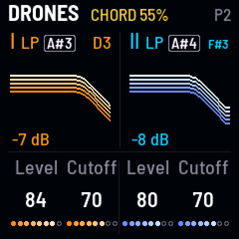
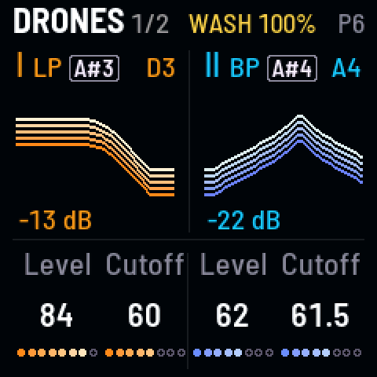
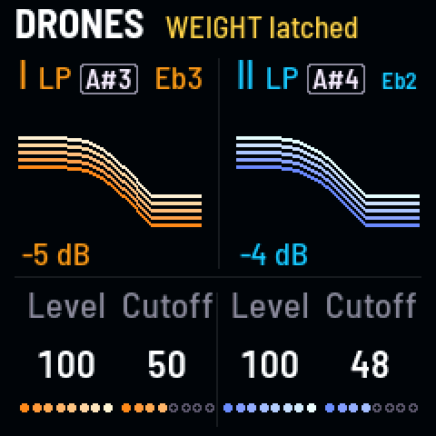
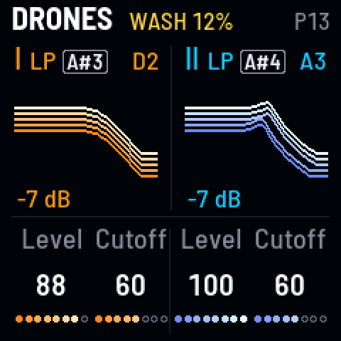

<!-- SPDX-License-Identifier: GPL-3.0-only -->

Gestures are macros: one key moves several settings at once. **PRESETS** sets how fast.

### Hold one in, let it go {#hold}

*Out as slowly as you held*

1. Hold **Wash**, [[G5]], a few seconds.
2. Let go: it leaves as slowly as you held it.

**Listen** (`g-hold`)

- 0:00 P1 Niagara as it starts
- 0:01 Wash held 4 seconds: the delay, then the reverb grows longer and darker, the dry dipping
- 0:05 let go: it leaves over as long as it was held, the dry back first, the tails last
- 0:10 Weight held 2 seconds: a fuller, warmer bass; let go and it leaves in 2

### Press harder for more {#press}

*Keys 9–12 follow your finger*

1. Press **Chord**, [[A4]], lightly, then harder: further in.
2. Ease off, and it comes back.

**Listen** (`g-press`)

- 0:00 P3 Vespers as it starts
- 0:01 Chord pressed lightly: the partners start to move toward a chord
- 0:04 pressed harder: further in, a full, beatless chord
- 0:08 eased off: it comes back toward where it was
- 0:11 let go: it goes

### Keep one {#keep}

*A tap, or SEL while holding*

1. Tap a gesture key: it comes all the way in and stays. Tap again to let it go.
2. Or hold one and tap [[SEL]]: it stays where it is.

**Listen** (`g-keep`)

- 0:00 P2 Embers as it starts
- 0:01 Clean tapped: it comes all the way in on its own and stays: the grit, the movement, then the effects leave
- 0:06 tapped again: it goes, the effects back first
- 0:10 Wash held, SEL tapped part way: it stays where it had got to

### Stack them for a climax {#stack}

*Snarl under Wash*

1. Press **Snarl**, [[B4]].
2. Hold **Wash**, [[G5]], too.

**Listen** (`g-stack`)

- 0:00 P6 Seance as it starts
- 0:01 Snarl pressed in: a growl under the sound
- 0:05 Wash held on top: the growl washes into the reverb, a climax
- 0:10 both let go: each leaves in its own order

### Make one last a minute {#minute}

*Gesture time slow, then a tap*

1. Turn **PRESETS** all the way left: **GESTURE TIME 33 s**.
2. Tap a gesture key: it comes in on its own.

**Listen** (`g-minute`)

- 0:00 P12 Ashram, Gesture time slow
- 0:01 Weight tapped: it comes in on its own, slowly, no key held

### In fast, out slow, or the other way round {#speed}

*Turn PRESETS after letting go*

1. Hold a gesture on a fast Gesture time, and let go.
2. Turn **PRESETS** left: it leaves slowly. (Or slow in, then fast out.)

**Listen** (`g-speed`)

- 0:00 P13 Telegraph, Gesture time fast
- 0:01 Wash held 2 seconds: in fast
- 0:03 let go, then PRESETS turned slow: the release stretches out, the reverb lingering
