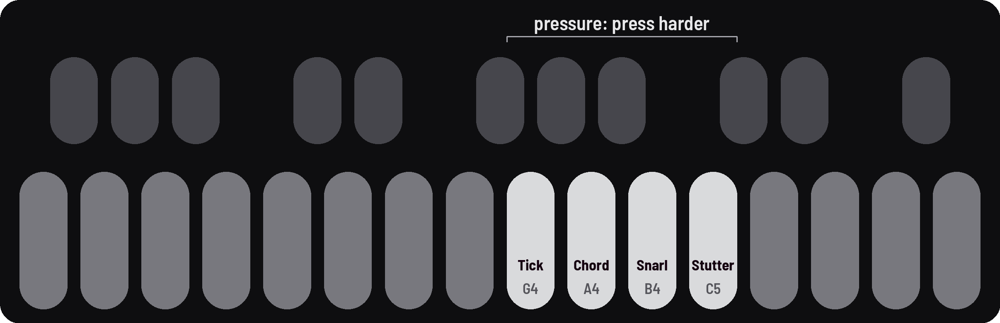
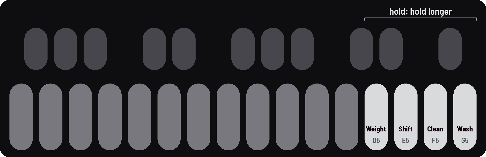

<!-- SPDX-License-Identifier: GPL-3.0-only -->

Gestures are macros: one key moves several settings at once. The **PRESETS** knob (gesture time) sets how fast.

## Pressure gestures

Keys 9–12: the harder you press, the further in.

### Swell into a chord and back {#press}

*Chord: as far as you press*

1. Press **Chord**, [[A4]], slowly harder: the drones move into a chord.
2. Ease off: they come back.

> **Good to know.** Chord builds its chord on the **Scale**, set on the **Pitch moves** page ([[SEQ]] twice, KNOB 4):
> change the Scale and the chord changes. A preset can bring its own: Vespers' is Just 1-8, the harmonics; Embers',
> major pentatonic.

**Listen** (`g-press`)

- 0:00 P3 Vespers
- 0:01 Chord pressed lightly: the drones start to move
- 0:04 Harder: a full chord
- 0:08 Eased off: back toward the start
- 0:11 Let go

## Held gestures

Keys 13–16: the longer you hold, the further in.

### Bloom into reverb, fade out slowly {#hold}

*The longer you hold, the slower it fades*

1. Hold **Wash**, [[G5]], until the reverb has bloomed.
2. Let go and it fades out as slowly as you held it in.

**Listen** (`g-hold`)

- 0:00 P1 Niagara
- 0:01 Wash held 4 s: the reverb grows
- 0:05 Let go: it fades over 4 s

### Hit it fast and let it fade slowly {#speed}

*Turn PRESETS after letting go*

1. Hold a gesture on a fast Gesture time, and let go.
2. Turn **PRESETS** left and the gesture fades slowly. (Or slow in, then fast out.)

**Listen** (`g-speed`)

- 0:00 P13 Telegraph, Gesture time fast
- 0:01 Wash held 2 s: in fast
- 0:03 Let go, PRESETS turned left: a slow fade

## Any gesture

Tap, latch, stack and slow down: these work on every gesture key.

### Leave a gesture on while you play {#keep}

*A tap latches it; SEL latches it at a level*

1. Tap a gesture key: it comes all the way in and stays. Tap again to let it go.
2. Or hold a gesture key (or press it harder) until the screen shows a level you like, and tap [[SEL]] while still holding it: it latches at that level. Let go when you like.

**Listen** (`g-keep`)

- 0:00 P2 Embers
- 0:01 Chord tapped: all the way in, latched
- 0:05 Tapped again: it goes
- 0:09 Pressed to 55%, SEL tapped: latched there

### Build a climax {#stack}

*Snarl under Wash*

1. Press **Snarl**, [[B4]], firmly.
2. Hold **Wash**, [[G5]], on top. Let go of both to come down.

**Listen** (`g-stack`)

- 0:00 P6 Seance
- 0:01 Snarl pressed: a growl
- 0:05 Wash held on top: the climax
- 0:10 Both let go: Snarl goes at once, Wash leaves over about 5 s
- 0:15 Back to Seance as it was

### Transform a sound over half a minute {#minute}

*A slow gesture time and a tap*

1. Turn **PRESETS** all the way left: **GESTURE TIME 33 s**.
2. Tap a gesture key: it comes in on its own.

**Listen** (`g-minute`)

- 0:00 P12 Ashram, Gesture time 33 s
- 0:01 Weight tapped: it comes in on its own
