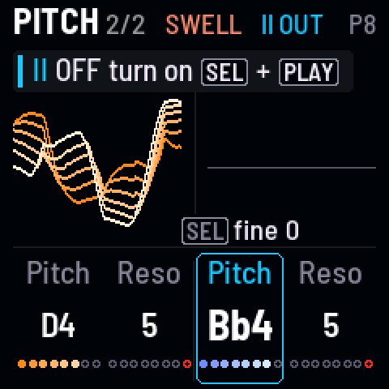
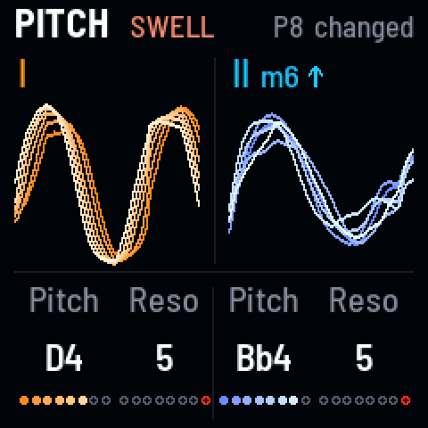
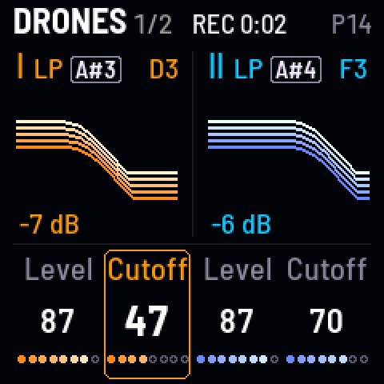
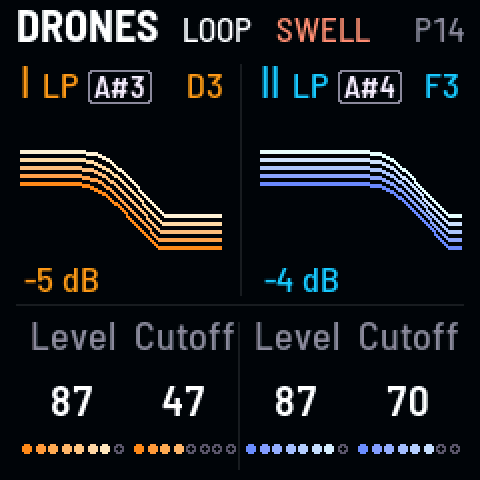
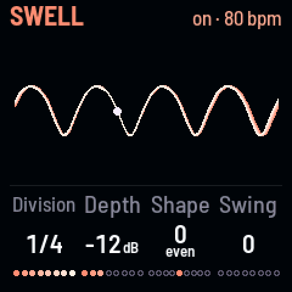
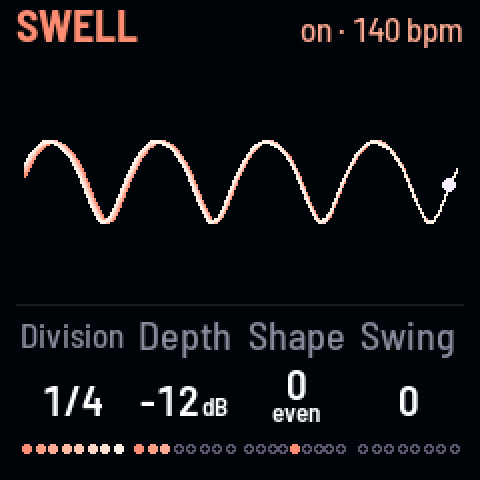

<!-- SPDX-License-Identifier: GPL-3.0-only -->

### Change chords without a slide {#retune}

*Drone II out, a new note, back in*

1. Hold [[SEL]] and tap [[PLAY]]: drone II fades out.
2. Press [[HOME]] until you're on **Pitch**, and turn KNOB 3 to a new note.
3. [[SEL]] + [[PLAY]] again: it fades back in on the new chord.

> **Good to know.** How fast it fades is **Fade** (Setup 1, KNOB 1).

**Listen** (`p-retune`)

- 0:00 P8 Sibyl, Fade 3 s
- 0:01 SEL + PLAY: drone II fades out
- 0:05 Retuned in the silence
- 0:07 SEL + PLAY: back in on a minor chord

### Loop your moves {#loop}

*REC, move, REC*

1. Tap [[REC]] and play: knobs, gestures, scenes.
2. Tap [[REC]] again: what you did plays back, round and round. Play on top.
3. Tap [[REC]] once more to stop.

**Listen** (`p-loop`)

- 0:00 P14 Tape
- 0:01 REC: drone I's cutoff down and back up
- 0:06 REC again: the move loops

### Reach another page and come back {#peek}

*Hold its button, turn, let go*

1. Hold a page's button, here [[FX]] for **Space**: [the header](../reference/controls.md#screen-header) says PEEK.
2. Turn a knob there.
3. Let go: you're back where you were, the change kept.

### Play in time with a MIDI clock {#clock}

*Send a clock: the Swell, the LFO, the delay and Wander follow it*

1. Send a MIDI clock from a DAW or a drum machine, over USB or the TRS jack.
2. Press [[ARP]] for the **Swell**, and turn KNOB 1, **Division**, to a note value: it breathes in time.

> **Good to know.** **Sync** (Setup 1, KNOB 4) on follows a clock, off ignores it. More in
> [MIDI](../reference/midi.md).

**Listen** (`p-clock`)

- 0:00 P10 Cistern, a clock at 80 BPM: a breath a beat
- 0:05 The clock at 140 BPM: faster
