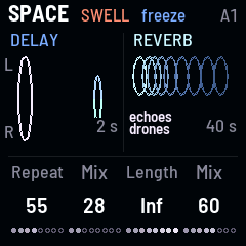
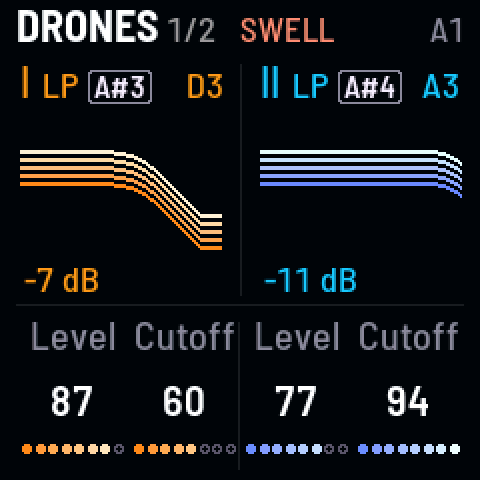
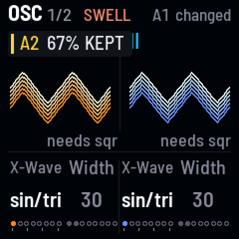
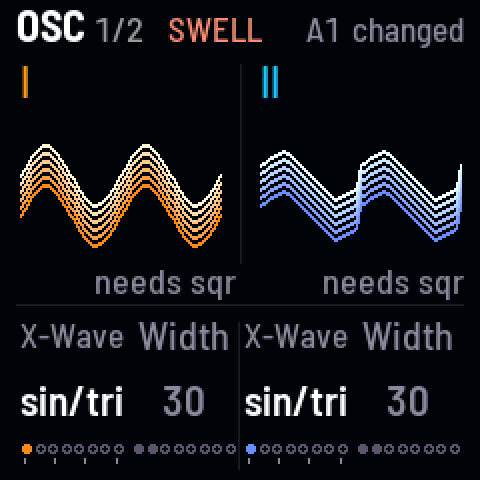
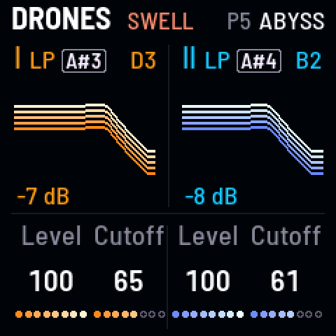
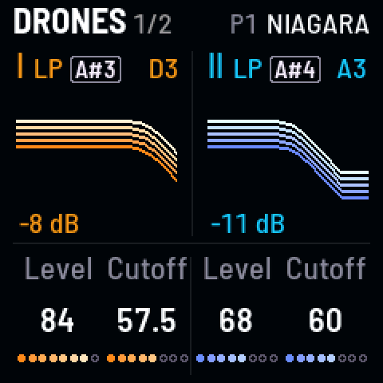

<!-- SPDX-License-Identifier: GPL-3.0-only -->

The 8 white keys are scenes: 6 banks of 8 (A to F) to fill with your own sounds, and the Presets.

### Make a Preset your own {#save}

*Pick a bank, change it, SAVE and a white key*

1. Tap a Preset, then pick bank A: hold [[SEL]] and tap [[G4]] (B to F are [[A4]] to [[E5]]).
2. Change it as you like.
3. Hold [[SAVE]] and tap a white key: it's stored there. Tap that key later to glide back to it.

> **Good to know.** The Presets can't be saved over: your sounds go in A to F.

### Blend between two sounds and keep the mix {#blend}

*Press a scene key harder, tap SEL*

1. Hold another scene's key and press slowly harder: the sound moves toward it, as far as you press.
2. Tap [[SEL]] while still holding: the blend stays there ("A2 67% KEPT"). Let go when you like.

> **Good to know.** Let go without SEL and it glides back. Press all the way and hold a moment, and the scene is taken
> ("TAKEN").

**Listen** (`s-blend`)

- 0:00 A1: P2 Embers (a darker version on A2)
- 0:01 A2 pressed slowly harder
- 0:05 SEL tapped, then let go: the blend stays

### Undo a scene change {#back}

*SEL + SAVE*

1. Hold [[SEL]] and tap [[SAVE]]: back to the sound before your last scene tap or blend.
2. Again: forward to where you were.

