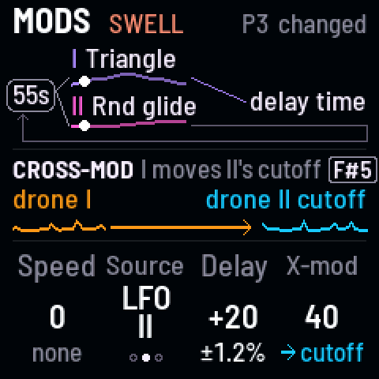
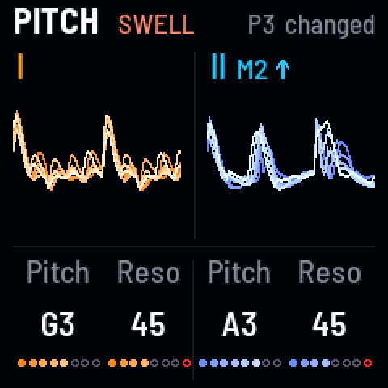
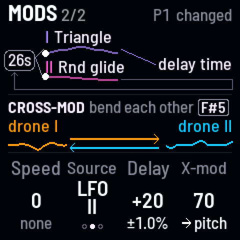
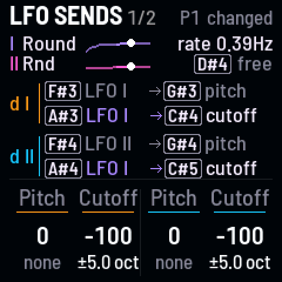
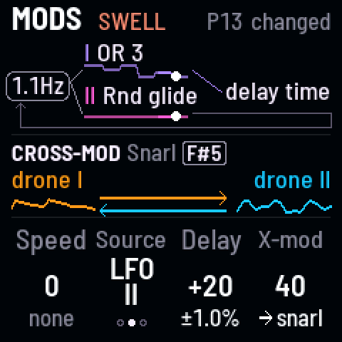
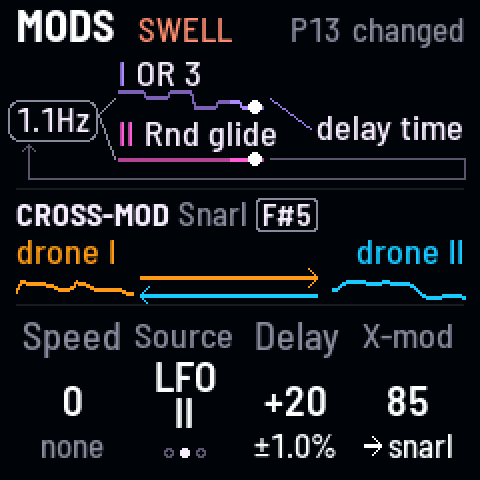

<!-- SPDX-License-Identifier: GPL-3.0-only -->

## Tone and texture

### Ticks and clicks {#ticks}

*A sub so low it breaks into clicks, a few a second*

Put drone I's sub four octaves down, all the way in, and turn drone I down to about 22 Hz: the sub stops being a
tone and becomes clicks, about 3 a second, ringing in the delay and reverb.

1. Press [[EDIT]] twice for **Sub · Drive**, and turn KNOB 1, Osc/Sb, all the way to the sub: **100**.
2. Tap [[G#3]], drone I's sub, until the screen says **−4 oct**. It goes round −1, −2, ⅓, ⅕, −3, −4.
3. Press [[HOME]] twice for **Pitch**, and turn KNOB 1, drone I's pitch, quickly down past **A0**, where the screen
   turns to Hz, to about **22 Hz**: clicks.

> **Good to know.** The clicks a second are drone I's pitch ÷ 8 (the sub is ÷ 16, two clicks to its cycle): at D3, 18
> a second; at A0 (27.5 Hz), about 3; at 22 Hz, 2.7; at 5 Hz, one every 1.6 s. The clicks reach the speaker, though
> the hum under them doesn't. The **Tick** gesture ([[G4]]) does this on its own, faster as you press harder. Or take
> drone I itself under 20 Hz with Osc/Sb at 0: a click each cycle, as in **Sonar** (P7).

**Listen** (`ticks`)

- 0:00 P1 Niagara as it starts: no clicks
- 0:01 Osc/Sb to the sub, the sub to −4 oct, drone I's pitch quickly down to 22 Hz
- 0:04 Clicks, about 3 a second, ringing in P1's delay and reverb

### A singing filter {#sing}

*Resonance up, and the LFO moving it: a ring that swells and fades*

Turn a filter's resonance up and it rings on the drone's notes; let the LFO move the resonance instead of the cutoff,
and the ring swells and fades on its own.

1. Press [[HOME]] twice for **Pitch**, and turn KNOB 2 and KNOB 4, the resonances, up: the filters ring. Their last dot is
   red: there they ring on their own.
2. Press [[HOME]] again for **Drones**, and turn the cutoffs (KNOB 2 and KNOB 4) up: the ring brighter.
3. Press [[LFO]] for **LFO sends**, and tap [[C#4]] and [[C#5]]: on the LFO pages they switch each drone's cutoff
   send to **resonance**.
4. Turn KNOB 2 and KNOB 4, the resonance sends, up: the ring swells and fades as the LFO goes round.

> **Good to know.** **Abyss** (P5) swells its resonances this way. With the drones a fifth or an octave apart the two
> rings meet; a semitone apart, they beat. Weight ([[D5]]) lets the resonance give way while you hold it.

**Listen** (`sing`)

- 0:00 P15 Falling, both resonances up and both cutoffs opened: the filters ring on the drones' notes
- 0:01 The filter LFOs moved to resonance: the ring swells and fades, slowly, again and again

### Hard sync sweep {#sync}

*Drone II locked to drone I, its pitch swept by hand: a sweep of tone, not of note*

With hard sync, drone II restarts its wave on every cycle of drone I: turning drone II's pitch then changes its tone,
not its note, a tearing, vocal, laser-like sweep.

1. Press [[HOME]] for **Drones**: turn KNOB 4, drone II's cutoff, well up, and bring drone II forward (KNOB 3 up,
   KNOB 1 down).
2. Tap black key 10, [[D#5]]: **hard sync**, drone II locked to drone I.
3. Press [[HOME]] for **Pitch**, and turn KNOB 3, drone II's pitch, slowly up two octaves and back: the tone sweeps.

> **Good to know.** It's strongest with drone II above drone I and a saw or square in its wave (Osc page). To keep
> it moving without a hand, send the LFO to drone II's pitch (LFO sends, KNOB 3) with a deep send: the LFO moves
> only a few semitones, so the sweep is gentler. Here Abyss's own resonance LFO was turned off first (LFO sends,
> KNOB 2 and 4 to 0), so its slow ringing doesn't cover the sweep.

**Listen** (`sync`)

- 0:00 P5 Abyss, drone II opened and brought forward
- 0:01 Hard sync on: a harder, buzzier edge
- 0:03 Drone II's pitch turned slowly up two octaves: its tone tears upward, a vocal, laser-like sweep
- 0:10 And back down: the sweep falls
- 0:16 Up again, faster

## Cross-mod

### Drone I shaping drone II {#xfilter}

*Drone I's sound moving drone II's filter*

At key 11's first setting, drone I's sound moves drone II's filter, as fast as drone I sounds: drone II growls,
buzzes and takes on drone I's pitch as a grain.

1. Tap black key 11, [[F#5]], once: it lights, **I moves II's cutoff**.
2. Press [[LFO]] twice for **Mods**, and turn KNOB 4, X-mod, up: the growl deepens.
3. Press [[HOME]] twice for **Pitch**, and move drone I's pitch (KNOB 1): the growl changes its grain.

> **Good to know.** It's strongest with drone II's filter resonant and band-pass ([[A#4]]), as in **Vespers** (P3)
> here. **Seance** (P6) uses it gently.

**Listen** (`xfilter`)

- 0:00 P3 Vespers as it starts: saws through band-pass filters
- 0:01 Key 11 once: drone I's sound moves drone II's filter: drone II growls and shimmers
- 0:04 X-mod up: the growl deepens into a buzzing, vocal edge
- 0:12 Drone I's pitch moved: the growl changes its grain

### Metallic bells {#bells}

*Cross-FM rings two high sines into metal; the LFO strikes it, again and again*

Each drone's sound bends the other's pitch, FM synthesis between the two. On pure, high tones a tritone apart it rings
into a metallic tone. A bell is struck and dies away, so the LFO snaps the filters open and lets them close slowly: a
bell struck every 2.5 s, ringing out.

1. Press [[EDIT]] for **Osc**, and turn KNOB 1 and KNOB 3, the X-Waves, all the way down: **sine**.
2. Press [[HOME]] twice for **Pitch**, and turn both drones high, a tritone apart (here C#6 and G6: the top of their
   range is about 1.6 kHz).
3. Tap black key 11, [[F#5]], until it winks: **bend each other** (twice from off).
4. Press [[LFO]] twice for **Mods**, and turn KNOB 4, X-mod, up to about **70**: the sines ring into metal.
5. Press [[HOME]] for **Drones**, and turn both cutoffs (KNOB 2 and KNOB 4) down to about **300 Hz**: the metal goes
   dull.
6. Press [[LFO]] for **LFO sends**. Tap OCT− until LFO I is **Round** (Roundtooth), and turn SELECT, the LFO's rate,
   to about **0.4 Hz**. Tap [[A#4]] until drone II's cutoff says **LFO I** too.
7. Turn KNOB 2 and KNOB 4, the cutoff sends, all the way left: **−100**. Each cycle the filters snap open and close
   slowly: the bell is struck, and rings out.
8. Press [[FX]] for **Space**, and turn KNOB 4, the reverb's Mix, to about **40**: more room for it to ring in.

> **Good to know.** Roundtooth rises fast and falls at the cycle's end; turned upside down (−100) it jumps and dies
> away, a strike. SELECT sets how often it strikes. Simple intervals (an octave, a fifth) lock into harmonies instead
> of bells; awkward ones (a tritone, a seventh) ring metallic. X-mod past 85 clangs and runs wild. If the Swell is on,
> switch it off ([[ARP]], then [[ARP]] again on its page) so only the LFO strikes.

**Listen** (`bells`)

- 0:00 A bell struck every 2.5 s (0:03, 0:05, 0:08, 0:10, 0:13): bright and clangy on the hit
- 0:03 The top dies first, and it fades about 25 dB into a dark hum before the next

### Snarl {#snarl}

*The finished sound, echoes and all, bending both drones*

At key 11's last setting, the finished sound, the delay's echoes included, bends both drones' pitch: a growl that
drags and tears the pitch, and the echoes with it. It's clearest on a steady sound with plenty of echoes.

1. Press [[FX]] for **Space**, and turn Repeat (KNOB 1) and Mix (KNOB 2) up: more echoes for Snarl to drag.
2. Tap black key 11, [[F#5]], three times from off: **Snarl** (it winks).
3. Press [[LFO]] twice for **Mods**, and turn KNOB 4, X-mod, up: 40 a growl, 85 a snarl.

> **Good to know.** The **Snarl** gesture ([[B4]]) brings it in by pressure, with the drive and Feedback on top, and
> leaves without a trace. **Clean** ([[F5]]) takes it out while you hold it.

**Listen** (`snarl`)

- 0:00 P2 Embers with more echoes: steady triangles blooming toward saws
- 0:01 Snarl on: the finished sound starts to bend both drones
- 0:04 X-mod up: the snarl grows, the pitch dragged and torn, the echoes bending with it

## Movement and rhythm

### A stepped figure that moves {#figure}

*OR on drone II's pitch: four notes round and round, and Wander moving the figure*

LFO II's **OR** shape adds two square waves, one five times as fast as the other: on a drone's pitch it steps round
four notes, a figure that repeats. Wander then moves the whole figure to a new note now and then.

1. Make drone II bright, so the figure stands out: press [[EDIT]] for **Osc** and turn KNOB 3, its wave, to a
   **saw**; then on **Drones** ([[HOME]]) turn KNOB 4, its cutoff, all the way up, KNOB 3, its level, up, and KNOB 1,
   drone I's level, down.
2. Press [[LFO]] for **LFO sends**, and tap [[OCT+]], LFO II's wave, until the screen says **OR 5**.
3. Turn KNOB 3, drone II's pitch send, up: 40 is about ±4 semitones.
4. Turn SELECT, the LFO's rate, up for a quicker figure.
5. Press [[SEQ]] twice for **Pitch moves**, and turn KNOB 3, Wander, up: every so often the figure starts on another
   note.

> **Good to know.** LFO I's OR ([[OCT−]]) is three times as fast: another figure. **AND** (AND 3 on LFO I, AND 5 on
> LFO II) steps between two notes instead, as in **Piston** (P11). **Telegraph** (P13) is built this way, on LFO I's OR 3.

**Listen** (`figure`)

- 0:00 The figure stepping: drone II bright, round four notes on LFO II's OR 5
- 0:02 Wander up: every few seconds the whole figure moves to a new note

### A filter rhythm in time with Swell {#swell}

*A square LFO on both cutoffs, locked to the Swell's breath*

The Swell makes both drones breathe; lock the LFO to it and a square wave on the filters jumps on the same beat, the
two filters in turn.

1. Press [[ARP]] for the **Swell** page (tap it again if the Swell is off), and turn KNOB 1 for about a breath a
   second.
2. Press [[LFO]] for **LFO sends**. Tap [[OCT−]] until LFO I is **Square**, and tap key 8, [[A#4]], until LFO I moves
   drone II's cutoff too.
3. Turn KNOB 2 and KNOB 4, the cutoff sends, one up and one down: the filters jump in turn. Turn SELECT to about the
   Swell's speed.
4. Hold black key 5, [[D#4]], half a second: the LFO restarts on each of the Swell's breaths ("on Swell").

> **Good to know.** Echoes blur the rhythm: if your sound has them, turn the delay's Mix down first ([[FX]],
> KNOB 2). The Swell's speed sets the rhythm: the locked LFO restarts on each of its breaths. Hold [[D#4]]
> again to free the LFO. (With a MIDI clock, the Swell and the locked LFO follow its beat too.)

**Listen** (`swell`)

- 0:00 P8 Sibyl, its delay off and its Swell quick: the drones breathe about once a second
- 0:01 LFO I to Square on both cutoffs: the filters jump in turn
- 0:11 The LFO locked to the Swell: each jump lands on its breath

### LFO chasing itself {#chase}

*Speed mod: the LFO rushing and dragging on its own wave*

Speed mod lets the LFO speed up and slow down on one of its own waves, so every wobble rushes, then drags. It's
easiest to hear on a vibrato.

1. Press [[LFO]] for **LFO sends**. Tap key 6, [[F#4]], until LFO I moves drone II's pitch, and turn KNOB 3, its pitch
   send, up: a slow vibrato.
2. Press [[LFO]] again for **Mods**, and turn KNOB 1, Speed, all the way up: the LFO speeds up and slows down by up to
   three octaves.
3. Turn KNOB 2, Source, to **LFO I**: a regular rush and drag (LFO II's random glide makes it uneven).

> **Good to know.** Speed mod moves the rate of everything the LFO moves at once: the filters, the pitches, the
> delay. Speed at 0 steadies it again.

**Listen** (`chase`)

- 0:00 P7 Sonar with a vibrato on drone II: a slow, steady wobble
- 0:03 Speed mod to the top, driven by LFO I's triangle: the wobble rushes, then drags, over and over
- 0:14 Speed back to 0: the wobble steady again

## Echoes and space

### Echoes that warble {#warble}

*The LFO moving the delay's time: echoes bending in pitch*

When the delay's time moves, its echoes bend in pitch, as tape does when it speeds up and slows down. Let an LFO move
it, and every echo warbles; let the Swell dip the drones, and the bending echoes ring on their own in the gaps.

1. Press [[FX]] for **Space**, and turn Repeat (KNOB 1) and Mix (KNOB 2) up: clear echoes to bend.
2. Press [[ARP]] for the **Swell** (tap it again if it's off), and turn KNOB 1 up for about a breath a second: the
   echoes sound in the gaps.
3. Press [[LFO]] twice for **Mods**, and turn KNOB 3, Delay, all the way up: the LFO wobbles the delay's time by a
   quarter, and every echo bends.
4. Press [[FX]] twice for **Details**, and turn Time (KNOB 2) up: deeper, slower bends.

> **Good to know.** On the LFO pages, black key 10, [[D#5]], picks which LFO moves the delay's time: LFO I's
> regular waves warble evenly, LFO II's random glide makes them wander, as here. Turning Time by hand bends the
> echoes too. Movement (ALGORITHM) scales the warble with the other LFO sends.

**Listen** (`warble`)

- 0:00 P8 Sibyl with its echoes up and its Swell quick: the drones dip about once a second, the echoes ring in the gaps
- 0:01 Delay all the way up: every echo bends in pitch, clearest in the gaps
- 0:10 A longer Time: deeper, slower bends

### Crackling echoes {#crackle}

*The Self delay and Drive: echoes that sag, distort and crackle*

The **Self** delay stretches its time as its echoes get louder, so loud echoes sag and wobble; **Drive** after it
distorts the drones and their echoes together: ghost notes and crackle.

1. Press [[FX]] for **Space**, and turn Repeat (KNOB 1) up: the echoes pile up.
2. Press [[FX]] again for **Details**. Hold [[SEL]] and turn KNOB 2 to **Self** (or **Grain**, whose own echoes shake
   its time).
3. Turn KNOB 1, Drive, up.

> **Good to know.** Past Repeat 85 the echoes run away into a ringing tone that holds itself ("runaway" in red); Self
> makes the runaway lurch. PLAY lets it ring out.

**Listen** (`crackle`)

- 0:00 P11 Piston as it starts
- 0:01 Repeat up: the echoes pile up
- 0:03 The delay to Self: its time stretching as the echoes get louder
- 0:08 Drive up: the drones and their echoes distorted together, ghost notes and crackle

### Freeze a chord, play over it {#freeze}

*Reverb at Inf holds the chord; new notes play over it*

At its top, the reverb's Length is **Inf**: it never dies away, a freeze of what's in it. Move the drones and they
play over the frozen chord.

1. Press [[FX]] for **Space**. Turn KNOB 4, the reverb's Mix, up, then KNOB 3, Length, all the way: **Inf**, "freeze"
   in blue.
2. Press [[HOME]] twice for **Pitch**, and turn KNOB 1 and KNOB 3 to new notes: the drones play over the frozen chord.
3. Turn Length back down to let it go, or stop with [[PLAY]].

> **Good to know.** On Details, [[SEL]] + KNOB 4 picks what goes into the reverb: **Drones** freezes the drones and
> keeps the echoes dry on top. Damp is out at Inf, so the freeze holds what's in it.

**Listen** (`freeze`)

- 0:00 P10 Cistern as it starts
- 0:01 Reverb Mix up, then Length to the top: the chord freezes and holds
- 0:08 New notes for both drones: they play over the frozen chord

### Shimmer on echoes {#shimmer}

*Only the echoes rise an octave into the halo*

The **Shimmer** reverb lifts what goes into it an octave, in two voices just apart. Send it only the echoes, and each
echo rises into a bright halo while the drones stay dry. It shines on voices in the middle and up; on a low drone the
octave stays low.

1. Press [[FX]] for **Space**, and turn Repeat (KNOB 1) and Mix (KNOB 2) up: more echoes.
2. Press [[FX]] again for **Details**, and turn KNOB 4, the reverb's Type, to **Shimmer**.
3. Hold [[SEL]] and turn KNOB 4: Into **Echoes**.
4. Press [[FX]] for Space again, and turn the reverb's Mix (KNOB 4) up.

> **Good to know.** The Shimmer washes in over about 8 seconds and out over 6. **Cistern** (P10) uses it on
> everything. If your drones are low, raise them an octave or two (Pitch page) and the halo sparkles.

**Listen** (`shimmer`)

- 0:00 P15 Falling, sines in the middle (G3 and E4), with its echoes up
- 0:01 The reverb to Shimmer, Into Echoes: over 8 seconds the echoes rise an octave into a halo
