<!-- SPDX-License-Identifier: GPL-3.0-only -->

Each recipe is a sound that takes more than one knob: a key and a knob together, or settings on two or three pages.
Each sound example starts from a different Preset.

## Tone and texture

### Ticks and clicks {#ticks}

*A sub under 20 Hz turns into a pulse*

Take a drone's sub below 20 Hz and it stops being a tone: it becomes a slow, steady tick under the other drone, a
pulse to play against.

1. Press [[EDIT]] twice for the **Sub · Drive** page.
2. Tap [[G#3]], drone I's sub, until the screen says **−3 oct**, or **−4 oct** for slower ticks. It goes round −1,
   −2, ⅓, ⅕, −3, −4.
3. Turn KNOB 1, Osc/Sb, toward the sub, to about 60.
4. Turn KNOB 2, Drive, up for a bite.

> **Good to know.** Only −3 and −4 oct go below 20 Hz, and only under a low drone: the lower drone I, the slower the
> ticks ([[G#4]] and KNOB 3 do the same for drone II). The FM-1's speaker can't play the low part: listen on
> headphones. The **Tick** gesture ([[G4]]) goes further, into a click or two a second, faster as you press harder.

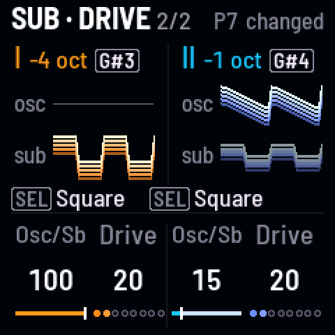
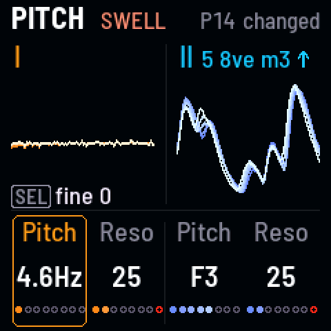

**Listen** (`ticks`)

- 0:00 P14 Tape as it starts: worn, a hum under it
- 0:03 the sub falls to −3 oct and comes up in the mix: the hum breaks into ticks
- 0:13 −4 oct: the ticks slow to half
- 0:19 Drive up: each tick gets a hard edge

### A drone as a pulse {#pulse}

*Its pitch under 27 Hz: a click each cycle against the other drone*

Turn one drone's pitch down far enough and it stops being a note: under about 27 Hz it's a stream of clicks, one a
cycle, a rhythm under the other drone that you tune with the knob, pinging through the delay.

1. Press [[HOME]] until the page says **Pitch** (from Drones, once).
2. Turn KNOB 1, drone I's pitch, down, a note a click, until the screen shows Hz instead of a note: here, 13 Hz.
   Slower still for single clicks: it goes down to 2 Hz.
3. Press [[FX]] for **Space**, and turn Repeat (KNOB 1) and Mix (KNOB 2) up: the clicks ping through the delay.

> **Good to know.** The speaker can't play the low part, but the clicks come through it. Through Drive (Details,
> KNOB 1) they ping against the other drone. **Sonar** (P7) is built this way: drone I at 2.7 Hz.

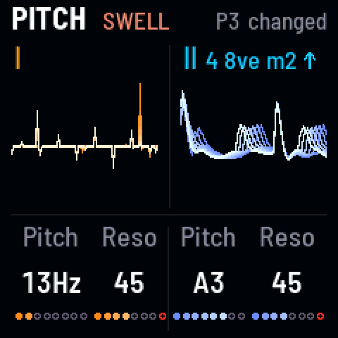
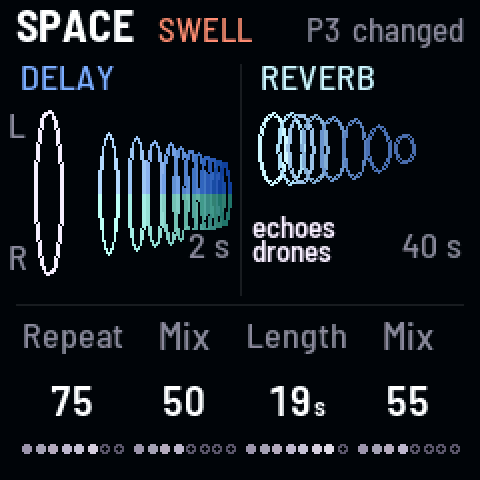

**Listen** (`pulse`)

- 0:00 P3 Vespers as it starts: two voices singing "ah"
- 0:03 drone I's pitch turned down, a note a click: it sinks, then starts to flutter
- 0:10 under 20 Hz it's a pulse: each cycle a click, under drone II's "ah"
- 0:15 more echoes: the clicks ping through the delay

### A sung "ah" {#ah}

*Band-pass filters and the LFO turning the waves: two voices*

A band-pass filter near a vowel makes a drone sound sung; the LFO turning its wave (X-Wave) opens and closes the vowel.

1. Tap [[A#3]] and [[A#4]], each drone's filter, to **BP** (band-pass): the drones thin to a nasal "ah".
2. Press [[LFO]] for **LFO sends**, and tap [[G#3]] and [[G#4]]: on the LFO pages they switch each drone's pitch send
   to **X-Wave**.
3. Turn KNOB 1 and KNOB 3, the X-Wave sends, up (or down, to move the other way): each wave turns slowly.
4. Press [[HOME]] for Drones, and turn the cutoffs to choose the vowel: lower for "oo", higher for "ah".

> **Good to know.** **Vespers** (P3) and **Sibyl** (P8) are built this way. A slow LFO (SELECT) sings; a fast one
> stutters. The filter key goes round: low-pass, band-pass, high-pass.

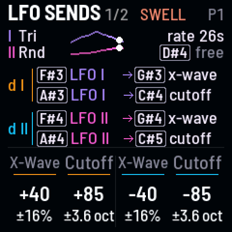
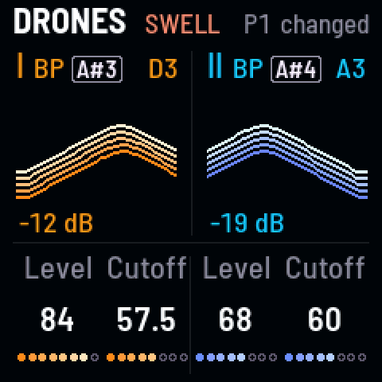

**Listen** (`ah`)

- 0:00 P1 Niagara as it starts
- 0:03 the filters to band-pass: the drones thin to a nasal "ah"
- 0:06 the sends on X-Wave, up: each wave turns slowly, the vowel opening and closing

### A singing filter {#sing}

*Resonance up, and the LFO moving it: a ring that swells and fades*

Turn a filter's resonance up and it rings on the drone's notes; let the LFO move the resonance instead of the cutoff,
and the ring swells and fades on its own.

1. Press [[HOME]] for **Pitch**, and turn KNOB 2 and KNOB 4, the resonances, up: the filters ring. Their last dot is
   red: there they ring on their own.
2. Press [[LFO]] for **LFO sends**, and tap [[C#4]] and [[C#5]]: on the LFO pages they switch each drone's cutoff
   send to **resonance**.
3. Turn KNOB 2 and KNOB 4, the resonance sends, up: the ring swells and fades as the LFO goes round.

> **Good to know.** **Abyss** (P5) swells its resonances this way. With the drones a fifth or an octave apart the two
> rings meet; a semitone apart, they beat. Weight ([[D5]]) lets the resonance give way while you hold it.

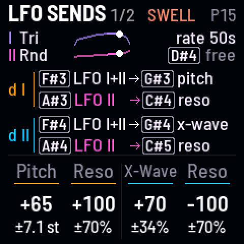
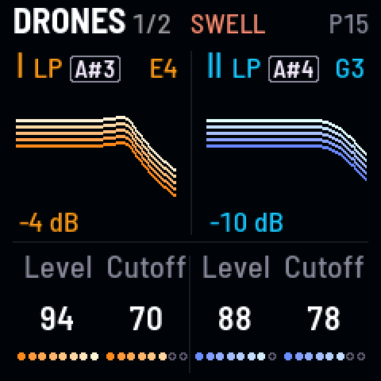

**Listen** (`sing`)

- 0:00 P15 Falling as it starts
- 0:03 both resonances up: the filters ring on the drones' notes
- 0:13 the filter LFOs moved to resonance: the ring swells and fades

### Tangled drones {#tangle}

*Each drone bending the other's pitch*

Each drone's sound bends the other's pitch (cross-FM): a little roughens and thickens the two, a lot tangles them into
one restless, metallic sound.

1. Tap black key 11, [[F#5]], until it winks: **bend each other** (twice from off).
2. Press [[LFO]] twice for the **Mods** page, where the screen says so.
3. Turn KNOB 4, X-mod, up: around 40 it roughens, by 85 it tangles.
4. Turn drone II's pitch (Pitch page, KNOB 3): every interval tangles differently.

> **Good to know.** Key 11 goes round four settings: off (dark); drone I moving drone II's cutoff (lit), a filter
> that follows the other drone, as in **Seance** (P6); bend each other (winking); and **Snarl** (winking), the
> finished sound, echoes and all, bending both: a growl that drags the delay's repeats with it. X-mod sets how far
> each goes. **Movement** (ALGORITHM) doesn't scale it: it's sound, not the LFO. The **Snarl** gesture ([[B4]])
> brings Snarl in by pressure.

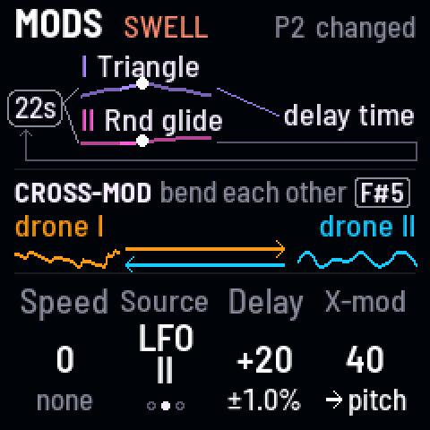
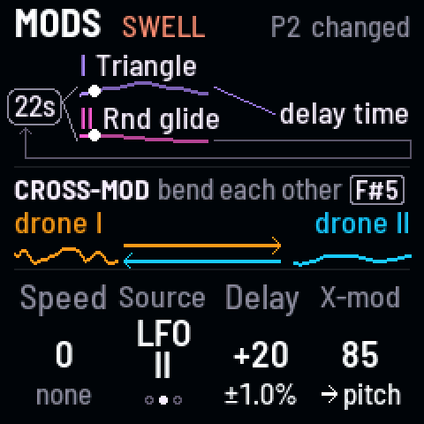

**Listen** (`tangle`)

- 0:00 P2 Embers as it starts: triangles blooming toward saws
- 0:03 key 11 twice: cross-FM at the amount already set: the drones roughen
- 0:07 X-mod up: they tangle into one restless, metallic sound
- 0:21 X-mod back down: they come apart

### Hard sync sweep {#sync}

*Drone II locked to drone I, its pitch swept by the LFO*

With hard sync, drone II restarts its wave on every cycle of drone I: moving drone II's pitch then changes its tone,
not its note, a tearing, vocal sweep.

1. Tap black key 10, [[D#5]]: **hard sync**, drone II locked to drone I.
2. Press [[LFO]] for **LFO sends**, and turn KNOB 3, drone II's pitch send, up: the LFO sweeps drone II's pitch, and
   you hear it as a sweep of tone.
3. Turn SELECT to set how fast it sweeps, and drone II's pitch (Pitch page) to set where the sweep sits.

> **Good to know.** It's strongest with drone II above drone I and a saw or square in its wave (Osc page). With Pitch
> link on ([[C#5]]) drone II follows drone I's notes as you tune.

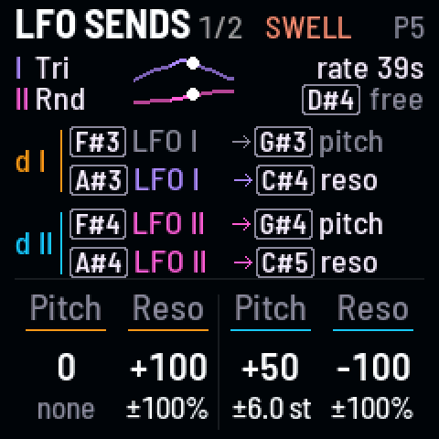
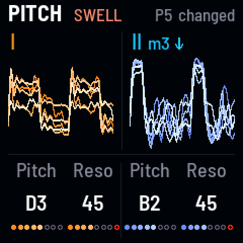

**Listen** (`sync`)

- 0:00 P5 Abyss as it starts
- 0:03 hard sync on: a harder, buzzier edge
- 0:07 drone II's pitch send up: its pitch sweeps under the sync, a tearing, vocal sweep

## Movement and rhythm

### A stepped figure that moves {#figure}

*OR on drone II's pitch: four notes round and round, and Wander moving the figure*

LFO II's **OR** shape adds two square waves, one five times as fast as the other: on a drone's pitch it steps round
four notes, a figure that repeats. Wander then moves the whole figure to a new note now and then.

1. Press [[LFO]] for **LFO sends**, and tap [[OCT+]], LFO II's wave, until the screen says **OR 5**.
2. Turn KNOB 3, drone II's pitch send, up: 40 is about ±4 semitones.
3. Turn SELECT, the LFO's rate, up for a quicker figure.
4. Press [[SEQ]] twice for **Pitch moves**, and turn KNOB 3, Wander, up: every so often the figure starts on another
   note.

> **Good to know.** LFO I's OR ([[OCT−]]) is three times as fast: another figure. **AND** (AND 3 on LFO I, AND 5 on
> LFO II) steps between two notes instead, as in **Piston** (P11). **Telegraph** (P13) is built this way, on LFO I's OR 3.

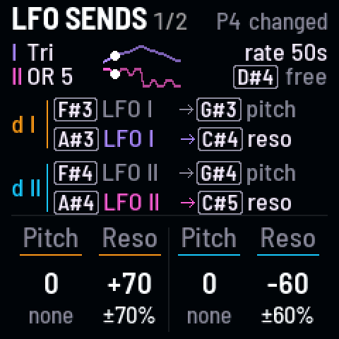
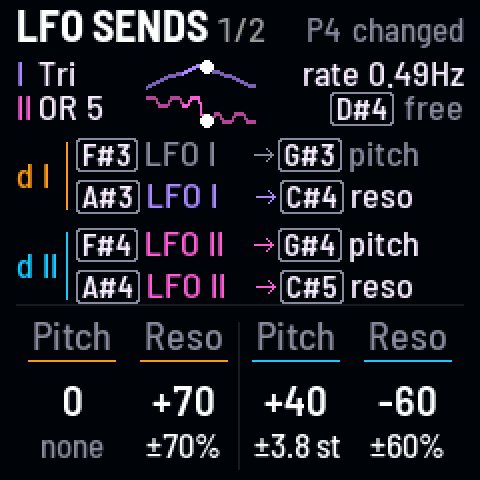

**Listen** (`figure`)

- 0:00 P4 Dreamhouse as it starts: a low A and its seventh harmonic
- 0:04 drone II's pitch send up: the high voice steps round a figure of four notes
- 0:13 the LFO's rate up: the figure quickens
- 0:25 Wander up: every so often the whole figure moves to a new note

### A filter rhythm in time with the Swell {#swell}

*A square LFO on both cutoffs, locked to the Swell's breath*

The Swell makes both drones breathe; lock the LFO to it and a square wave on the filters jumps on the same beat, the
two filters in turn.

1. Press [[ARP]] for the **Swell** page (tap it again if the Swell is off), and turn KNOB 1 for about a breath a
   second.
2. Press [[LFO]] for **LFO sends**. Tap [[OCT−]] until LFO I is **Square**, and tap key 8, [[A#4]], until LFO I moves
   drone II's cutoff too.
3. Turn KNOB 2 and KNOB 4, the cutoff sends, one up and one down: the filters jump in turn. Turn SELECT to about the
   Swell's speed.
4. Hold black key 5, [[D#4]], half a second: the LFO restarts on each of the Swell's breaths ("on Swell").

> **Good to know.** On a MIDI clock the Swell keeps its time in bars and beats, and the locked LFO with it (see
> [MIDI](../reference/midi.md)). Hold [[D#4]] again to free the LFO.

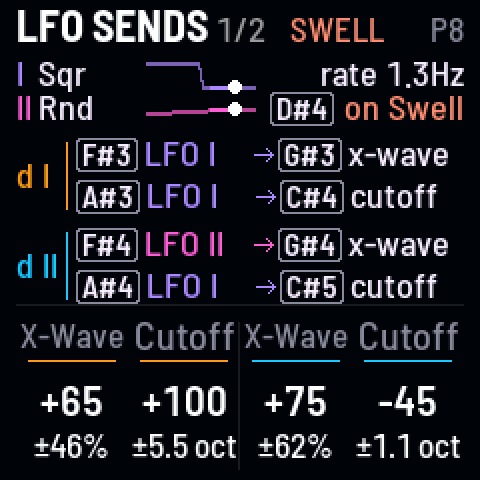
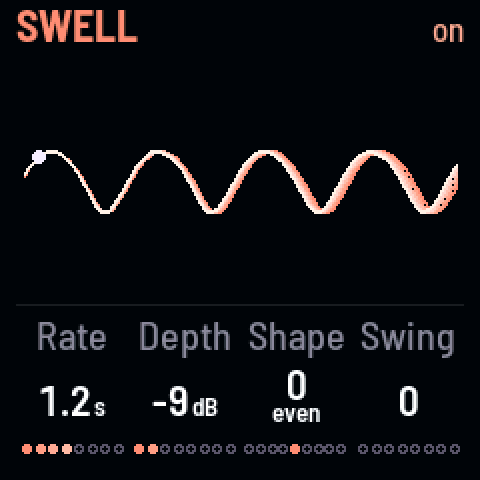

**Listen** (`swell`)

- 0:00 P8 Sibyl as it starts
- 0:03 the Swell quicker: the drones breathe about once a second
- 0:08 LFO I to Square on both cutoffs: the filters jump in turn
- 0:18 the LFO locked to the Swell: each jump lands on its breath

### The LFO chasing itself {#chase}

*Speed mod: the LFO rushing and dragging on its own wave*

Speed mod lets an LFO speed up and slow down on one of its own waves, so every sweep rushes, then drags.

1. Press [[LFO]] twice for the **Mods** page.
2. Turn KNOB 1, Speed, up: the LFO speeds up and slows down by up to three octaves.
3. Turn KNOB 2, Source, to pick which wave does it: LFO I, LFO II or both.

> **Good to know.** Speed mod moves the rate of everything the LFO moves at once: the filters, the pitches, the
> delay. **Sonar** (P7) with it sweeps unevenly.

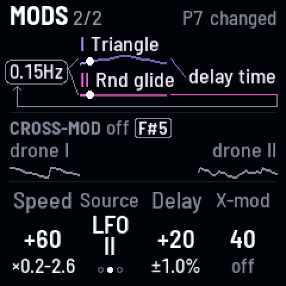
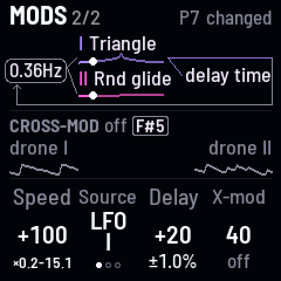

**Listen** (`chase`)

- 0:00 P7 Sonar as it starts
- 0:03 Speed mod up: the LFO speeds up and slows down on its own wave, the sweep rushing and dragging
- 0:17 Source to both LFOs: the push and pull gets lopsided

## Echoes and space

### Echoes that warble {#warble}

*The LFO moving the delay's time: echoes bending in pitch*

When the delay's time moves, its echoes bend in pitch, as tape does when it speeds up and slows down. Let an LFO move
it, and every echo warbles.

1. Press [[LFO]], and tap black key 10, [[D#5]], to pick which LFO moves the delay's time (I, II or both).
2. Press [[LFO]] again for **Mods**, and turn KNOB 3, Delay, up: the delay's time wobbles by up to a quarter, and the
   echoes bend with it.
3. Press [[FX]] for **Space**, and turn Repeat (KNOB 1) up: each echo bends again as it comes round.
4. Press [[FX]] again for **Details**, and turn Time (KNOB 2) up: the bends get deeper and slower.

> **Good to know.** Turning Time by hand bends the echoes too. A slow LFO warbles; a fast one makes a vibrato on the
> echoes alone. Movement (ALGORITHM) scales the warble with the other LFO sends.

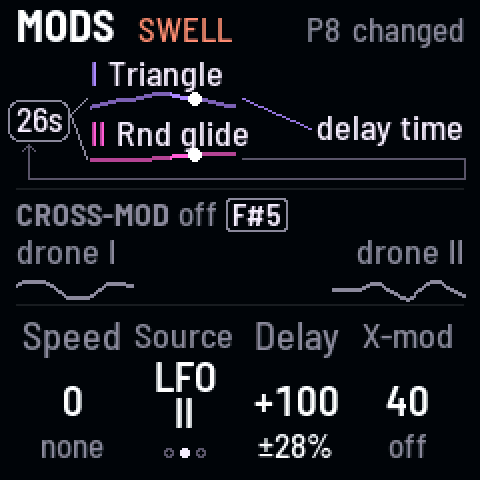
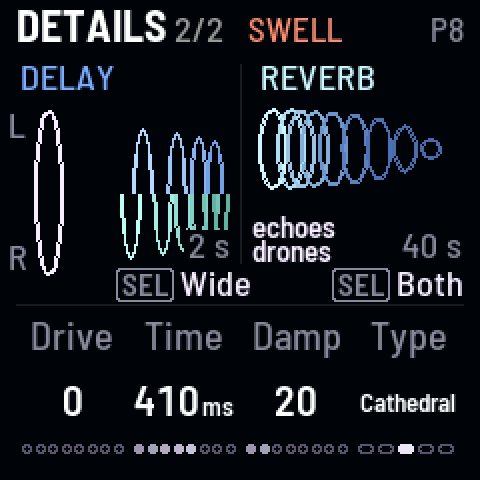

**Listen** (`warble`)

- 0:00 P6 Seance as it starts
- 0:03 the LFO on the delay's time, Delay up: the echoes wobble and bend
- 0:16 more repeats: each echo bends again as it comes round
- 0:19 a longer Time: deeper, slower bends

### Crackling echoes {#crackle}

*The Self delay and Drive: echoes that sag, distort and crackle*

The **Self** delay stretches its time as its echoes get louder, so loud echoes sag and wobble; **Drive** after it
distorts the drones and their echoes together: ghost notes and crackle.

1. Press [[FX]] for **Space**, and turn Repeat (KNOB 1) up: the echoes pile up.
2. Press [[FX]] again for **Details**. Hold [[SEL]] and turn KNOB 2 to **Self** (or **Grain**, whose own echoes shake
   its time).
3. Turn KNOB 1, Drive, up.

> **Good to know.** Past Repeat 85 the echoes run away into a ringing tone that holds itself ("runaway" in red); Self
> makes the runaway lurch. PLAY lets it ring out.

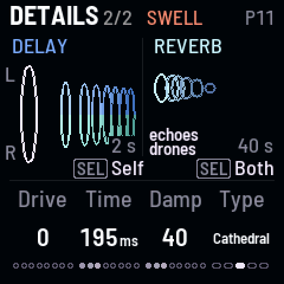
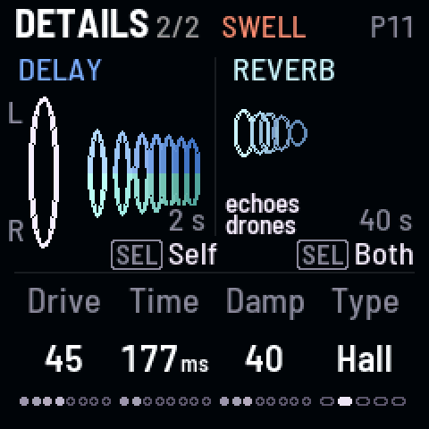

**Listen** (`crackle`)

- 0:00 P11 Piston as it starts
- 0:03 Repeat up: the echoes pile up
- 0:04 the delay to Self: its time stretching as the echoes get louder
- 0:10 Drive up: the drones and their echoes distorted together, ghost notes and crackle

### Freeze a chord, play over it {#freeze}

*Reverb at Inf holds the chord; new notes play over it*

At its top, the reverb's Length is **Inf**: it never dies away, a freeze of what's in it. Move the drones and they
play over the frozen chord.

1. Press [[FX]] for **Space**. Turn KNOB 4, the reverb's Mix, up, then KNOB 3, Length, all the way: **Inf**, "freeze"
   in blue.
2. Press [[HOME]] for **Pitch**, and turn KNOB 1 and KNOB 3 to new notes: the drones play over the frozen chord.
3. Turn Length back down to let it go, or stop with [[PLAY]].

> **Good to know.** On Details, [[SEL]] + KNOB 4 picks what goes into the reverb: **Drones** freezes the drones and
> keeps the echoes dry on top. Damp is out at Inf, so the freeze holds what's in it.

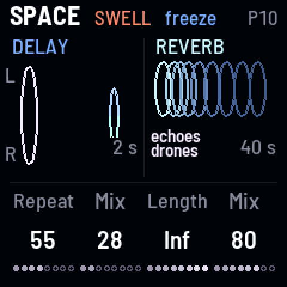
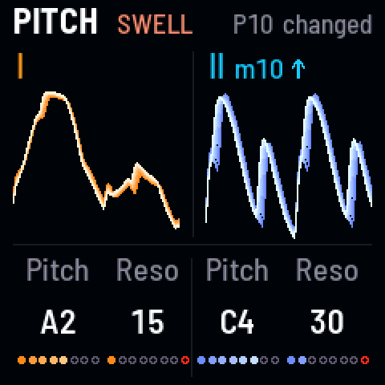

**Listen** (`freeze`)

- 0:00 P10 Cistern as it starts
- 0:03 reverb Mix up, then Length to the top: the chord freezes and holds
- 0:11 new notes for both drones: they play over the frozen chord

### Shimmer on the echoes {#shimmer}

*Only the echoes rise an octave into the halo*

The **Shimmer** reverb lifts what goes into it an octave, in two voices just apart. Send it only the echoes and the
drones stay dry while each echo rises into the halo.

1. Press [[FX]] for **Space**, and turn Repeat (KNOB 1) and Mix (KNOB 2) up.
2. Press [[FX]] again for **Details**, and turn KNOB 4, the reverb's Type, to **Shimmer**.
3. Hold [[SEL]] and turn KNOB 4: Into **Echoes**.
4. Press [[FX]] for Space again, and turn the reverb's Mix (KNOB 4) up.

> **Good to know.** The Shimmer washes in over about 8 seconds and out over 6. **Cistern** (P10) uses it on
> everything.

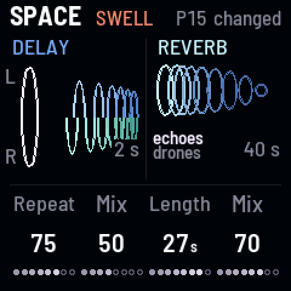
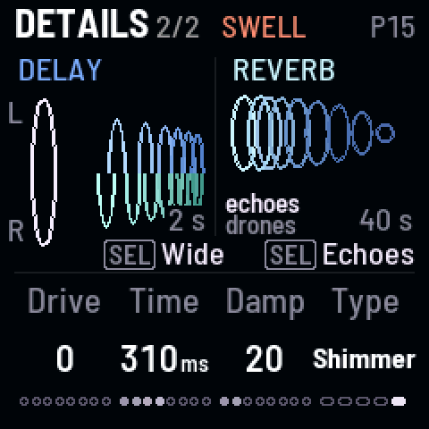

**Listen** (`shimmer`)

- 0:00 P12 Ashram as it starts
- 0:03 more echoes
- 0:06 the reverb to Shimmer, Into Echoes: only the echoes rise an octave into the halo
