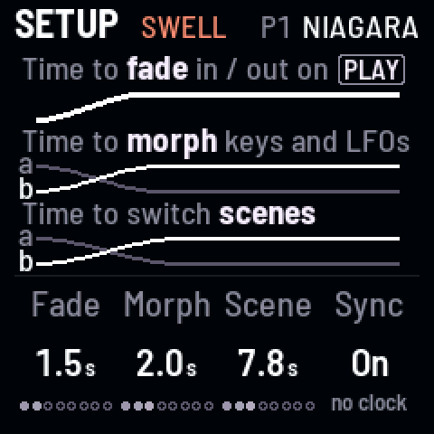
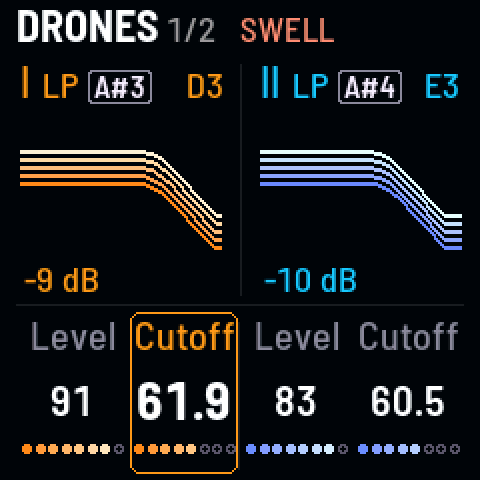
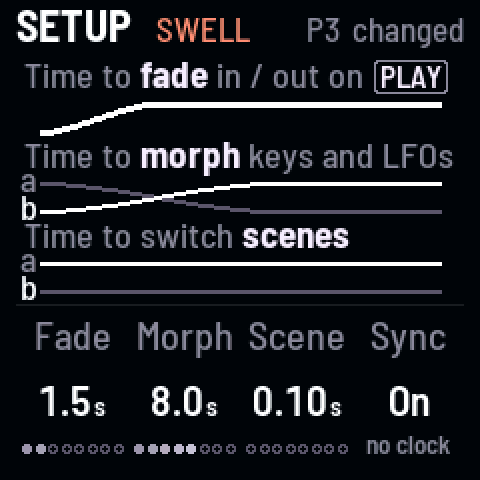
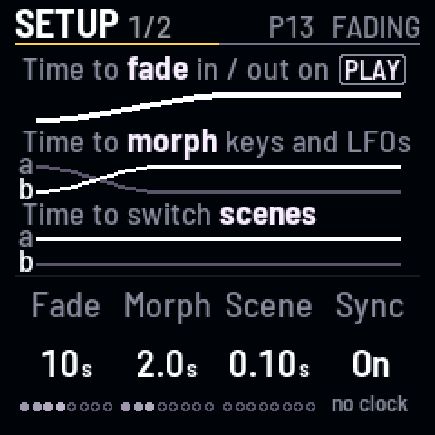
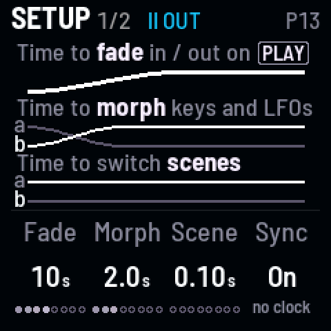

<!-- SPDX-License-Identifier: GPL-3.0-only -->

Three times on **Setup 1** ([[GLO]]): Fade (KNOB 1), Morph (KNOB 2) and Scene time (KNOB 3).

### Cut or glide between scenes {#cuts}

*Scene time, from 0.1 s to 5 minutes*

1. Press [[GLO]] until you're on **Setup 1**.
2. Turn **Scene time** (KNOB 3) all the way left.
3. Tap a different scene key: the sound cuts straight to it.
4. Turn Scene time up, then tap another scene key: the sound glides there, taking as long as Scene time says.

**Listen** (`t-cuts`)

- 0:00 P1 Niagara, Scene time 0.1 s
- 0:01 P5 Abyss tapped: a cut
- 0:04 P1 tapped: a cut back
- 0:06 Scene time 8 s, P5 tapped: a slow glide

### Stop a glide part way {#stop}

*Turn a knob while a scene is on its way*

1. Tap a scene on a slow Scene time.
2. Turn any knob on the way: the glide stops there, a sound between the two.

**Listen** (`t-stop`)

- 0:00 P1 Niagara, Scene time 8 s
- 0:01 P5 Abyss tapped: a slow glide
- 0:04 A knob turned: the glide stops there

### Make a switch move slowly {#morph}

*Morph: a black key over seconds*

1. Turn **Morph** up.
2. Tap a black key, or an LFO's shape (OCT− or OCT+): its change comes in over that time.

**Listen** (`t-morph`)

- 0:00 P3 Vespers, Morph 0.02 s
- 0:01 [[A#3]] tapped: thin and bright, at once
- 0:04 Morph 8 s, tapped again: the body comes back slowly
- 0:12 Again: it thins as slowly

### Fade in slowly, or fade one drone out {#fades}

*Fade: PLAY over up to a minute*

1. Turn **Fade** up, then tap [[PLAY]]: the drones come in over that time.
2. Hold [[SEL]] and tap [[PLAY]]: drone II alone fades out (again, and it comes back).

**Listen** (`t-fade`)

- 0:00 P13 Telegraph, Fade 10 s, PLAY tapped: in over 10 s
- 0:12 SEL + PLAY: drone II fades out
