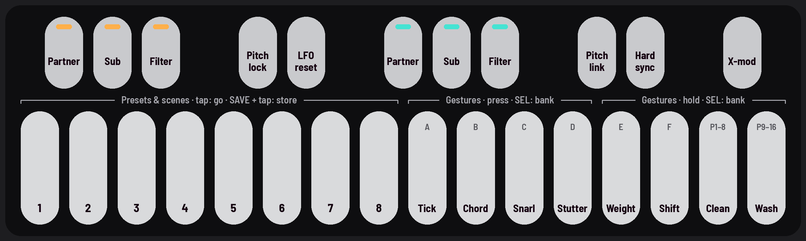
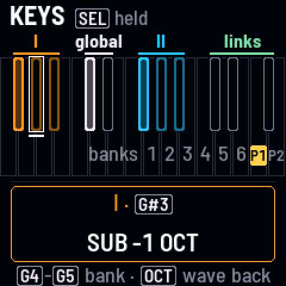

<!-- SPDX-License-Identifier: GPL-3.0-only -->

## Black keys

Eleven switches, left to right: drone I's three, two for both drones, drone II's three, then the links. On the LFO pages, most of
them route the LFO instead.

| Key | Normally | On the LFO pages |
|---|---|---|
| 1 · F#3 | I partner | which LFO moves I's pitch (I, II, both) |
| 2 · G#3 | I sub: −1 oct, −2 oct, ⅓, ⅕, −3 oct, −4 oct | I's pitch send moves X-Wave instead |
| 3 · A#3 | I filter: LP, BP, HP | which LFO moves I's cutoff (I, II, both) |
| 4 · C#4 | pitch lock (on to start) | I's cutoff send moves resonance instead |
| 5 · D#4 | LFO reset | LFO reset |
| 6 · F#4 | II partner | which LFO moves II's pitch (I, II, both) |
| 7 · G#4 | II sub: −1 oct, −2 oct, ⅓, ⅕, −3 oct, −4 oct | II's pitch send moves X-Wave instead |
| 8 · A#4 | II filter: LP, BP, HP | which LFO moves II's cutoff (I, II, both) |
| 9 · C#5 | pitch link (II follows I) | II's cutoff send moves resonance instead |
| 10 · D#5 | hard sync (II to I) | which LFO moves the delay's time (I, II, both) |
| 11 · F#5 | cross-mod: off, I moves II's cutoff, bend each other, Snarl | the same |

## The map

### Hold SEL

The screen draws the black keys, lit as on the panel.

### Touch a key

While SEL is held, the screen names the key and its setting, without switching it.

## Good to know

- **Lights:** dark is off, lit is on. A key of several choices is dim on its first, lit on the second, winking on a
  third.
- **Filter:** low-pass (dim), band-pass (winking), high-pass (lit).
- **Sub:** −1 octave (dim), −2 octaves (lit), then the subharmonics ⅓ and ⅕ (winking).
- **Pitch lock** keeps the drones' pitches through scenes and Presets; the pitch knobs still tune.
- **Pitch link:** drone II follows drone I; KNOB 3 sets the gap ("+7 st").
- **LFO reset:** hold half a second to lock the LFO to the Swell; hold again to free it.
- **On the LFO pages** the screen says what now moves what ("LFO II → I PITCH").
- **A key the screen names in a box** ("needs [F#3]") blinks while the message shows.
