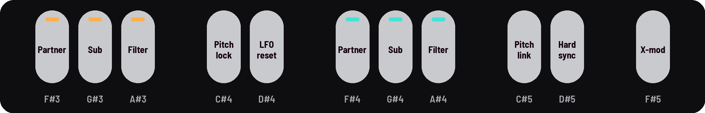
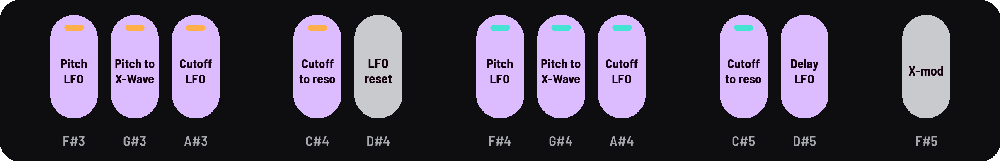

<!-- SPDX-License-Identifier: GPL-3.0-only -->

## Black keys

The 11 black keys are switches, with two sets of jobs: one for the drones, on every page but the LFO pages, and one
for the LFO, while an LFO page is open. LFO reset ([[D#4]]) and cross-mod ([[F#5]]) do the same in both.

## Drone keys

On every other page, each drone has three keys, and five more set the links between them.

| Key | Switches |
|---|---|
| [[F#3]] · [[F#4]] | drone I's · drone II's partner, on or off |
| [[G#3]] · [[G#4]] | the sub: −1 oct, −2 oct, ⅓, ⅕, −3 oct, −4 oct |
| [[A#3]] · [[A#4]] | the filter: low-, band- or high-pass |
| [[C#4]] | pitch lock: scenes and Presets keep the drones' pitches (on to start) |
| [[D#4]] | LFO reset |
| [[C#5]] | pitch link: drone II follows drone I |
| [[D#5]] | hard sync: drone II to drone I |
| [[F#5]] | cross-mod: off, I moves II's cutoff, bend each other, Snarl |

## LFO keys

On the [LFO pages](lfo-pages.md), each drone's four keys set its two sends.

| Key | Switches |
|---|---|
| [[F#3]] · [[F#4]] | which LFO moves the pitch: I, II or both |
| [[G#3]] · [[G#4]] | the pitch send moves X-Wave instead |
| [[A#3]] · [[A#4]] | which LFO moves the cutoff: I, II or both |
| [[C#4]] · [[C#5]] | the cutoff send moves resonance instead |
| [[D#5]] | which LFO moves the delay's time: I, II or both |

## Finding a key while you play

### Hold SEL

The screen draws the black keys, lit as on the panel.

### Touch a key

While SEL is held, the screen names the key and its setting, without switching it.

## Good to know

- **Lights:** dark is off, lit is on. A key of several choices is dim on its first, lit on the second, winking on a
  third.
- **Filter:** low-pass (dim), band-pass (winking), high-pass (lit).
- **Sub:** −1 octave (dim), −2 octaves (lit), then the subharmonics ⅓ and ⅕ (winking).
- **An LFO key:** LFO I (dim), II (lit), both (winking). The screen says what now moves what ("LFO II → I PITCH").
- **Pitch lock:** the pitch knobs still tune.
- **Pitch link:** KNOB 3 on Pitch sets the gap ("+7 st").
- **LFO reset:** hold half a second to lock the LFO to the Swell; hold again to free it.
- **A key the screen names in a box** ("needs [F#3]") blinks while the message shows.
