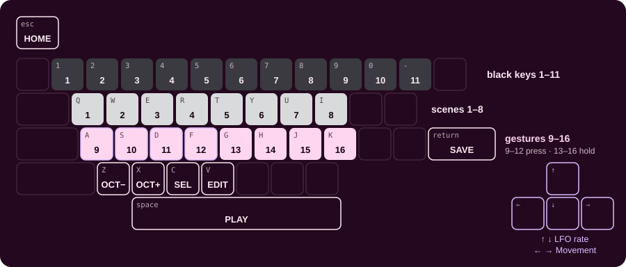

<!-- SPDX-License-Identifier: GPL-3.0-only -->

## Playing in a browser

The emulator on the front page runs the firmware itself, with sound: no FM-1 needed.

## Mouse

Play it on the [front page](https://evanyerburgh.github.io/niagara-drift/).

| To | With the mouse |
|---|---|
| **Turn a knob** | drag up or down, or scroll over it |
| **Press a button or key** | click and hold |
| **Hold a button** while you do something else | Shift-click or right-click; click again to let go |
| **Slide across the white keys** | hold a click on one and drag sideways |

## Computer keys

A key held down holds the control, as a finger would.

| Keys | On the FM-1 |
|---|---|
| **1 … 0, −** | black keys 1–11 |
| **Q … I** | scene keys 1–8 |
| **A … F** · **G … K** | gesture keys 9–12 · 13–16 |
| **Space** · **Return** · **Esc** | PLAY · SAVE · HOME |
| **C** · **V** · **Z** · **X** | SEL · EDIT · OCT− · OCT+ |
| **↑ ↓** · **← →** | LFO rate (SELECT) · Movement (ALGORITHM) |
| **Tab**, then the arrows | any knob, one at a time |

## Good to know

- **No pressure in a browser:** a scene key only taps (glides to its scene); holding it doesn't crossfade. A gesture
  key 9–12 held climbs all the way at the gesture's own time, and falls when you let go. On the FM-1 those keys follow
  how hard you press.
- **SAVE** keeps your sound in that browser.
- **Working on the code:** `./emulator.command` builds the same page from your checkout and serves it at
  http://localhost:8765.
