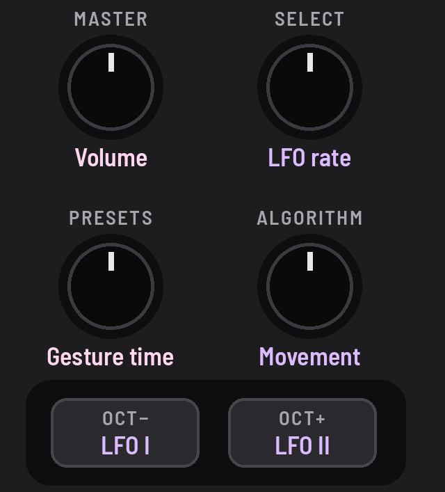
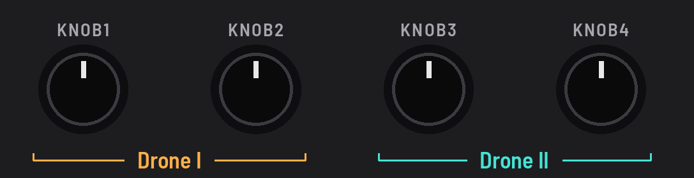
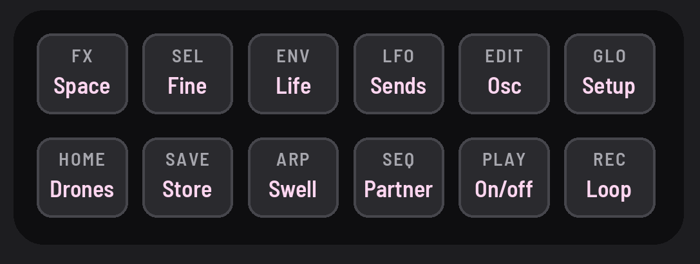

<!-- SPDX-License-Identifier: GPL-3.0-only -->

## Controls

The FM-1's knobs and buttons, and the header at the top of the screen.

## Knobs

Four knobs on the left always do the same; four on the right change with the page.

### MASTER

The volume.

### SELECT

The LFO's rate.

### ALGORITHM

Movement: how much the LFO moves the sound.

### PRESETS

Gesture time: how fast the gestures move.

### KNOB 1–4

What the page shows. On the drone pages, KNOB 1–2 are drone I and KNOB 3–4 drone II.

## Buttons

Eight buttons open pages; four do something.

### Page buttons

[[HOME]], [[FX]], [[ENV]], [[LFO]], [[EDIT]], [[SEQ]], [[GLO]] and [[ARP]] each open a page. Tap again for its next.

### PLAY

Fades the drones in or out.

### SAVE

Saves the sound.

### SEL

Hold for fine steps, and with other controls for their second job.

### REC

Records your moves, then loops them.

### OCT− and OCT+

LFO I's and LFO II's shape.

## Header

The top line of the screen.

### Left

The page's name, then what's running: REC or LOOP, SWELL, a gesture, II OUT.

### Right

The sound: its bank and key ("A5", "P6 SEANCE"), "changed" once you've moved it.

## Good to know

- **Hold a page button to peek:** turn a knob, let go, and you're back ("let go: DRONES").
- **HOME and FX** always open Drones and Space; the other buttons open the page you last used there.
- **The drone pages:** Drones, Tone, Osc, Sub · Drive, Partner, LFO sends; their knob names underlined amber and teal.
- **SEL + PLAY** fades drone II alone. Stopped, PLAY breathes slowly, and nothing else on the panel moves.
- **SAVE** saves at once (the sound dips for about 50 ms while playing), and glows dimly while something isn't saved.
- **SEL** gives a pitch knob single cents, cutoff and resonance tenths. It glows when it can keep what you're holding.
- **REC:** tap to record, tap to loop, tap to stop; up to 5 minutes, the time in the header. See
  [the recipe](../recipes/performing.md#loop).
- **OCT− / OCT+:** tap for the next shape; [[SEL]] + OCT for the one before. Each light pulses with its wave.
- **On the way to a scene** the header says where, in gold ("→ P3 VESPERS"), a gold line filling under it.
- **Every knob glides:** a slow turn is a smooth sweep, a fast turn goes further.
