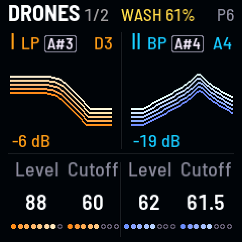

<!-- SPDX-License-Identifier: GPL-3.0-only -->

## Controls

The FM-1's knobs and buttons, and the screen header at the top of the screen.

## Knobs

| Knob | What it does |
|---|---|
| **MASTER** | the volume. Past about four-fifths it overdrives: thicker, at about the same loudness |
| **SELECT** | the LFO's rate |
| **ALGORITHM** | Movement: how much the LFO moves the sound |
| **PRESETS** | Gesture time: how fast the gestures move |
| **KNOB 1–4** | what the page shows. On the drone pages, KNOB 1–2 are drone I, KNOB 3–4 drone II |

## Buttons

| Button | What it does |
|---|---|
| [[HOME]] [[FX]] [[ENV]] [[LFO]] [[EDIT]] [[SEQ]] [[GLO]] [[ARP]] | open a page; tap again for its next |
| [[PLAY]] | fades the drones in or out |
| [[SAVE]] | saves the sound |
| [[SEL]] | hold for fine steps, and with other controls for their second job |
| [[REC]] | records your moves, then loops them |
| [[OCT−]] [[OCT+]] | LFO I's and LFO II's shape |

## Screen header

| Side | What it shows |
|---|---|
| **Left** | the page's name, then what's running: REC or LOOP, SWELL, a gesture, II OUT |
| **Right** | the sound: its bank and key ("A5", "P6 SEANCE"), "changed" once you've moved it |

## Good to know

### Pages and the screen

- **Hold a page button to peek:** turn a knob, let go, and you're back ("let go: DRONES").
- **HOME and FX** always open Drones and Space; the other buttons open the page you last used there.
- **The drone pages:** Drones, Tone, Osc, Sub · Drive, Partner, LFO sends; their knob names underlined amber and teal.
- **On the way to a scene** the header says where, in gold ("→ P3 VESPERS"), a gold line filling under it.

### Buttons

- **SEL + PLAY** fades drone II alone. Stopped, PLAY breathes slowly, and nothing else on the panel moves.
- **SAVE** saves at once (the sound dips for about 50 ms while playing), and glows dimly while something isn't saved.
- **SEL** gives a pitch knob single cents, cutoff and resonance tenths. It glows when it can keep what you're holding.
- **REC:** tap to record, tap to loop, tap to stop; up to 5 minutes, the time in the header. See
  [the recipe](../recipes/performing.md#loop).
- **OCT− / OCT+:** tap for the next shape; [[SEL]] + OCT for the one before. Each light pulses with its wave.

### Knobs

- **Every knob glides:** a slow turn is a smooth sweep, a fast turn goes further.
- **Overdriving MASTER** flattens the drones' swells and dips.
