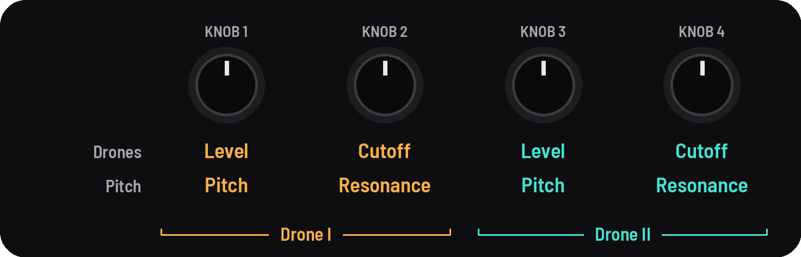
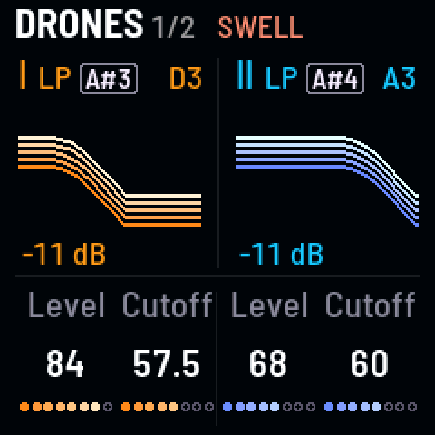
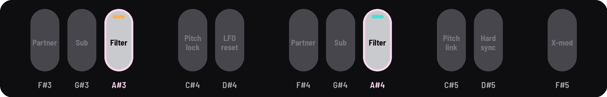
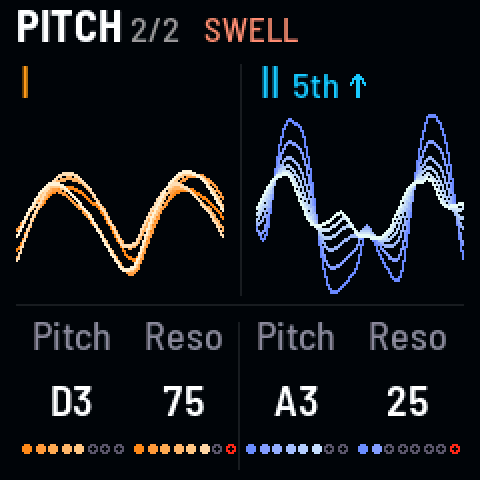
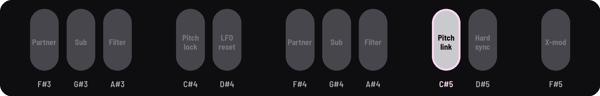

<!-- SPDX-License-Identifier: GPL-3.0-only -->

## Drones and Pitch

The page you play from: each drone's level and cutoff; then its pitch and resonance.

## Knobs

[[HOME]] opens Drones; [[HOME]] again, Pitch. KNOB 1–2 are drone I, KNOB 3–4 drone II.

## Drones

| KNOB 1 | KNOB 2 | KNOB 3 | KNOB 4 |
|---|---|---|---|
| I level | I cutoff | II level | II cutoff |

| Knob | What it does |
|---|---|
| **Level** | How loud each drone is. Halfway is about a quarter as loud |
| **Cutoff** | Opens or closes each drone's filter |

### Filter type

Low-pass (LP), band-pass (BP) or high-pass (HP), on a black key: [[A#3]] for drone I, [[A#4]] for drone II.

## Pitch

| KNOB 1 | KNOB 2 | KNOB 3 | KNOB 4 |
|---|---|---|---|
| I pitch | I resonance | II pitch | II resonance |

| Knob | What it does |
|---|---|
| **Pitch** | 1.6 kHz down to 2 Hz, a note of the Tuning a click. With [[SEL]] held, a cent a click |
| **Resonance** | boosts the filter at its cutoff. The last dot is red: there it rings on its own (self-oscillates) |

### Pitch link

[[C#5]] links drone II to drone I: drone II's pitch knob then sets the interval between them.

## Good to know

- **Under 27 Hz** a drone becomes a pulse of clicks; the speaker can't play that low, so listen on headphones.
- **Pitch glides** from note to note, so a steady turn is one slide.
- **A fine offset stays** (with SEL, +3 cents stays +3 from note to note) until you change the Tuning; "fine +3" shows
  it.
- **The pictures:** on Drones, each filter's curve, its level in dB under it, its note at the right; a silent drone is
  a thin gray curve. On Pitch, each wave as strands that fan out as it moves, and drone II's interval from drone I
  ("5th ↑").
