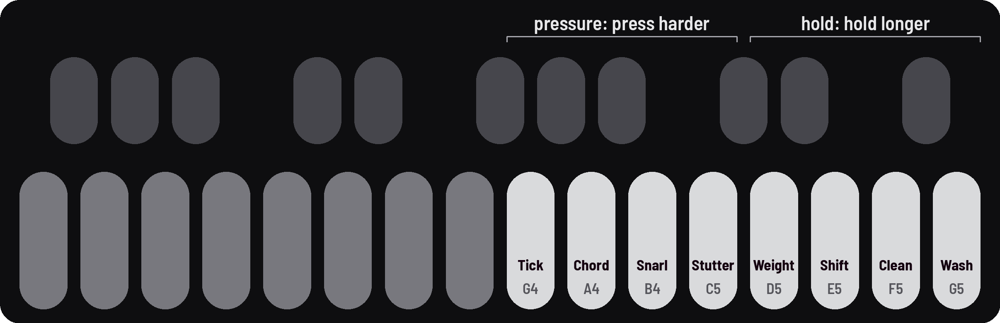

<!-- SPDX-License-Identifier: GPL-3.0-only -->

## Gestures

Macros: one key moves several settings together, on top of your sound, each in its own order. Four answer
pressure, four how long you hold.

> **Your sound is safe.** Your settings stay underneath, as they were, once a gesture has left.

### Pressure gestures: keys 9–12

The harder you press, the further in. Ease off and it comes back out.

> **Pressure-sensitive keys.** Keys 9–12 feel how hard you press, all the time you hold them (as aftertouch does),
> not how fast you strike. A light press moves a little, a firm one all the way. How firm is "all the way" is
> **Pressure** ([Setup 2](setup.md#setup-2), KNOB 4), as for the scene keys.

| Key | Gesture | What it does |
|---|---|---|
| [[G4]] | **Tick** | The sub sinks into slow clicks; pressing harder speeds them into a flutter |
| [[A4]] | **Chord** | The partners move to a beatless chord on the Scale (Pitch moves), a different voicing every press |
| [[B4]] | **Snarl** | Drone II detunes, Snarl grows, each drone's drive bites, and Feedback sings at the top |
| [[C5]] | **Stutter** | The Swell chops the drones, deeper and harder into a gate |

### Held gestures: keys 13–16

The longer you hold, the further in. Let go and it leaves.

| Key | Gesture | What it does |
|---|---|---|
| [[D5]] | **Weight** | A full, warm bass: the drones and the sub come up, the cutoffs ease down, each drone's drive rounds it off |
| [[E5]] | **Shift** | A new chord, a voice at a time: drone I glides by Shift's move (Pitch moves), drone II follows |
| [[F5]] | **Clean** | A clean sound with your notes kept: the grit goes, then the movement, then the effects |
| [[G5]] | **Wash** | The delay, then a reverb growing toward a freeze, the dry sound breathing in and out of it |

## Playing them

### Hold or press

In while you hold or press; out over as long as you held, or as you ease off.

### Tap to latch

A tap takes one all the way in and keeps it; tap again and it goes.

### Latch at a level

Tap [[SEL]] while holding: it stays at the level it has reached.

### Gesture time (PRESETS)

How fast they all move: left slower, right faster.

## Good to know

Recipes: [Gestures](../recipes/gestures.md) · [Ticks and clicks](../recipes/sounds.md#ticks)

### In and out

- **Each leaves in its own order:** Weight's brightness comes back first and the sub lingers; Shift's drone I comes
  back first; Clean brings the effects back first; Wash brings the dry back first and the tails ring on.
- **Gesture time:** up to 12 times slower or 4 times faster. The middle is each one's own time (Weight 2.8 s, Shift
  3.9 s, Clean and Wash 3.3 s, the pressure gestures 6.5 s); the screen shows Weight's.
- **It acts on a gesture already moving:** in fast, let go, turn it slow, and it leaves slowly.
- **For a long one,** tap the key: it comes in on its own.

### On the panel and the screen

- **[The header](controls.md#screen-header)** shows the last one played and how far in ("WASH 40%"), or "latched". Scenes remember which are
  latched: a scene tapped brings them back.
- **Pairs on the panel:** each key of 9–12 pairs with the key four to its right: Tick and Weight the low end, Chord and
  Shift pitch, Snarl adds the dirt Clean takes out, Stutter and Wash time.

### With the rest of the sound

- **The LFO steps aside** from what a gesture moves, so Movement doesn't wobble it.
- **Chord** follows the Tuning's notes. **Clean** keeps the same loudness.
