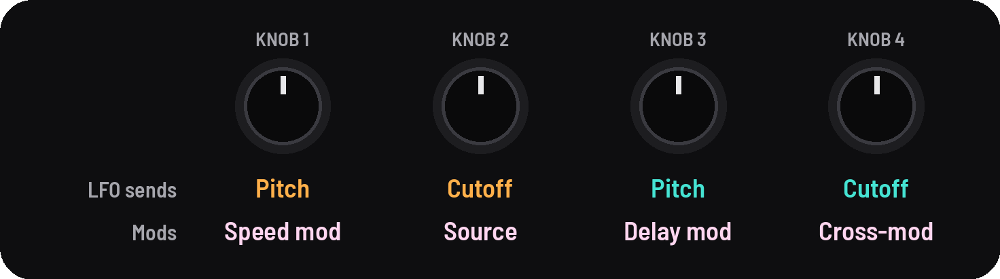
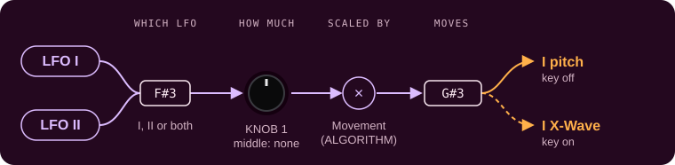
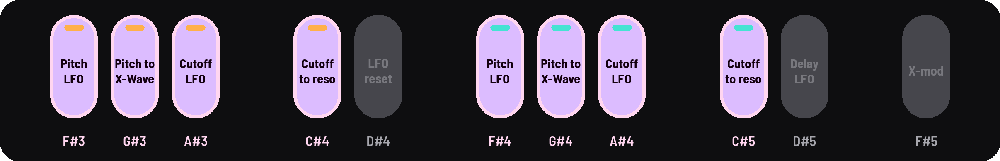
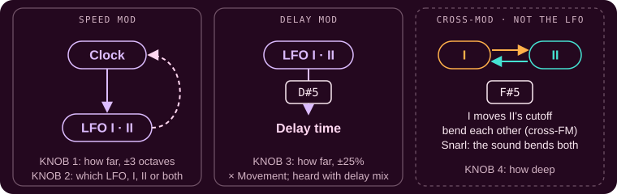

<!-- SPDX-License-Identifier: GPL-3.0-only -->

## LFO sends and Mods

Where the LFO goes, and what else it moves.

## Knobs

[[LFO]] opens LFO sends; [[LFO]] again, Mods. The LFO's rate and shapes are on the left knobs: see [LFO](lfo.md).

## LFO sends

| KNOB 1 | KNOB 2 | KNOB 3 | KNOB 4 |
|---|---|---|---|
| I pitch (or X-Wave) | I cutoff (or resonance) | II pitch (or X-Wave) | II cutoff (or resonance) |

| Knob | What it does |
|---|---|
| **Pitch send** | How far the LFO moves the drone's pitch, or its X-Wave instead ([[G#3]], [[G#4]] on the LFO pages) |
| **Cutoff send** | How far the LFO moves the drone's cutoff, or its resonance instead ([[C#4]], [[C#5]] on the LFO pages) |

### How a send works

Each send is a chain: which LFO, how much, scaled by Movement, and what it moves.

Drone I's pitch send. Its cutoff send is the same with [[A#3]], KNOB 2 and [[C#4]] (cutoff or resonance); drone II's two use its own keys and KNOB 3 and 4.

### Which LFO, and what it moves

On the LFO pages, each drone's four black keys pick the LFO for each send and what it moves.

## Mods

| KNOB 1 | KNOB 2 | KNOB 3 | KNOB 4 |
|---|---|---|---|
| Speed mod | Source (LFO) | Delay mod | X-mod |

| Knob | What it does |
|---|---|
| **Speed mod** (on screen Speed) | The LFO speeds up and slows down on one of its own waves, up to 3 octaves either way |
| **Source** | Which LFO moves the speed: I, II or both |
| **Delay mod** (on screen Delay) | How far the LFO wobbles the delay's time, up to ±25% |
| **X-mod** | How deep cross-mod goes, in the mode [[F#5]] picks: cutoff (I moves II's cutoff), pitch (the drones bend each other, cross-FM) or snarl |

### How the Mods work

Speed mod and Delay mod move with the LFO; Cross-mod doesn't: it's the drones moving each other.

## Where the LFO goes

Everything the LFO can reach, on both pages. Each key picks LFO I, II or both for its place; Speed mod lets the waves speed up and slow down the clock itself.

## Good to know

### Sends

- **Every black key on the LFO pages:** see [Black keys](black-keys.md#lfo-keys).
- **Under each send's value,** how far it swings as heard ("±12c", "±3.6 oct"), Movement included.
- **On X-Wave and resonance,** 100 sweeps the whole range, turning at the ends so it keeps moving.
- **Movement** (ALGORITHM) scales the sends and Delay mod, not Speed mod or Cross-mod.
- **"mvmt 0%"** in the rate's place: Movement is at 0, so nothing moves.

### Mods

- **Delay mod** is heard only with some delay mix; its wave is picked by [[D#5]] on the LFO pages.
- **Cross-mod's modes,** as the screen names them: *cutoff* (drone I's sound moves drone II's filter); *pitch* (each
  drone bends the other's pitch, from rough to metallic); *snarl* (the finished sound bends both: a growl).
- **Cross-mod** bends around the pitches you set; they stay where they are.

### Pictures

- On LFO sends, each drone's sends as a sentence with its keys ("[F#3] LFO II → [G#3] x-wave"), the
  two LFOs above. On Mods, the LFO's clock feeding LFO I and II, and cross-mod's mode with its key.
