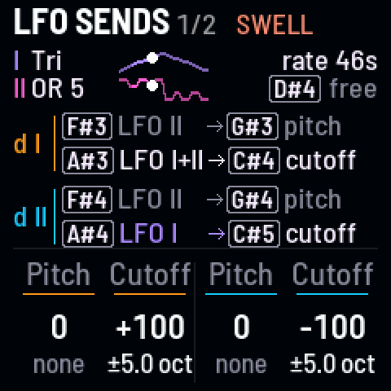
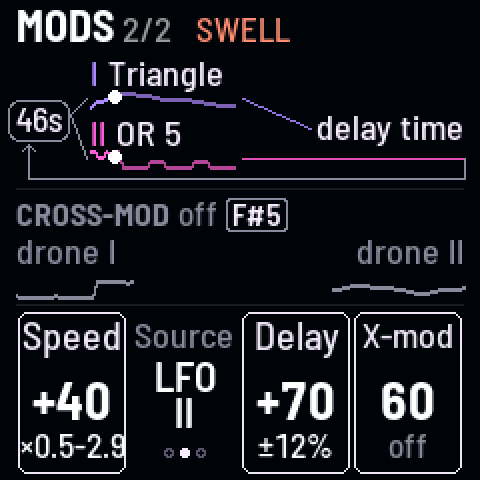

<!-- SPDX-License-Identifier: GPL-3.0-only -->

## The knobs

[[LFO]] opens LFO sends; [[LFO]] again, Mods. The LFO's rate and shapes are on the left knobs: see [LFO](lfo.md).

| Page | KNOB 1 | KNOB 2 | KNOB 3 | KNOB 4 |
|---|---|---|---|---|
| LFO sends | I pitch (or X-Wave) | I cutoff (or resonance) | II pitch (or X-Wave) | II cutoff (or resonance) |
| Mods | speed mod | source (LFO) | delay mod | cross-mod |

## LFO sends

How far the LFO moves each drone. The middle of each knob is none.

### Pitch send

How far the LFO moves the drone's pitch, or its X-Wave instead ([[G#3]], [[G#4]] on the LFO pages).

### Cutoff send

How far the LFO moves the drone's cutoff, or its resonance instead ([[C#4]], [[C#5]] on the LFO pages).

## Mods

What else the LFO moves, and cross-mod.

### Speed mod

The LFO speeds up and slows down on one of its own waves, up to 3 octaves either way.

### Source

Which LFO moves the speed: I, II or both.

### Delay mod

How far the LFO wobbles the delay's time, up to ±25%.

### Cross-mod

How deep cross-mod goes, in the mode [[F#5]] picks:

- **I moves II's cutoff:** drone I's sound moves drone II's filter.
- **Bend each other** (cross-FM): each drone bends the other's pitch, from rough to metallic.
- **Snarl:** the finished sound bends both drones' pitch: a growl.

## Good to know

- **Which LFO** feeds each send is on a black key on the LFO pages ([[F#3]], [[A#3]], [[F#4]], [[A#4]]).
- **Under each send's value,** how far it swings as heard ("±12c", "±3.6 oct"), Movement included.
- **On X-Wave and resonance,** 100 sweeps the whole range, turning at the ends so it keeps moving.
- **Movement** (ALGORITHM) scales the sends and Delay mod, not Speed mod or Cross-mod.
- **Delay mod** is heard only with some delay mix; its wave is picked by [[D#5]] on the LFO pages.
- **Cross-mod** bends around the pitches you set; they stay where they are.
- **"mvmt 0%"** in the rate's place: Movement is at 0, so nothing moves.
- **The pictures:** on LFO sends, each drone's sends as a sentence with its keys ("[F#3] LFO II → [G#3] x-wave"), the
  two LFOs above. On Mods, the LFO's clock feeding LFO I and II, and cross-mod's mode with its key.
