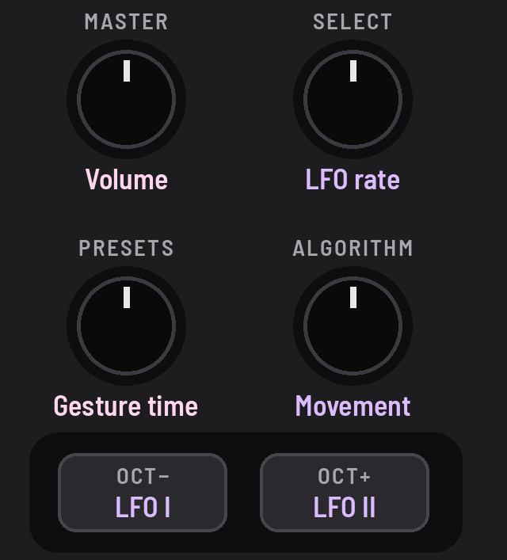

<!-- SPDX-License-Identifier: GPL-3.0-only -->

## The controls

### Rate (SELECT)

One cycle in 100 s to 70 Hz. Most of the turn is 100 s to 10 s, a second a click. Slow rates show a cycle's length
("21s", "1m40").

### Movement (ALGORITHM)

Every LFO depth together, from still (0%) to double (200%). [More below](#movement).

### Shapes (OCT− and OCT+)

LFO I's and LFO II's shape: tap for the next, round and round; with [[SEL]], the one before. Each light pulses with
its wave.

### Gesture time (PRESETS)

How fast every gesture moves: see [Gestures](gestures.md).

## Shapes

| LFO I | LFO II |
|---|---|
| Off | Off |
| Triangle | Tri 90 |
| Square | Square 90 |
| Saw | Exp saw |
| Roundtooth | Log tri |
| 2x Tri | 2x Saw |
| 2x Exp | 2x Pattern |
| 4x Pattern | 4x Exp |
| Random | Rnd glide |
| AND 3 | AND 5 |
| OR 3 | OR 5 |

### AND and OR

Two square waves together, one at the LFO's rate and one 3 times as fast (LFO I) or 5 times
(LFO II). AND is up only while both are: 2 levels. OR adds them: 4 levels. On a drone's pitch, the drone jumps between
2 or 4 notes in a pattern.

## Movement

How much of the LFO you hear: every depth you've set, scaled together. 0% moves nothing; 100% (the middle) is as set;
200% twice as deep. A depth turned that can't be heard says why on the screen.

| Movement scales | Movement leaves alone |
|---|---|
| **LFO sends:** all four | **Mods: Speed mod** |
| **Mods: Delay mod** (the delay's wobble) | **Mods: Cross-mod** (that's sound, not the LFO) |
| | the rate, the shapes, and where the waves go |

