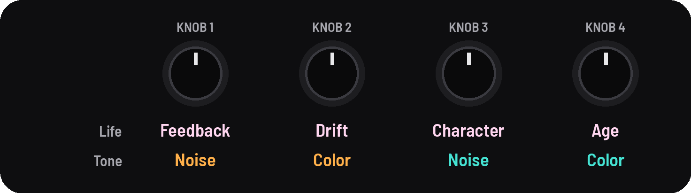
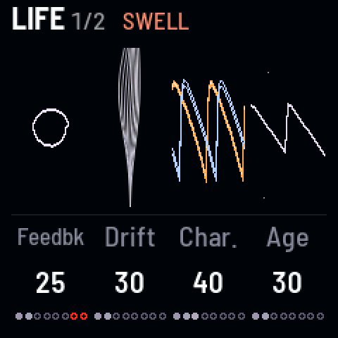
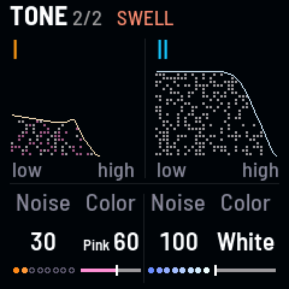

<!-- SPDX-License-Identifier: GPL-3.0-only -->

## Life and Tone

What keeps the drones alive and worn, and each drone's noise.

## Knobs

[[ENV]] opens Life; [[ENV]] again, Tone.

## Life

| KNOB 1 | KNOB 2 | KNOB 3 | KNOB 4 |
|---|---|---|---|
| feedback | drift | character | age |

| Knob | What it does |
|---|---|
| **Feedback** | the finished sound, after the delay and reverb, fed back into the drones: a resonant, thickening color. Past about 70 it sings on its own |
| **Drift** | slow random modulation: each drone's pitch, cutoff, wave, level and partner detune wander around where you set them. 0 holds everything still |
| **Character** | the oscillators from clean to vintage: softer edges, a bent saw, a little pitch jitter |
| **Age** | wear like an old tape: darker, a little hiss, slow wow and flutter |

## Tone

| KNOB 1 | KNOB 2 | KNOB 3 | KNOB 4 |
|---|---|---|---|
| I noise | I color | II noise | II color |

| Knob | What it does |
|---|---|
| **Noise** | how much noise beside the oscillators: 100 is level with a saw. It goes through the drone's filter |
| **Color** | white (left) to pink (right) |

## Good to know

- **Feedback** rings in key, on drone I's harmonics, and holds about the same loudness when it sings.
- **Age** wears in over about 20 s, and out as slowly. Character is the oscillators' own wear; Age is the tape's.
- **Noise** follows the cutoff, resonance, LFO and Drift, since it's in the filter.
- **The pictures:** on Life, rings for Feedback (the outer one red once it sings), a flame for Drift, a wave going
  hand-drawn for Character, a worn saw for Age. On Tone, each drone's noise as snow, as tall as it sounds.
