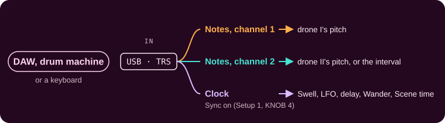
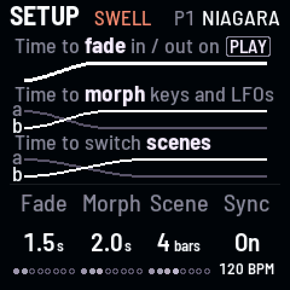
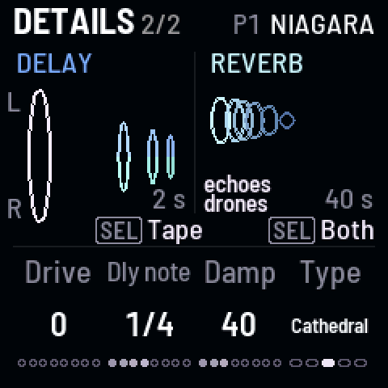

<!-- SPDX-License-Identifier: GPL-3.0-only -->

## MIDI in

Notes tune the drones and a clock puts them in time, over USB or the TRS jack.

## Messages

| Message | What it does |
|---|---|
| **Notes, channel 1** | Tune drone I to the note |
| **Notes, channel 2** | Tune drone II; with Pitch link on, set the interval |
| **Clock** | Puts the drones in time: after about two beats it locks ("120 BPM") |
| **Start** | Brings the Swell back to its top at once; the LFO glides back to its own |
| **Stop**, **Continue** | Ignored: when the clock stops coming, everything carries on at the last tempo ("keeps 120") |

## Sync

Setup 1, KNOB 4: **On** follows a clock, **Off** ignores it. Under it, what the clock is doing:

| Under Sync | Means |
|---|---|
| **120 BPM** | Following a clock at that tempo |
| **keeps 120** | The clock stopped; the last tempo carries on |
| **no clock** | Sync is on, but nothing is coming in |
| **free time** | Sync is off: the drones keep their own time |

## On a clock

What follows the clock, with Sync on:

| What | On the clock |
|---|---|
| **The Swell** (KNOB 1 on its page) | A breath a **Division**: 32 bars to 1/4 |
| **The LFO** (SELECT) | A cycle a division: 32 bars to 1/16 ("LFO CYCLE") |
| **The delay** (Time, Details) | A **note value**: 1/16, 1/8T, 1/8, 1/4T, 1/8D, 1/4, 1/2T, 1/4D, 1/2, 1/2D, 1 bar |
| **Wander** | Its notes land on the beat (on the bar, when slow), still at random |
| **Scene time** (Setup 1) | In **bars**: 1, 2, 4, 8 or 16; a scene change ends on a bar line |

## Good to know

Recipe: [Play in time with a MIDI clock](../recipes/performing.md#clock)

### Notes

- **Notes tune,** even with Pitch lock on; they don't start or stop the drones. Note-offs, velocity, other channels
  and controllers (CC) are ignored.

### The clock

- **Sync off** ignores the clock and Start; notes still tune.
- **The clock** needs to be at least 20 BPM.
- **A wobbly clock** is smoothed, and nothing drifts from it however long it runs.
- **While synced,** scenes leave the Swell's on / off and division alone.
- **A delay note value** longer than the delay holds is halved.
- **In Logic:** File → Project Settings → Synchronization → MIDI, tick Clock for the FM-1.

### What goes out

- **One thing goes out:** over USB, the FM-1 sends how hard you press each pressure key (scene keys 1–8 and keys
  9–12) as polyphonic aftertouch on channel 1, on that key's own note. A DAW can record it, or let it move another
  synth. It sends no notes and no clock.
