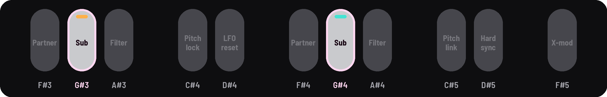

<!-- SPDX-License-Identifier: GPL-3.0-only -->

## Osc and Sub · Drive

Each drone's waveform, its sub-oscillator and its drive.

## Knobs

[[EDIT]] opens Osc; [[EDIT]] again, Sub · Drive. KNOB 1–2 are drone I, KNOB 3–4 drone II.

| Page | KNOB 1 | KNOB 2 | KNOB 3 | KNOB 4 |
|---|---|---|---|---|
| Osc | I X-Wave | I Width (pulse width) | II X-Wave | II Width |
| Sub · Drive | I osc/sub (+ SEL: sub wave) | I drive | II osc/sub (+ SEL: sub wave) | II drive |

## Osc

| Knob | What it does |
|---|---|
| **X-Wave** | blends sine → triangle → saw → square |
| **Width** | the square's pulse width |

## Sub · Drive

| Knob | What it does |
|---|---|
| **Osc/Sub** | crossfades the oscillator with the sub (the knob reads "Osc/Sb") |
| **Sub wave** | hold [[SEL]] and turn Osc/Sub: Square, Sine, Triangle or Saw |
| **Drive** | pushes the drone into its filter |

### Sub octave

A black key steps each drone's sub through octaves and subharmonics: [[G#3]] for drone I, [[G#4]] for drone II.

## Good to know

- **The sine and triangle** are a little louder, so they carry on a small speaker.
- **Width needs a square** in the wave; without one it goes gray, "needs sqr".
- **The sub's octave** shows beside each drone's name ("-1 oct"): −1, −2, ⅓, ⅕, −3, −4.
- **Sub waves:** Sine is the deepest on headphones and the least on a small speaker; Saw the brightest. A change
  glides.
- **The pictures:** on Osc, each drone's wave; on Sub · Drive, each drone's osc and sub lanes, as loud as their share,
  shaped by the drive.
