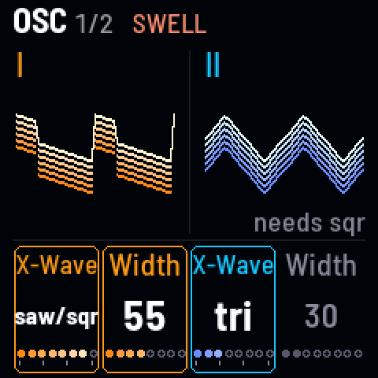
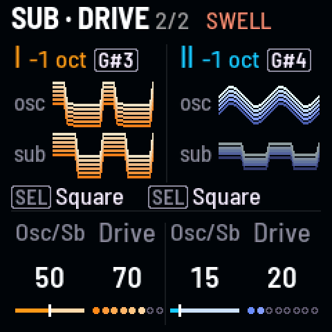

<!-- SPDX-License-Identifier: GPL-3.0-only -->

| Page | KNOB 1 | KNOB 2 | KNOB 3 | KNOB 4 |
|---|---|---|---|---|
| Osc | I X-Wave | I Width (pulse width) | II X-Wave | II Width |
| Sub · Drive | I osc/sub (+ SEL: sub wave) | I drive | II osc/sub (+ SEL: sub wave) | II drive |

## Osc

- **X-Wave** blends sine → triangle → saw → square. The sine and triangle are a little louder, so they carry on a
  small speaker.
- **Width** is the square's pulse width. With no square in the wave it does nothing: it goes gray, "needs sqr" above it.

## Sub · Drive

- **Osc/Sub** (the knob reads "Osc/Sb") crossfades the oscillator with the sub, an octave or more below.
- **Drive** pushes each drone into its filter.
- **The picture:** each drone's two lanes, **osc** and **sub**, as loud as their share, shaped by the drive.
- **Beside each name:** the sub's octave ("-1 oct") and the black key that steps it ([[G#3]], [[G#4]]).
- **The sub's wave:** hold [[SEL]] and turn Osc/Sub: **Square** (to start), **Sine** (the deepest on headphones, the
  least on a small speaker), **Triangle**, **Saw** (the brightest). All as loud as the square; a change glides. The
  screen names it above the knob ("SEL Square").
