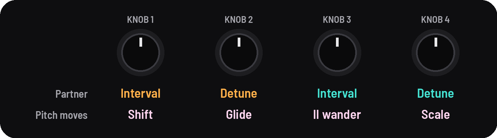
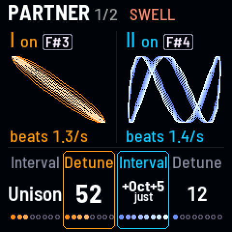
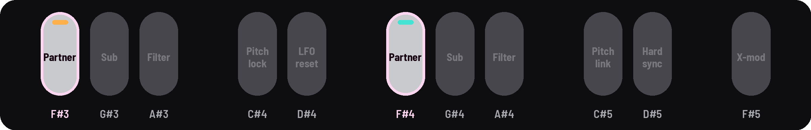
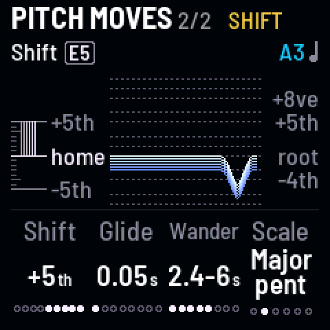

<!-- SPDX-License-Identifier: GPL-3.0-only -->

## Partner and Pitch moves

A second oscillator for each drone, and how the drones' pitches move: Shift, glide and Wander.

## Knobs

[[SEQ]] opens Partner; [[SEQ]] again, Pitch moves.

## Partner

| KNOB 1 | KNOB 2 | KNOB 3 | KNOB 4 |
|---|---|---|---|
| I interval | I detune | II interval | II detune |

| Knob | What it does |
|---|---|
| **Interval** | from an octave below to an octave and a fifth above, each tempered or **just** (a pure ratio that doesn't beat) |
| **Detune** | up to 30 cents, so the two beat |

### On and off

A black key switches each partner: [[F#3]] for drone I, [[F#4]] for drone II.

## Pitch moves

| KNOB 1 | KNOB 2 | KNOB 3 | KNOB 4 |
|---|---|---|---|
| Shift's move | pitch glide | II wander | scale |

| Knob | What it does |
|---|---|
| **Shift's move** | where the Shift gesture ([[E5]]) takes the drones: a fifth down to a fifth up |
| **Pitch glide** | how long a drone takes to reach a new pitch: up to 10 s |
| **Wander** | a slow random melody for drone II on the Scale. The knob is how often; 0 is off |
| **Scale** | for Wander and the Chord gesture: minor pentatonic, major pentatonic, fifths and octaves, whole tone, Dorian, or just |

## Good to know

### Partner

- **Just intervals** don't beat; Detune adds beating on purpose. On the other Tunings, intervals take the Tuning's
  own, named in its terms ("+11\19", "+3/2"); see [Intervals on a Tuning](setup.md#intervals-on-a-tuning).
- **A partner off:** Detune goes gray ("needs [F#3]") and the key blinks while you turn it.

### Pitch moves

- **Shift's move** goes a note of the Tuning a click ("+5th", "+m3"); with [[SEL]], a cent a click.
- **Wander** stays within an octave of drone II's pitch and comes home now and then: 25–30 s apart at the bottom of
  the knob, 0.5–2 s at the top. Pitch glide slides its notes.
- **Just** (on the Scale) is drone I's harmonics 1–8. The Scale's notes follow the Tuning.

### The pictures

- **The pictures:** on Partner, each drone and its partner as a knot that rolls as they beat ("beats 2.0/s"). On Pitch
  moves, Shift's move on the left and drone II's last four Wander notes on the right.
