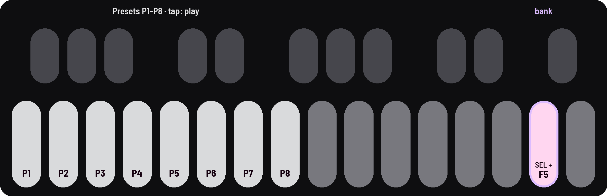
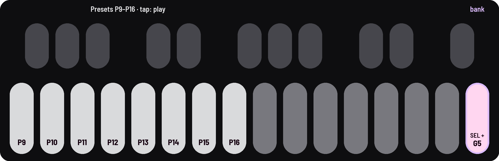

<!-- SPDX-License-Identifier: GPL-3.0-only -->

## Presets

16 sounds built into Niagara Drift, each showing a different side of it and changing over a minute. They sit in two
banks of eight on white keys 1–8.

### P1–P8

Hold [[SEL]] and tap [[F5]] for this bank, then tap white keys 1–8.

| Key | Preset | What it shows |
|---|---|---|
| P1 | **Niagara** | The starting sound: D and A a fifth apart, breathing slowly |
| P2 | **Embers** | D and a pure third above, triangles blooming toward saws and back, the two drones in turn, a chorus hall |
| P3 | **Vespers** | Saws through band-passes near a sung "ah", the waves turning slowly, a gentle Swell (tremolo), a bright cathedral |
| P4 | **Dreamhouse** | On the Harmonics Tuning: A1 and its 7th harmonic, sines with pure fifths, the resonance swelling, a little feedback |
| P5 | **Abyss** | Dark: D over B a minor third below, a saw and a narrow square, a subharmonic sub, closed resonant filters, character and feedback, a dark hall; the resonance swells and rings, and the Swell sinks it all slowly, like a tide |
| P6 | **Seance** | On Harrison's Tuning: a hollow bass (D with a fifth under it) under a high band-passed voice with a breath of noise; drone I moving drone II's filter, long swinging echoes, a chorus hall; the high voice wanders, rarely |
| P7 | **Sonar** | Drone I slowed to 2.7 Hz, a click each cycle pinging through the delay, drone II's resonant filter singing as it sweeps |
| P8 | **Sibyl** | A voice: D4 and F♯5, sines with just thirds and fifths, each wave turning into an "ah", a gentle Swell, a bright cathedral |

### P9–P16

Hold [[SEL]] and tap [[G5]] for this bank, then tap white keys 1–8.

| Key | Preset | What it shows |
|---|---|---|
| P9 | **Howl** | Low, D and E♭ a semitone apart so they grind, the feedback high, drone II band-passed; a random LFO flares the filters every few seconds |
| P10 | **Cistern** | Reeds in a cistern: a fifth apart, drone I rounder with a sine sub, a bellows Swell, a tape delay a second long, the Shimmer reverb |
| P11 | **Piston** | The low D stepping a whole tone up and back about once a second, driving drone II's filter; a slow Swell |
| P12 | **Ashram** | A warm organ on E♭ on the Shruti Tuning: a filtered pulse over a sine sub, a second voice about 24 cents sharp, the bass wandering in Dorian, a chorus hall |
| P13 | **Telegraph** | A stepped figure on drone II's pitch and filter over a low D; every 20 seconds or so the whole figure moves to a new note |
| P14 | **Tape** | Worn: D and F, a wide square and a saw, Age and lots of Character, tape wow, a tape delay, hiss, a slow tired Swell |
| P15 | **Falling** | On the LMY Tuning: sines on E4 and G3, the filters opening slowly, a falling, gliding top, feedback, the bass wandering slowly |
| P16 | **Bare** | One oscillator, everything else off: a plain saw to build from. Drone II is out: SEL + PLAY brings it in |

## Good to know

- **Pitch lock** ([[C#4]]) is on when a new FM-1 starts: the presets keep the pitch you're on. Turn it off to hear
  each at its own notes. A preset's Tuning comes with it either way.
- **They're fixed:** to keep your changes, save them in a bank of your own, 1 to 6
  ([recipe](../recipes/scenes.md#save)).
- **Most are rooted on D,** so moving between them keeps the root.
- **Their loudest moments match P1's;** Bare is quieter on purpose.
