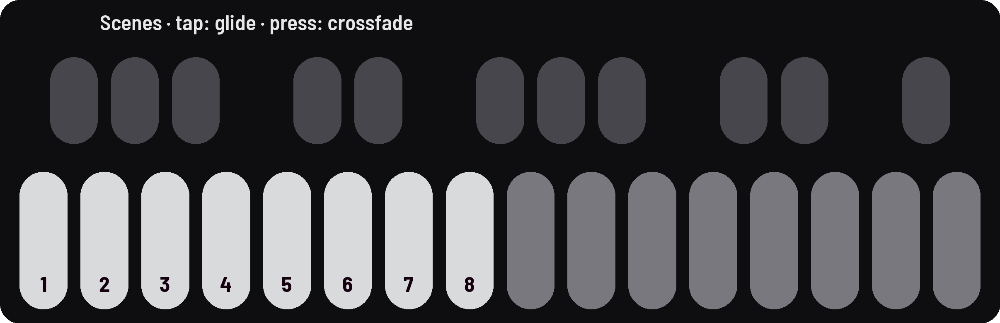
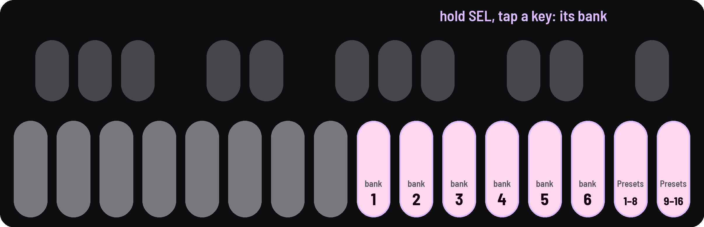

<!-- SPDX-License-Identifier: GPL-3.0-only -->

## Scenes and banks

The white keys play your saved sounds, gliding in, or crossfading as you press.

## Scenes

White keys 1–8 hold scenes: saved sounds you move between.

> **What a scene keeps.** The sound and its Tuning, but not the room: Pressure, Stereo, Tune, Sync, Pitch lock and
> the Setup times stay as they are.

### Tap a new scene key

Glides to the scene, and stays.

### Press a new scene key

Crossfades toward the scene, as far as you press. Let go and it glides back.

### Keep a blend

Tap [[SEL]] while pressing: the blend stays.

### Take it

Press all the way and hold a moment: the scene stays when you let go.

### Undo

[[SEL]] + [[SAVE]]: back to the sound before. Again: forward.

## Scene banks

Eight banks of eight scenes: banks 1 to 6 are yours, and two hold the presets. The screen names your scenes by bank
and key, 3.5 for bank 3, key 5, and the presets by number, P5.

### Save a scene

Hold [[SAVE]], tap a key.

> **SAVE first.** Hold SAVE before you touch the key: a key pressed first plays its scene instead. The presets can't
> be saved over.

### Pick a bank

Hold [[SEL]] and tap a gesture key. The bank's scenes are then on white keys 1–8.

| Key | Bank |
|---|---|
| [[G4]] | 1 |
| [[A4]] | 2 |
| [[B4]] | 3 |
| [[C5]] | 4 |
| [[D5]] | 5 |
| [[E5]] | 6 |
| [[F5]] | Presets P1–P8 |
| [[G5]] | Presets P9–P16 |

## Good to know

### Playing scenes

- **The glide** takes the Scene time (Setup 1). Turn a knob to stop it part way.
- **A tap** is anything let go within half a second, however hard.
- **The screen** says how far a press has gone ("3.5 40%"), "KEPT" for a kept blend, and "→ 3.5" as it glides back.
- **The keys' lights:** lit keys hold a scene; the one you're on blinks slowly until you change something.
- **Keys 9–16** are the [gestures](gestures.md).

### From 0.2

- **From 0.2:** scenes on keys 9–12 moved to empty keys 1–8 (the screen says how many). 0.2's presets that 0.3
  doesn't keep (Eerie, Glass, Tanpura, Whistle, Cathedral, Metal) are in bank 6, keys 1–6 (6.1 to 6.6); Heaven is now Sibyl, Clean
  is Bare. Feedback moved to KNOB 1 on Life, Cross-mod to KNOB 4 on Mods, Tune to KNOB 2 on Setup 2; HOME opens
  Drones, FX opens Space.
