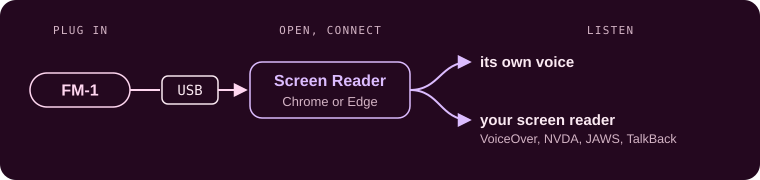
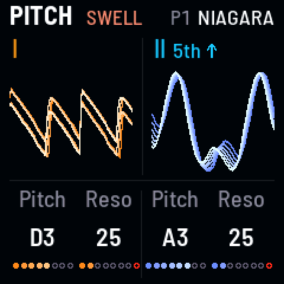

<!-- SPDX-License-Identifier: GPL-3.0-only -->

## Hearing your screen

Niagara Drift can say what its screen shows, for players who can't see it.

## Screen Reader

Charles Vestal's [FM-1 Screen Reader](https://charlesvestal.github.io/fm1-reader/) is a web page that speaks it. More
about it, and the other firmwares it reads, in [its own guide](https://github.com/charlesvestal/fm1-reader#readme).

1. Plug the FM-1 into a computer over USB.
2. Open the Screen Reader in Chrome or Edge, and click Connect.
3. Listen: it speaks in its own voice, or hands the words to your screen reader (VoiceOver, NVDA, JAWS, TalkBack).

## What it says

For the Pitch page pictured here, as it opens: "Pitch page. Drone 1: Pitch D3, resonance 25. Drone 2: Pitch A3,
resonance 25."

| When | It says | For example |
|---|---|---|
| **A page opens** | Its name and its knobs | "Pitch page. Drone 1: Pitch D3, resonance 25. Drone 2: Pitch A3, resonance 25." |
| **A knob turns** | Its name and value | "Drone 1 resonance 28" |
| **A key is tapped** | What it set | "Drone 1 band-pass filter" |
| **[[SEL]] held, a black key touched** | What it does and what a press would do, without switching it | "G sharp 3: drone 1 Sub, 1 octave down. Press for 2 octaves down" |
| **PLAY, a scene, a gesture** | What started or is on its way | "Play"; "to Preset 2 embers"; "wash" |
| **You ask** | Everything on the screen: the page, whether it's playing, the sound | The page as it opens, then "Playing, on its way to Preset 2 embers. Swell on." |

The examples are the words as the Screen Reader says them; your own screen reader may pronounce them its own way.
